# Pixel Studio — Mühendislik Belgesi

Dal: `Pixel_Studio_Beta` · Paket: **`com.pixel.studio`** · Sürüm: **0.1.0**

**com.pixel.studio** — insanların ve yapay zekâ ajanlarının aynı piksel çalışma alanında, gerçek piksel araçlarıyla birlikte çizim ve animasyon yaptığı bağımsız sanat platformu.

Pixel Studio'nun kendi yapay zekâsı yoktur. Zekâyı dışarıdan gelen ajan sağlar (Claude Code, Antigravity, ChatGPT, Gemini ya da kendi ajanınız). Pixel Studio ise onun **elleri, gözleri ve çalışma masası** olur: `set_pixel`, `draw_line`, `frame_duplicate` gibi gerçek editör araçları, revizyon kontrolü, geri alma ve izin sistemiyle birlikte.

```
AI / İnsan ──► MCP (/mcp) · REST (/api/v1) · Function calling · STDIO
                         │
              Kotlin (Android Views / Windows Swing) ── JNI ──► Rust pixcore
                                                               piksel · katman · kare · geçmiş
                                                               render · PNG/GIF · .pxs
```

---

## İçindekiler

1. [Durum ve galeri](#1-durum-ve-galeri)
2. [Dosya yapısı](#2-dosya-yapısı)
3. [Derleme ve testler](#3-derleme-ve-testler)
4. [Mimari](#4-mimari)
5. [MCP bağlantısı ve araçlar](#5-mcp-bağlantısı-ve-araçlar)
6. [REST API ve function calling](#6-rest-api-ve-function-calling)
7. [2D piksel art](#7-2d-piksel-art)
8. [3D voxel](#8-3d-voxel)
9. [Oyun üretimi](#9-oyun-üretimi)
10. [.pxs proje formatı](#10-pxs-proje-formatı)
11. [Bağımlılık politikası](#11-bağımlılık-politikası)
12. [Karşılaştırmalı asset üretim testleri](#12-karşılaştırmalı-asset-üretim-testleri)

---

## 1. Durum ve galeri


| Parça | Durum | Doğrulama |
| --- | --- | --- |
| Rust çekirdek (`Native/Core.rs`, yalnızca `std`, Rust 1.100) | ✅ | 69 test, `clippy -D warnings` temiz |
| 2D: **gerçek renk** (RGBA8), 16×16 COW tile, katman, dinamik kare, etiket, onion skin | ✅ | birim ve motor testleri |
| **3D Voxel motoru**: 512³ modeller, şekil araçları, PBR materyaller + 7 harita, PNG/prosedürel dokular | ✅ | birim ve motor testleri |
| Rig, keyframe animasyon, prosedürel walk/run/idle, kare kare VFX sekansları | ✅ | motor testleri + varlık betikleri |
| Render: köşe AO, gölge haritası, nokta ışıklar, bloom, G-buffer pass'leri, outline, 8 yönlü sprite bake | ✅ | render testleri, görsel kontrol |
| Revizyon kontrolü, idempotency, atomik transaction, undo/redo | ✅ | motor testleri |
| PNG/GIF/sprite sheet export, PNG import (kendi zlib/LZW/inflate kodumuz) | ✅ | PIL ve JDK ImageIO ile doğrulandı |
| `.pxs` v3 (2D + 3D + rig + animasyon + materyal + doku + slice + tileset + tilemap, CRC-32) | ✅ | gidiş-dönüş testleri |
| JNI köprüsü, Rust ↔ JVM golden render | ✅ | `Native/Golden.jsonl` |
| **2D piksel art araçları**: ASCII çizim, selective outline, ton kaydırmalı rampa, palet kütüphanesi (12 Lospec paleti), quantize + Bayer dither, normal map | ✅ | birim + gateway testleri |
| **Oyun üretimi**: katman karışım modları, slice (hitbox/pivot), 47'lik blob autotile üreticisi, tilemap + ASCII arazi, normal map'li 2D ışık önizlemesi, RotSprite, palet takası, MaxRects atlas, Aseprite JSON / Godot SpriteFrames / Tiled TMJ dışa aktarma | ✅ | birim + motor + gateway testleri |
| **Karakter bitirme**: `auto_shade` (şekle uyan cel gölge + katmanlar arası gölge + rim ışığı), sel-out outline, gradient map, parıltı damgası, pixel-perfect temizlik; 8 pastel chibi (64×80) + 2 animasyonlu portre (128×128) | ✅ | birim + motor + gateway testleri |
| **2D kadro** (10 özgün anime-chibi karakter, idle + walk) ve **2D VFX paketi** (8 efekt) | ✅ | motordan `draw_ascii` ile üretildi |
| MCP (eski + 2026-07-28), REST, function calling: **111 araç** | ✅ | 14 uçtan uca gateway testi |
| Masaüstü editör: **2D Pixel + 3D Voxel** sekmeleri | ✅ | derleniyor; Xvfb altında çalıştırıldı |
| Android: 2D editör + 3D görüntüleyici + Agent Mode | 🟡 | APK derleniyor, lint temiz; **cihazda henüz çalıştırılmadı** |
| LAN + TLS eşleştirme | ⏳ | şimdilik `adb forward` (USB) |

Ayrıntılar: [2D piksel art](#7-2d-piksel-art), [3D voxel](#8-3d-voxel) ve [oyun üretimi](#9-oyun-üretimi).

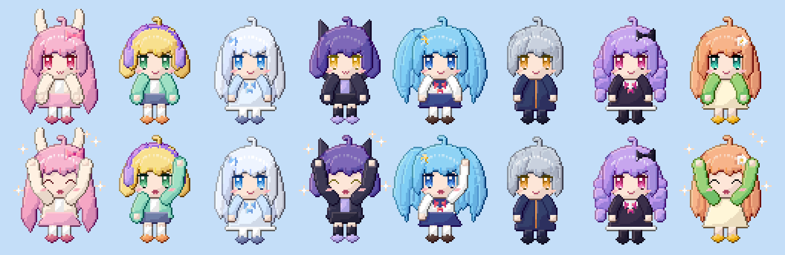

| Portre: yağmur | Portre: yıldızlı büyücü | Chibi |
| --- | --- | --- |
| 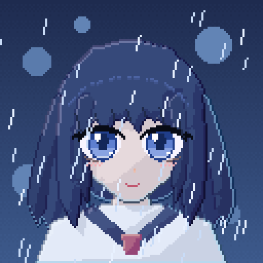 |  |   |

| Oyun sahnesi: autotile + gece ışığı (`render_lit`) | Gündüz, katman karışımları |
| --- | --- |
|  |  |

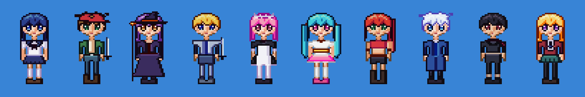

| 2D karakterler | 2D VFX |
| --- | --- |
|  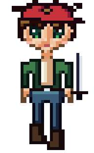  | 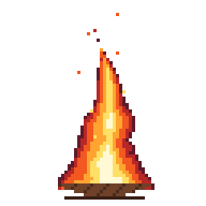    |

| Şövalye 8 yön yürüyüş (256 px) | VFX (16 kare) |
| --- | --- |
|  | 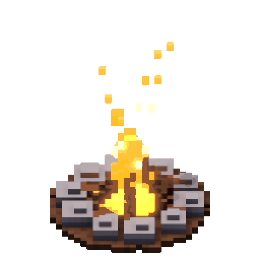  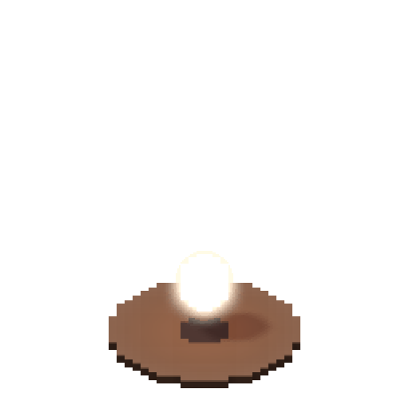 |

---

## 2. Dosya yapısı

```
Pixel_Studio/
├── .github/workflows/build.yml   CI: Rust, JVM (Linux + Windows), Android
├── Android/                      Android editörü
│   ├── Source/Main/              AndroidManifest.xml, Kotlin/Core.kt, Resources/
│   └── build.gradle.kts          NDK ile Native/ derlemesi, APK
├── Assets/                       Varlık üreticileri ve galeri
│   ├── Voxel.py  Sprites.py  Scene.py  Bench.py
│   ├── Knight.jsonl              uygulamaların paketlediği 3D şövalye demosu
│   ├── Icon.png
│   └── Gallery/                  README görselleri, örnek Godot/Tiled/Aseprite çıktıları
├── Gateway/                      Ortak JVM çekirdeği: JNI köprüsü, JSON, MCP + REST, araç kataloğu
│   ├── Source/Main/Kotlin/       Core.kt, Stdio.kt
│   ├── Source/Test/Kotlin/       Tests.kt
│   ├── Schemas/                  MCP / OpenAI / Anthropic / Gemini araç şemaları
│   └── build.gradle.kts
├── Gradle/                       Gradle wrapper
├── Native/                       Rust motoru (pixcore)
│   ├── Core.rs  Tests.rs  Script.rs
│   ├── Golden.jsonl  Golden.fingerprint
│   └── Cargo.toml  Cargo.lock  rust-toolchain.toml  rustfmt.toml
├── Windows/                      Masaüstü editörü (Swing; Windows, Linux, macOS)
│   ├── Source/Main/              Kotlin/Core.kt, Resources/
│   ├── Packaging.properties      .pxs dosya ilişkilendirmesi (jpackage)
│   └── build.gradle.kts
├── Engineering.md                bu belge
└── build.gradle.kts  settings.gradle.kts  gradle.properties  gradlew  gradlew.bat
```

Freedom Network düzeni: her platform tek kaynak dosyası (`Core.kt` / `Core.rs`), kökte yalnızca modül klasörleri ve bu belge.

---

## 3. Derleme ve testler

### Araç zinciri (doğrulanan sürümler)

| Araç | Sürüm |
| --- | --- |
| Rust | 1.100.0 (edition 2024, `Native/rust-toolchain.toml` ile sabit), yalnızca `std` |
| JDK | 25 LTS (bytecode hedefi 17) |
| Kotlin | 2.4.21 |
| Gradle | 9.9.1 (wrapper, `Gradle/`) |
| Android Gradle Plugin | 9.5.1 (yerleşik Kotlin) |
| Android | compileSdk 37.2, targetSdk 37 (Android 17), minSdk 30 (Android 11) |
| NDK | 30.0.16248370 |

### Hızlı başlangıç

```bash
cd Native && cargo test                     # Rust motoru: 69 test (golden render dahil)
./gradlew test                              # JVM: JSON, JNI köprüsü, gateway (Rust'ı otomatik derler)
./gradlew :Windows:run                      # masaüstü editörü
./gradlew :Gateway:run --args="--size 64x64 --port 38471 --workspace ./workspace [--token T] [--allow-destructive]"
```

Uygulama açıldığında **Agent → Connect an agent…** penceresi bağlantı komutlarını ve token'ı gösterir:

```bash
claude mcp add --transport http pixel-studio http://127.0.0.1:38471/mcp --header "Authorization: Bearer <TOKEN>"
```

Sonra ajana şunu söyleyin: *"Pixel Studio'yu kullan. 64x64 bir samuray çiz, ardından 24 karelik koşu animasyonu yap. Her kareyi kendin çiz ve tutarlılığı kontrol et."*

### Rust motoru

```bash
cd Native
cargo fmt --check && cargo clippy --all-targets -- -D warnings && cargo test
cargo run --release --example run_script -- Golden.jsonl out/ 32 32 10   # betiği PNG/GIF/.pxs'e dönüştürür
```

`Core.rs` modül yapısını korur (`mod commands`, `mod voxel`, `mod gamedev` …); bütün testler `Tests.rs` içindedir ve `Core.rs`'in sonunda `#[path = "Tests.rs"] mod tests;` ile bağlanır. `Script.rs` JSON-lines komut betiklerini motorda oynatan geliştirici aracıdır.

### Varlıklar

```bash
python3 Assets/Voxel.py        # hero, knight (→ Assets/Knight.jsonl), vfx
python3 Assets/Sprites.py      # chibi, cast, vfx2d, portraits
python3 Assets/Scene.py        # kamp ateşi sahnesi
cd Native && cargo run --release --example run_script -- ../Assets/Build/chibi_showcase.jsonl out/chibi
```

Betikler komut betiklerini `Assets/Build/` klasörüne yazar (git'e girmez). Tek tek de çalıştırılabilir: `python3 Assets/Sprites.py chibi`.

### Masaüstü / Windows

Windows x64 kurulum paketi (Windows makinesinde):

```powershell
cd Native; cargo build --release --target x86_64-pc-windows-msvc; cd ..
.\gradlew :Windows:packageWindows                         # .exe kurulum
.\gradlew :Windows:packageWindows -PpackageType=app-image  # taşınabilir klasör
```

`jpackage` JRE'yi pakete gömer, `pixcore.dll` dosyasını uygulama klasörüne koyar, `.pxs` dosya ilişkilendirmesini kaydeder (`Windows/Packaging.properties`) ve `Windows/Source/Main/Resources/icon.ico` simgesini kullanır.

### Android

`local.properties` içine `sdk.dir=/path/to/android-sdk` yazın ya da `ANDROID_HOME` tanımlayın. Android modülü yalnızca SDK bulunduğunda projeye dahil edilir.

```bash
rustup target add aarch64-linux-android x86_64-linux-android
./gradlew :Android:assembleDebug
```

`cargoBuild-arm64-v8a` ve `cargoBuild-x86_64` görevleri `Native/` klasörünü NDK'nın clang'ıyla (API 30) derler ve `libpixcore.so` dosyasını APK'ya koyar.

### Testler

| Komut | Kapsam |
| --- | --- |
| `cargo test` (`Native/`) | JSON, raster, render, PNG/GIF/zlib, .pxs, motor, FFI, voxel, oyun üretimi, karakter araçları, golden |
| `./gradlew :Gateway:test` | Kotlin JSON, JNI yaşam döngüsü, golden eşleşmesi, ImageIO ile PNG/GIF çözme; HTTP güvenliği, eski ve 2026 MCP, insan+AI çakışması, onay akışı, REST, function calling, çalışma alanı sınırı, STDIO adaptörü, şema güncelliği |
| `./gradlew :Android:assembleDebug :Android:lintDebug` | APK ve lint |

---

## 4. Mimari

### Katmanlar

| Katman | Konum | Dil | Sorumluluk |
| --- | --- | --- | --- |
| Rust Core (`pixcore`) | `Native/Core.rs` | Rust (`std`) | Belgenin tek otoritesi: pikseller, katmanlar, kareler, geçmiş, render, dışa aktarma, depolama, 3D voxel, oyun üretimi |
| Native köprü | `Native/Core.rs` (`mod ffi`), `Gateway` (`NativeBridge`) | Rust + Kotlin | El yazımı JNI (yalnızca 4 JNIEnv fonksiyonu) |
| Gateway | `Gateway/Source/Main/Kotlin/Core.kt` | Kotlin/JVM | JSON, `PixelEngine`, HTTP sunucusu, MCP, REST, izinler, araç kataloğu |
| STDIO adaptörü | `Gateway/Source/Main/Kotlin/Stdio.kt` | Kotlin/JVM | Alt süreç MCP istemcileri için HTTP köprüsü (`pixstudio-mcp`) |
| Windows/masaüstü | `Windows/Source/Main/Kotlin/Core.kt` | Kotlin + Swing | İnsan editörü |
| Android | `Android/Source/Main/Kotlin/Core.kt` | Kotlin + platform View'ları | İnsan editörü + Agent Mode servisi |
| Araç şemaları | `Gateway/Schemas` | JSON | MCP/OpenAI/Anthropic/Gemini araç şemaları (Kotlin kataloğundan üretilir) |

Gateway ve paylaşılan modüller saf JVM kodudur (`java.net`, `java.util`, `java.security`), bu yüzden hem Android'de hem masaüstünde değişmeden çalışır.

### Tek giriş noktası: komut protokolü

İnsan arayüzü, MCP, REST ve testlerin hepsi aynı çağrıyı yapar:

```json
{"op":"set_pixel","actor":"mcp:Claude Code","operationId":"op_1042","expectedRevision":125,
 "args":{"x":12,"y":18,"color":"#D94B42","frame":4}}
```

Yanıt `{"ok":true,"op":"set_pixel","revision":126,"actor":"...","result":{...}}` ya da `{"ok":false,...,"error":{"code":"conflict","message":"..."}}` biçimindedir. JNI çerçevesi `u32 LE json uzunluğu | JSON | ikili veri` şeklindedir; PNG, GIF, `.pxs` ve ham RGBA bu ikili kısımda taşınır.

İşlem listesi `Native/Core.rs` (`mod commands`) içindeki `OPERATIONS` tablosundadır ve `status` sorgusuyla da alınabilir. Gateway testleri her aracın motorda var olan bir işleme karşılık geldiğini doğrular.

### Veri modeli

```
Document
 ├─ name, width, height (1..4096)
 ├─ palette: Vec<RGBA>  (renk örnekleri; tuval gerçek renk)
 ├─ models: [VoxelModel{size ≤ 512³, chunks 16³, bones, animations}]
 ├─ materials: [Material{PBR + 7 harita}], textures: [RGBA8]
 ├─ layers: [Layer{id, name, visible, locked, opacity, blend}]   alttan üste
 ├─ slices: [Slice{name, color, keys[frame, rect, pivot]}]   hitbox / pivot
 ├─ tilesets: [Arc<Tileset{tile w×h, plain | blob47, tiles}>]
 ├─ tilemaps: [Arc<Tilemap{tileset, cols×rows, cells, terrain}>]
 ├─ frames: [Frame{id, duration_ms}]                       sabit kare sınırı yok
 ├─ tags:   [Tag{name, from_id, to_id, direction, repeat}] Idle/Walk/Attack
 └─ cels:   (layer_id, frame_id) → Arc<PixelGrid>
               PixelGrid = 16×16 tile ızgarası, tile = Option<Arc<[u16; 256]>>
```

- Pikseller **gerçek renk** (`0xRRGGBBAA`, u32) olarak tutulur; renk sınırı yoktur. Palet yalnızca renk örneği (swatch) listesidir. Bir örneği değiştirmek, eski rengi kullanan tüm pikselleri yeniden renklendirir.
- 3D modeller (`models`), PBR materyaller ve dokular aynı belgede bulunur. Ayrıntılar için [3D voxel](#8-3d-voxel).
- Tile'lar ve cel'ler **copy-on-write**'tır. Kare çoğaltmak işaretçi kopyalar; değişmeyen tile'lar kareler arasında fiziksel olarak paylaşılır. Undo anlık görüntüsü bu yüzden ucuzdur.
- Katman ve kare kimlikleri yeniden sıralamadan etkilenmez. API'de kullanıcılar indekslerle çalışır.

### Eşzamanlılık: insan + AI

- **Tek yazıcı:** FFI katmanı her motoru bir mutex arkasında tutar ve komutlar sırayla uygulanır.
- **İyimser revizyon kontrolü:** Her değişiklik revizyonu artırır. `expectedRevision` güncel değilse komut `conflict` ile reddedilir, böylece AI eski bir görüntüye dayanarak insanın yeni çizimini ezemez.
- **Idempotency:** Aynı `operationId` ikinci kez uygulanmaz; önbellekteki yanıt `replayed:true` ile döner.
- **Transaction:** `transaction` içindeki tüm komutlar ya birlikte uygulanır ya da hiçbiri uygulanmaz. Sonuç tek undo adımı ve tek revizyondur.
- **Geçmiş:** Her değişiklik `actor`, `op`, `operationId` ve değişen piksel sayısıyla kaydedilir (`history_list`, `.pxs` içindeki `HIST` bölümü). Undo, değişikliği kimin yaptığından bağımsız olarak çalışır.
- **Arayüz senkronu:** `PixelEngine` her revizyon değişiminde dinleyicileri tetikler; masaüstü ve Android arayüzü ajanın yaptığı değişiklikleri anında gösterir.

### Render

Render tamamen tamsayı aritmetiğiyle yapılır (`renderer::blend_over`) ve aynı girdi her platformda bit düzeyinde aynı sonucu verir. `Native/Golden.jsonl` + `Golden.fingerprint` hem Rust testinde hem JVM/JNI testinde doğrulanır.

### Güvenlik

- Gateway varsayılan olarak yalnızca `127.0.0.1`'e bağlanır. 256 bit rastgele Bearer token zorunludur ve sabit zamanlı karşılaştırılır.
- DNS rebinding'e karşı `Origin` ve (loopback modunda) `Host` doğrulanır; geçersiz Origin `403` döner.
- Ajanlar yalnızca Pixel Studio araçlarına erişir; kabuk, dosya sistemi veya ağ aracı yoktur.
- Yıkıcı araçlar (`frame_delete`, `layer_delete`, `project_new`, `canvas_resize`) ve bunları içeren transaction'lar insan onayı ister. Arayüzsüz modda varsayılan cevap **ret**'tir.
- Dosya yazımı yalnızca çalışma alanı klasörüne yapılır ve dosya adları temizlenir (`../../etc/passwd` → `etc_passwd`).
- Rust tarafında bozuk JSON, aşırı büyük bölge, sınır dışı koordinat ve bozuk `.pxs` girdileri panik yerine hata döndürür; JVM'e asla panik geçmez.

---

## 5. MCP bağlantısı ve araçlar

Endpoint: `http://127.0.0.1:38471/mcp` (port doluysa uygulama boş bir port seçer ve bağlantı penceresinde gösterir). Tüm istekler `Authorization: Bearer <token>` başlığı ister.

### Bağlanma

**Claude Code (HTTP):**
```bash
claude mcp add --transport http pixel-studio http://127.0.0.1:38471/mcp --header "Authorization: Bearer <TOKEN>"
```

**Antigravity / JSON yapılandırması:**
```json
{"mcpServers":{"pixel-studio":{"serverUrl":"http://127.0.0.1:38471/mcp","headers":{"Authorization":"Bearer <TOKEN>"}}}}
```

**STDIO isteyen istemciler:** `pixstudio-mcp` adaptörü (`./gradlew :Gateway:installDist` → `bin/pixstudio-mcp`). Çizim motoru taşımaz; açık uygulamanın HTTP endpoint'ine köprü kurar.
```json
{"mcpServers":{"pixel-studio":{"command":"pixstudio-mcp","args":["--url","http://127.0.0.1:38471/mcp","--token","<TOKEN>"]}}}
```

**Android telefondaki Pixel Studio + bilgisayardaki ajan:** Telefonda Agent Mode'u açın, ardından USB üzerinden `adb forward tcp:38471 tcp:38471` çalıştırın. Bundan sonra bilgisayardaki ajan `127.0.0.1:38471` adresine bağlanır. Sunucu ağa açılmaz.

### Protokol sürümleri

Sunucu "dual-era"dır ve iki dönemi aynı endpoint'te sunar:

| İstemci | Davranış |
| --- | --- |
| `initialize` gönderen eski istemci (2024-11-05, 2025-03-26, 2025-06-18, 2025-11-25) | El sıkışma yapılır, desteklenen sürüm geri döner, `Mcp-Session-Id` verilir (yalnızca istemci adını geçmişe yazmak için) |
| 2026-07-28 istemcisi | Durumsuz çalışır. Her istek `params._meta["io.modelcontextprotocol/protocolVersion"]` ve `clientCapabilities` taşır. `MCP-Protocol-Version`, `Mcp-Method` ve gerekiyorsa `Mcp-Name` başlıkları doğrulanır (uyuşmazsa 400 / -32020). Desteklenmeyen sürüm 400 / -32022 döner. Sonuçlarda `resultType:"complete"` ve `_meta.serverInfo` bulunur. Liste yanıtlarında `ttlMs`/`cacheScope` vardır. `server/discover` desteklenir |

Yanıtlar her zaman `application/json` olarak döner. Bildirimler `202` alır. `GET /mcp` isteği `405` döner.

### Araçlar (111)

Tam şemalar `Gateway/Schemas/pixel-studio-tools.mcp.json` dosyasındadır.

| Grup | Araçlar |
| --- | --- |
| Tuval | `canvas_inspect`, `canvas_snapshot` (PNG + özet), `get_pixel`, `read_region` (ascii/hex), `set_pixel`, `set_pixels`, `erase_pixel`, `draw_line`, `draw_rectangle`, `draw_ellipse`, `draw_polygon`, `pattern_fill` (tuğla/kiremit/tahta/taş/karo/çim/dalga/dama), `fill_region`, `replace_color`, `flip_horizontal`, `flip_vertical`, `rotate`, `move_region`, `copy_region`, `clear`, `canvas_resize`* |
| Animasyon | `frame_add`, `frame_duplicate`, `frame_delete`*, `frame_move`, `frame_get`, `frame_set_duration`, `frame_select`, `animation_tag_create`, `animation_tag_delete`, `animation_set_loop`, `animation_info`, `animation_preview` (GIF) |
| Katman | `layer_create`, `layer_delete`*, `layer_rename`, `layer_visibility`, `layer_lock`, `layer_opacity`, `layer_move`, `layer_select` |
| Palet | `palette_get`, `palette_set`, `palette_add` |
| Efekt | `fx_generate` — ateş, kamp ateşi, kılıç izi, vuruş, büyü, duman, yıldırım, iyileşme, patlama; tek çağrıda animasyonlu kareler |
| Piksel art | `draw_ascii`, `outline` (selective/selout/solid), `auto_shade`, `gradient_map`, `draw_sparkle`, `pixel_cleanup`, `color_ramp`, `palette_list`, `palette_load`, `quantize`, `dither_fill`, `export_normal_map` |
| 3D Voxel | `voxel_model_create`, `voxel_model_clone`, `voxel_model_delete`*, `voxel_model_set`, `voxel_inspect`, `voxel_get`, `voxel_set`, `voxel_set_many`, `voxel_shape`, `voxel_mirror`, `material_set`, `texture_import`, `texture_generate`, `rig_bone_add`, `rig_clear`*, `rig_bind`, `anim3d_create`, `anim3d_key`, `anim3d_generate`, `voxel_render` (PNG), `voxel_render_sheet` (PNG), `voxel_render_to_frames`, `voxel_pick` |
| Oyun üretimi | `layer_blend`, `slice_set`, `slice_delete`, `palette_swap`, `rotsprite`, `tileset_create`, `tileset_add_tiles`, `tileset_generate_blob`, `tileset_delete`*, `tilemap_create`, `tilemap_delete`*, `tilemap_set`, `tilemap_terrain`, `tilemap_bake`, `tilemap_render` (PNG), `export_tileset` (PNG), `render_lit` (PNG), `export_atlas`, `export_godot_spriteframes`, `export_tiled`, `gamedev_inspect` — bkz. [Oyun üretimi](#9-oyun-üretimi) |
| Proje | `image_import`, `project_inspect`, `project_save`, `project_export` (png/gif/spritesheet/atlas/godot/tiled/normal_map), `project_new`*, `project_rename`, `history_undo`, `history_redo`, `history_list`, `transaction` |

`*` işaretli araçlar insan onayı ister. Değişiklik yapan her araç isteğe bağlı `expectedRevision` ve `operationId` parametrelerini kabul eder.

**AI'nın gözleri:** `canvas_snapshot` görsel destekleyen modeller için büyütülmüş bir PNG döndürür; ayrıca içerik sınırlarını ve kullanılan renkleri JSON olarak verir. `read_region` görsel desteklemeyen modeller için pikselleri metin olarak sunar:

```
"legend": {".":"transparent","0":"#F6D7B0","1":"#000000"},
"rows": ["..000..", ".01010.", "..000.."]
```

### Kaynaklar ve promptlar

- Kaynaklar: `pixelstudio://project/current`, `pixelstudio://project/palette`, `pixelstudio://frame/current` (PNG), `pixelstudio://animation/current`, `pixelstudio://guide/pixel-art`
- Promptlar: `draw_sprite`, `animate_sprite`, `build_level`, `review_canvas`
- Sunucu `instructions` alanı ajanlara iş akışını öğretir: önce incele, palet ve katman planla, bloklarla başla, `set_pixels` ile detaylandır, `canvas_snapshot` ile kontrol et, kareleri çoğalt ve yalnızca değişeni düzenle.

---

## 6. REST API ve function calling

Taban adres: `http://127.0.0.1:38471/api/v1`. Tüm istekler `Authorization: Bearer <token>` başlığı ister. İsteğe bağlı `X-Pixel-Actor: <ad>` başlığı geçmişe `api:<ad>` olarak yazılır.

| Metot ve yol | İşlev |
| --- | --- |
| `GET /status` | Motor durumu, revizyon, işlem listesi, gateway bilgisi |
| `GET /project` | `project_inspect` |
| `GET /canvas` | `canvas_inspect` |
| `GET /frame/{i}` | Kare bilgisi |
| `GET /frame/{i}/pixels?x=&y=&width=&height=&format=ascii\|hex\|indexed` | Piksel okuma |
| `GET /snapshot?frame=&scale=` | PNG (`image/png`, `X-Pixel-Revision` başlığıyla) |
| `GET /tools?format=mcp\|openai\|anthropic\|gemini` | Function-calling araç şemaları |
| `POST /tools/{name}` | Bir aracı çağırır. Gövde, modelin ürettiği argüman nesnesidir |
| `POST /commands` | Ham motor komutu: tek nesne, dizi ya da `{"commands":[...]}` |
| `POST /frames` | `frame_add` |
| `POST /animations` | `animation_tag_create` |
| `POST /export` | `{"format":"png\|gif\|spritesheet\|pxs", ...}` → ikili dosya |

Durum kodları: `200` başarı, `400` geçersiz argüman, `401` token yok veya yanlış, `403` izin yok ya da Origin geçersiz, `404` bulunamadı, `409` revizyon çakışması.

### Function calling ile kullanım

1. `GET /api/v1/tools?format=openai` (ya da `anthropic`, `gemini`) ile araç şemalarını alın ve modele verin.
2. Model bir araç çağrısı ürettiğinde argümanları olduğu gibi `POST /api/v1/tools/<name>` adresine gönderin.
3. Yanıttaki `content` (metin/görsel) ve `structuredContent` alanlarını modele geri iletin.

```bash
curl -H "Authorization: Bearer $TOKEN" -H "Content-Type: application/json" \
     -d '{"x":0,"y":0,"width":8,"height":8,"color":"#3366FF","filled":true}' \
     http://127.0.0.1:38471/api/v1/tools/draw_rectangle
```

Şemaların JSON Schema kaynağı Kotlin kataloğudur (`Gateway/Source/Main/Kotlin/Core.kt` içindeki `ToolCatalog`). `./gradlew :Gateway:exportToolSchemas` komutu `Gateway/Schemas/*.json` dosyalarını yeniden üretir; testler bu dosyaların güncel olup olmadığını kontrol eder.

---

## 7. 2D piksel art


### Tuval ve renk

- Tuval **gerçek renklidir** (RGBA8). Palet, renk örneği listesidir; `palette_set` eski rengi kullanan tüm pikselleri yeniden renklendirir (palet takası).
- **Palet kütüphanesi** (`palette_list`, `palette_load`): ENDESGA 32/64, Resurrect 64, Sweetie 16, Apollo, AAP-64, Na16, SLSO8, PICO-8, Lospec500, Vinik24, TwilioQuest 76. Kaynak [Lospec](https://lospec.com/palette-list); yazarları `palette_list` çıktısında listelenir.

### Usta piksel artistin araçları

| Araç | Ne yapar |
| --- | --- |
| `draw_ascii` | Sprite'ı metin olarak çizer (satırlar + lejant). `read_region format=ascii` ile aynı biçimdedir: AI ajanı okuyabilir, düzenleyebilir ve tek çağrıda tekrar çizebilir. `flip_x` ile sağ ve sol yönler aynı çizimden üretilir |
| `color_ramp` | Ton kaydırmalı gölge rampası (OKLCH): gölgeler mor-maviye, ışıklar sarıya kayar; gamut eşlemesi tonu korur |
| `outline` | 1 px dış çizgi: sabit renk veya *selective outline* (komşu rengin koyu ve soğuk tonu) |
| `quantize` | Median cut ya da kütüphane paleti + Bayer dither. Bütün animasyon için tek palet kullanılır |
| `dither_fill` | İki renkli sıralı dither (16 yoğunluk seviyesi) |
| `export_normal_map` | Sprite'tan normal map üretir (Godot, Unity ve Unreal Paper2D'de 2D dinamik ışık için) |
| 3D → piksel | `voxel_render*` + `pixel_palette` / `dither`: 3D render'ları piksel art'a dönüştürür (bkz. aşağıdaki karşılaştırma) |


*Soldan sağa: ham render, 16 renk, ENDESGA 32.*

### Kadro (özgün karakterler)

`Assets/Sprites.py` (`build_cast`) ile üretilir. Bu, sprite stüdyolarının kullandığı paper-doll (parça giydirme) yöntemidir:

1. Elle yazılmış bölge haritaları: yüz, 6 saç modeli (ön ve arka katman), 10 kıyafet, göz damgaları, şapka ve silahlar.
2. Otomatik piksel art gölgelendirme: 5 tonlu ton kaydırmalı rampalar, sol üstten ışık, katman önceliğine göre iç çizgiler, renkli selective outline.
3. Elle eklenen detaylar: göz parlaması, anime saç halesi (angel ring), tutam ayrımları, kıvrımlar, allık.
4. Animasyon: idle (nefes, göz kırpma, saç salınımı) ve 4 karelik yürüme.

Aoi, Ren, Mira, Kai, Hana, Sora, Rika, Yuki, Kuro ve Luna; her biri 32×52 px. Çizim motora `draw_ascii` ile aktarılır; etiketler `Aoi_idle`, `Aoi_walk` biçimindedir.

### 2D VFX paketi (64×64)


`Assets/Sprites.py` (`build_vfx2d`): ateş (16, döngü), kılıç izi (8), vuruş kıvılcımı (6), büyü patlaması (12), duman (8), yıldırım (8), iyileşme (12, döngü), patlama (12).

Klasik piksel art kurallarına uyar: her efektte 4–6 renklik bant paleti, net kümeler, kenar yumuşatma yok, parlak çekirdekten koyu kenara geçiş, sönerken dither ile kaybolma. Döngüler kesintisizdir; zaman bir çember üzerine eşlendiği için son kare ilk kareye bağlanır.

```bash
python3 Assets/Sprites.py cast vfx2d
cd Native && cargo run --release --example run_script -- ../Assets/Build/cast_showcase.jsonl out/cast
```

### Karakter bitirme araçları (2026 pastel anime stili)

Modern anime piksel karakterlerinin kalitesi büyük ölçüde bitirme aşamasından gelir: şekli takip eden ton kaydırmalı cel gölge, saçın yüze düşen gölgesi, siyah yerine rengin koyu tonuyla çizilmiş outline ve parıltılar. Pixel Studio bu aşamaları araç olarak sunar:

| Araç | Ne yapar |
| --- | --- |
| `auto_shade` | Düz renkli her bölgeyi şeklini takip eden 2–4 tonlu cel gölgeyle boyar: ışık tarafı aydınlık, karşı taraf gölgeli olur, büyük alanlarda yumuşak bir geçiş oluşur. **Üstteki katmanlar gölge düşürür** (kâkül alna, kafa boyna, şapka saça). İsteğe bağlı rim ışığı, açık rampa tanımları, korunacak renkler ve küçük detay bölgelerini atlama desteklenir |
| `outline` `mode=selout` | Seçici outline. Işık tarafında outline açılır, yani sel-out uygulanır. `darkness` ile pastel ya da sert ton seçilir, `inside` şekli büyütmeden kenara çizer |
| `gradient_map` | Parlaklığı bir gradyana eşleyerek renk düzenler: yağmurlu mavi akşam, gün batımı, sepya |
| `draw_sparkle` | 4 köşeli parıltı, artı, elmas ya da nokta damgası (tek tek ya da toplu) |
| `pixel_cleanup` | 1 px çizgilerdeki L köşe fazlalarını temizler ("pixel perfect") |

Önerilen akış: karakteri katmanlara ayrılmış düz renklerle kur (arka saç, gövde, yüz, ön saç, kollar) → her katmana `auto_shade` uygula → `outline mode=selout` → `pixel_cleanup` → gözleri, allığı ve saç parlamasını elle çiz → `draw_sparkle`.

#### Pastel chibi koleksiyonu (64×80)


| | | | |
| --- | --- | --- | --- |
|  |  |  |  |

`Assets/Sprites.py` (`build_chibi`) 8 özgün karakter üretir: Mochi, Yuzu, Fuyu, Kuro, Sora, Ren, Lila ve Hana. Her karakterin 4 karelik idle animasyonu (nefes, göz kırpma, saç salınımı) ve 4 karelik ikinci bir animasyonu vardır (sevinç zıplaması, el sallama ya da ikinci idle). Toplam 64 kare. Saç, inceltilmiş Bezier tutamlardan kurulur. Gözler el çizimi damgalardır: gradyan iris, çift parıltı ve kirpik kanadı. Gölge, outline ve parıltılar tamamen motor araçlarıyla eklenir.

#### Bust portreler (128×128, 8 kare)

| Shizuku: yağmurlu akşam | Astra: yıldızlı büyücü |
| --- | --- |
|  |  |

`Assets/Sprites.py` (`build_portraits`) iki portre üretir. Shizuku'da `gradient_map` ile soğuk akşam tonu, cyan rim ışığı ve yağan yağmur var. Astra'da şapka saça gölge düşürüyor ve gökyüzünde yıldızlar parlıyor. Gözler katmanlıdır: sklera, gradyan iris, koyu iris kenarı, göz bebeği, 3 px kalınlığında kirpik ve kanat, alt kirpik ve iki parıltı.

Tüm karakterler özgündür. Referans görseller yalnızca stil, oran ve teknik analizi için kullanıldı; mevcut karakterler ya da eserler kopyalanmadı.

```bash
python3 Assets/Sprites.py chibi portraits
cd Native && cargo run --release --example run_script -- ../Assets/Build/chibi_showcase.jsonl out/chibi
```

---

## 8. 3D voxel

Pixel Studio'da hem 2D piksel hem 3D voksel ("3D piksel") çizebilirsiniz. 3D modeller rig'lenir, animasyonlandırılır ve tek komutla 8 yönlü 2D sprite'lara, normal map sayfalarına veya düzenlenebilir 2D karelere dönüştürülür.


### Veri modeli

| Kavram | Ayrıntı |
| --- | --- |
| Model | En fazla 512×512×512 seyrek voksel ızgarası, 16³'lük copy-on-write chunk'lar. y yukarı, model önü +z, `origin` = ayakların arası |
| Voksel | Gerçek renk RGBA8 (16,7 milyon renk + alfa; yarı saydam duman ve cam desteklenir) + materyal + kemik |
| Materyal (PBR) | roughness, metallic, emission, uv_scale, normal_strength + 7 harita: **albedo, normal, roughness, metallic, occlusion (AO), height, emission** |
| Doku eşleme | Her voksel yüzü kendi ekseninde UV alır (X yüzleri z/y, Y yüzleri x/z, Z yüzleri x/y). `uv_scale` = voksel başına texel; render alt-voksel UV kullanır |
| Dokular | PNG içe aktarma (`texture_import`) veya 9 prosedürel PBR seti (`texture_generate`): brushed_metal, hammered_metal, leather, fabric, scales, stone, wood, chainmail, noise |
| Rig | Kemik hiyerarşisi (head → tail), katı (rigid) skinning, otomatik bağlama |
| Animasyon | Keyframe (Euler + öteleme, yumuşak interpolasyon), prosedürel yürüme/koşma/bekleme (ayaklar zemine basar), kare kare model sekansları (VFX) |

### Render motoru

- Yüzey çıkarma: düzgün normaller ve iki ölçekli AO, ayrıca **MagicaVoxel tarzı köşe AO'su** (yüz üzerinde interpolasyonlu).
- **PBR**: GGX, Smith ve Fresnel; stüdyo ortam yansıması; toon modu (`toon_steps`).
- **Gölge haritası** (`shadows`, 3×3 PCF), şeffaf sprite'lar için **zemin gölgesi** (`ground_shadow`).
- **Nokta ışıklar** (`lights`: ateş, pencere, büyü), **bloom** (`bloom`, `bloom_radius`); parlama şeffaf piksellere hale olarak taşar.
- G-buffer pass'leri: lit, albedo, normal, depth, occlusion, roughness, metallic, emission.
- Süpersampling, seçici outline (selective outline), iç çizgiler, gradyan arka plan ve vinyet.
- Deterministiktir: aynı proje her platformda aynı pikselleri üretir.

### Tipik akış (MCP araçlarıyla)

1. `voxel_model_create` → `texture_generate` / `material_set`
2. `rig_bone_add` (hips, spine, chest, neck, head, upper_arm_l/r, lower_arm_l/r, hand_l/r, upper_leg_l/r, lower_leg_l/r, foot_l/r, cape)
3. `voxel_shape` (box, ellipsoid, capsule, cone, cylinder; add/paint/erase, gradyan, jitter, `mirror_x`) veya ayrıntı için `voxel_set_many`
4. `rig_bind` → `anim3d_generate {kind: walk|run|idle}` ya da `anim3d_key`
5. `voxel_render` ile kontrol et (agent'ın gözleri)
6. `voxel_render_sheet {directions: 8, animation: "walk", pass: "lit"|"normal"…}` ya da `voxel_render_to_frames` (2D'ye bake; etiketler `walk_S`, `walk_SE`, …)

### VFX: kare kare 3D animasyon

Statik tabanı bir kez modelleyin, `voxel_model_clone` ile her kareye kopyalayın ve hareket eden voksel'leri (alev, kıvılcım, duman) ekleyin. Ardından `voxel_render_sheet {models: ["Fire_00", …, "Fire_15"]}` ile tek ve sabit bir kamerayla render edin.

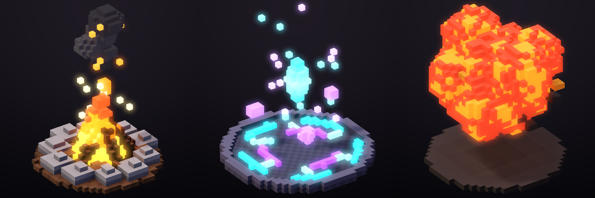

### Hazır varlıklar

| Varlık | Betik | İçerik |
| --- | --- | --- |
| Sir Valen (iri vokselli şövalye) + diorama | `Assets/Voxel.py` (`build_knight`) | Rig'li model; walk/run/idle; 8 yön × 8 kare 256 px sprite'lar, normal map sayfası, GIF'ler, diorama render'ı |
| Aurelion (512³ yüksek çözünürlüklü kahraman) | `Assets/Voxel.py` (`build_hero`) | 300 voksel boyunda; PBR dokular; 8 yönlü walk/run/idle sayfaları ve tüm pass'ler |
| VFX kütüphanesi | `Assets/Voxel.py` (`build_vfx`) | 16 karelik kamp ateşi (kesintisiz döngü), arcane portal (döngü), patlama |

Hepsi aynı yöntemle üretilir:

```bash
python3 Assets/Voxel.py knight
cd Native && cargo run --release --example run_script -- ../Assets/Build/knight_showcase.jsonl out/
```

Betikler yalnızca herkese açık komut protokolünü kullanır; bir AI ajanı MCP üzerinden aynı sonucu üretebilir. Masaüstü uygulamasında **3D Voxel → Load knight demo** ile şövalyeyi yükleyebilirsiniz.

---

## 9. Oyun üretimi

Pixel Studio yalnızca çizim yapmaz, çizimi oyuna taşır. Bu belgedeki araçlar bir sahneyi baştan sona üretir: zemin tileset'i, otomatik döşenen harita, gölge ve parıltı katmanları, normal map'li gece ışığı, hitbox verisi ve Godot / Tiled / Aseprite uyumlu dosyalar.


| Gündüz (albedo, katman karışımları) | Gece (`render_lit`: ateş, fener, ateş böcekleri, 5 bant) |
| --- | --- |
|  |  |

Sahnenin tamamı [`Assets/Scene.py`](Assets/Scene.py) ile motorun herkese açık komutlarından üretilir (99 komut). Yapay zekâ ajanları da aynı araçları MCP üzerinden kullanır.

### Neyi neden ekledik

Araştırdığımız 2026 dönemi iş akışları ve araçlar:

- **Aseprite v1.3.18** (Temmuz 2026) ve sürüm notları: tilemap katmanları, slice'lar (9-slice ve pivot), JSON sprite sheet çıktısı. Sprite sheet verisini bu formatla uyumlu yazıyoruz, böylece Aseprite içe aktarıcısı olan her motor dosyayı okuyabiliyor. Kaynaklar: <https://blog.aseprite.org/2026/07/22/aseprite-v1318/>, <https://www.aseprite.org/release-notes>
- **Dinamik ışıklı piksel sanatı** (normal map + nokta ışıklar, Godot/Unity 2D ışıkları, SpriteIlluminator iş akışı). Bu yüzden normal map üretimi ve editör içinde ışık önizlemesi var. Kaynaklar: <https://80.lv/articles/exploring-next-gen-pixel-art-with-real-time-dynamic-lighting>, <https://forum.defold.com/t/normal-map-lighting-for-2d-pixel-art-sprites/70967>, <https://www.codeandweb.com/spriteilluminator/tutorials/how-to-create-dynamically-lit-2d-scenes-for-unity>
- **47 tile'lık blob autotile üreticileri** (Blobsmith, AutoBlob, Ziva autotile şablonu). Tek bir dolgu tile'ından 47 kenar ve köşe varyasyonunu otomatik çıkarıyoruz. Kaynaklar: <https://blobsmith.itch.io/blobsmith>, <https://violetpixel13.itch.io/autoblob>, <https://ziva.sh/tools/autotile-template-generator>

### Araçlar

| Araç | Ne yapar |
| --- | --- |
| `layer_blend` | Katman karışım modu: normal, multiply (gölge, AO), screen/add (parıltı, ateş ışığı, büyü), overlay/soft_light (renk düzeltme), darken, lighten |
| `slice_set` / `slice_delete` | Kareye özel adlandırılmış dikdörtgenler: hitbox, hurtbox, pivot, silah bağlama noktası. `frame` verilmeyen anahtar tüm animasyonda geçerlidir; sonraki anahtarlar kendi karesinden itibaren onu geçersiz kılar. Kare silinirse anahtar bir sonraki kareye taşınır |
| `palette_swap` | RGB eşleşmesiyle renk değiştirme, alfa korunur. Takım renkleri, düşman varyantları, gündüz/gece paletleri, hasar flaşı için. Kapsam: cel, katman, kare ya da tümü |
| `rotsprite` | RotSprite döndürme (Scale2x ×3 = 8× büyütme, en yakın komşu, geri örnekleme). Çizgiler kırılmaz, bulanıklık ya da yeni renk oluşmaz |
| `tileset_create` / `tileset_add_tiles` | Tuvalden ızgara halinde tile keser. Aynı ve boş tile'lar atlanır |
| `tileset_generate_blob` | Tek bir dikişsiz dolgudan (tuval bölgesi ya da prosedürel renk + vurgu kümeleri) eksiksiz **47'lik blob autotile** seti üretir: aydınlık üst kenar, gölgeli yanlar, seçici outline, yuvarlak köşeler, isteğe bağlı uçurum dudağı (gölge + katman çizgileri) |
| `tilemap_create` / `tilemap_set` | Tile hücre ızgarası. Hücreler `[[x, y, tile], …]` ya da satır metni (`"0 1 1 2"`) olarak verilir |
| `tilemap_terrain` | ASCII arazi boyama (`#` arazi, `.` boş). Her hücre için kenar, iç köşe ve dış köşe otomatik seçilir. Harita kenarı arazi sayılır, böylece dolgular sınıra temiz biçimde ulaşır |
| `tilemap_bake` / `tilemap_render` | Haritayı bir katmana çizer (sahneyle birlikte birleşir, ışıklanır, dışa aktarılır) ya da PNG olarak gösterir |
| `render_lit` | Normal map'li 2D nokta ışıklar. Normaller çizimden üretilir ya da elle boyanmış bir normal katmanından alınır. `unlit_layers` (ateş, parlayan gözler) tam parlak kalır. `bands` ışığı keskin piksel basamaklarına böler |
| `export_atlas` | Kırpılmış, tekilleştirilmiş MaxRects atlas + Aseprite uyumlu JSON (`frames`, `frameTags`, `layers`, `slices`). Phaser, PixiJS, Unity ve Godot içe aktarıcıları okur |
| `export_godot_spriteframes` | Godot 4 `SpriteFrames` .tres dosyası. Her etiket için bir animasyon oluşur, kırpılan kareler `AtlasTexture` margin'leriyle geri kurulur, kare süreleri korunur |
| `export_tiled` | Tiled TMJ haritası: gömülü tileset ve blob setler için **Wang arazi seti** (harita Tiled'ın arazi fırçasıyla düzenlenmeye devam edebilir) + tileset PNG'si |
| `export_tileset` | Tileset atlas PNG'si. Blob setler için mask sırası da döner |
| `gamedev_inspect` | Slice'lar, tileset'ler, tilemap'ler (ASCII arazi önizlemesiyle) ve katman karışım modları |

`project_export` dosyaları doğrudan çalışma alanına yazar: `format=atlas` (`.png` + `.json`), `godot` (`.png` + `.tres`), `tiled` (`_tileset.png` + `.tmj`), `normal_map`.

### Örnek akış (ajan için)

```jsonc
{"op":"tileset_generate_blob","name":"plateau","tile_size":16,"fill":"#5B9A44","lip":6,"lip_color":"#8A6446"}
{"op":"tilemap_create","name":"level","tileset":"plateau","columns":20,"rows":12}
{"op":"tilemap_terrain","tilemap":"level","rows":["####################","######..........###.","...................."]}
{"op":"tilemap_bake","tilemap":"level","layer":"Ground"}
{"op":"layer_blend","layer":"Shadows","mode":"multiply"}
{"op":"slice_set","name":"hurtbox","x":118,"y":104,"width":16,"height":40,"pivot":[8,40]}
{"op":"render_lit","lights":[{"x":168,"y":118,"color":"#FFB060","intensity":3.3,"radius":160}],"ambient":"#3E4A7C","bands":5,"unlit_layers":["Fire"]}
{"op":"export_tiled","tilemap":"level"}
```

### Örnek çıktılar

- Tileset'ler (4×): [plato](Assets/Gallery/tileset_plateau_x4.png), [toprak](Assets/Gallery/tileset_dirt_x4.png), [gölet](Assets/Gallery/tileset_pond_x4.png)
- Motor dosyaları: [Tiled .tmj](Assets/Gallery/clearing.tmj), [Godot .tres](Assets/Gallery/campfire.tres), [Aseprite JSON atlas](Assets/Gallery/campfire_atlas.json)
- Sahnenin normal map'i: [campfire_clearing_normals.png](Assets/Gallery/campfire_clearing_normals.png)

### Sınırlar

- Tilemap'ler şu an bir katmana "bake" edilerek sahneye girer. Canlı tilemap katmanı (Aseprite tarzı, tile düzenlenince sahnenin anında güncellenmesi) henüz yok.
- `render_lit` bir önizlemedir. Oyundaki asıl ışığı motor hesaplar; önizleme aynı normal map'i kullanır.
- Tiled ve Godot dosyalarının biçimi testlerle doğrulanıyor, fakat Tiled ve Godot uygulamalarının kendisinde bu ortamda açılıp denenmedi.

---

## 10. .pxs proje formatı

Tüm tamsayılar little-endian'dır. Metinler `u32 uzunluk + UTF-8` olarak saklanır.

```
"PXS\0" | version u16 = 3 | reserved u16
chunk* : tag[4] | length u32 | payload
"END\0" | 4 | CRC-32 (END'den önceki tüm baytlar)
```

| Bölüm | İçerik |
| --- | --- |
| `META` | ad, genişlik, yükseklik, aktif katman id, aktif kare id, sonraki katman id, sonraki kare id |
| `PALT` | renk örnekleri (swatch): sayı + `u32 0xRRGGBBAA` (little-endian). Tuval gerçek renk olduğu için pikseller palete bağlı değildir |
| `LAYR` | katmanlar alttan üste: id, ad, görünür, kilitli, opaklık, karışım modu (v3: 0 normal, 1 multiply, 2 screen, 3 add, 4 overlay, 5 darken, 6 lighten, 7 soft light) |
| `FRAM` | kareler sırayla: id, süre (ms) |
| `TAGS` | ad, başlangıç kare id, bitiş kare id, yön (0 ileri, 1 geri, 2 ping-pong), tekrar (0 = sonsuz) |
| `TILE` | tekilleştirilmiş 16×16 tile'lar, RLE: `run sayısı u16` + `(uzunluk u16, piksel u32 0xRRGGBBAA)*` |
| `CELS` | `(katman id, kare id)` + satır satır tile referansları (`0` = boş, `n` = TILE[n-1]) |
| `HIST` | işlem günlüğü: revizyon, aktör, işlem, operationId, değişen piksel, zaman damgası |
| `MATL` | PBR materyaller: ad, roughness, metallic, emission, uv_scale, normal_strength, 7 harita için doku indeksi (`-1` = yok) |
| `TXTR` | dokular: ad, genişlik, yükseklik, zlib ile sıkıştırılmış RGBA8 |
| `VOXM` | voksel modeller: ad, boyut, origin, kemikler (ad, parent, head, tail), animasyonlar (ad, kare sayısı, ms, döngü, anahtarlar), zlib ile sıkıştırılmış 16³ chunk'lar (voksel başına `rgba u32, materyal u8, kemik u8`) |
| `SLCE` | (v3) slice'lar: ad, renk, anahtarlar (kare id, x, y, genişlik, yükseklik, pivot var mı, pivot x/y) |
| `TSET` | (v3) tileset'ler: ad, tile genişliği/yüksekliği, tür (0 düz, 1 47'lik blob), tile sayısı, zlib ile sıkıştırılmış `u32 0xRRGGBBAA` pikseller |
| `TMAP` | (v3) tilemap'ler: ad, tileset indeksi, sütun, satır, zlib(`u32` hücreler — 0 boş, n = tile n-1 — + hücre başına arazi baytı) |

- Aynı içeriğe sahip tile'lar bir kez saklanır. Çoğaltılmış ya da bekletilmiş animasyon kareleri neredeyse hiç yer kaplamaz.
- Okuyucu tüm sayıları, kimlikleri, palet referanslarını ve RLE uzunluklarını doğrular. Bozuk ya da kesik dosya hata verir, panik oluşturmaz.
- Bilinmeyen bölümler atlanır (ileriye uyumluluk). Kaydetme deterministiktir: yükle → kaydet işlemi aynı baytları üretir.
- Sürüm 2 dosyaları açılır (karışım modu normal kabul edilir); kaydetme her zaman sürüm 3 yazar.

---

## 11. Bağımlılık politikası

Çalışma zamanında üçüncü taraf kütüphane yoktur. Rust tarafı yalnızca `std` kullanır. Kotlin tarafında tek çalışma zamanı bağımlılığı dilin kendi `kotlin-stdlib`'idir; UI için platform API'leri kullanılır (Android `View`/`Canvas`, JDK Swing). Derleme araçları (Gradle, AGP, NDK, JDK) ve yalnızca test kapsamındaki `kotlin-test` bu politikanın dışındadır.

---

## 12. Karşılaştırmalı asset üretim testleri

Soru: Pixel Studio ile ev, karakter, eşya, ağaç ve efekt gibi herhangi bir piksel asset'i kolayca ve oyun kalitesinde yapabiliyor muyuz? `Assets/Bench.py` aynı özgün tasarımları, ajanların MCP üzerinden çağırdığı araçlarla dört yoldan üretir. Ardından her sonucu ölçer:

| Yol | Ne kullanır |
| --- | --- |
| **A** ham | Yalnızca düz şekiller (dikdörtgen, elips, poligon). Sıradan bir ajanın ilk denemesi |
| **B** zanaat | Aynı şekiller + `pattern_fill`, `auto_shade`, `outline mode=selout`, `draw_sparkle`, `dither_fill`, `layer_blend`, `quantize` (palet kilidi) |
| **C** voxel | 3D voxel model → `voxel_render_to_frames` (piksel paleti + outline) |
| **G** üretici | Tek `fx_generate` çağrısı (animasyonlu efektler) |

Ölçülenler:
- **Çağrı sayısı:** proje kurulumu ve dışa aktarma hariç.
- **Komut boyutu** ve **motorun süresi**.
- **Renk sayısı:** palet disiplini.
- **Ton derinliği:** her ana renk ailesindeki ton sayısı.
- **Siluet tanımı:** kenar pikselinin iç dolgudan ayrı bir tonda olması. Işık tarafında açık tutulan sel-out kenarlar da sayılır.

Ölçüm ayrı bir sprite olarak yapılır; zemin gölgesi katmanı gizlenir.

Kalite eşikleri:
- **B ve C:** ton derinliği ≥ 3, renk ≤ 64, siluet ≥ %80.
- **Efektler:** 3–24 parlaklık bandı.
- **G:** tam olarak 1 çağrı.

A yolu karşılaştırma tabanıdır, değerlendirmeye girmez.

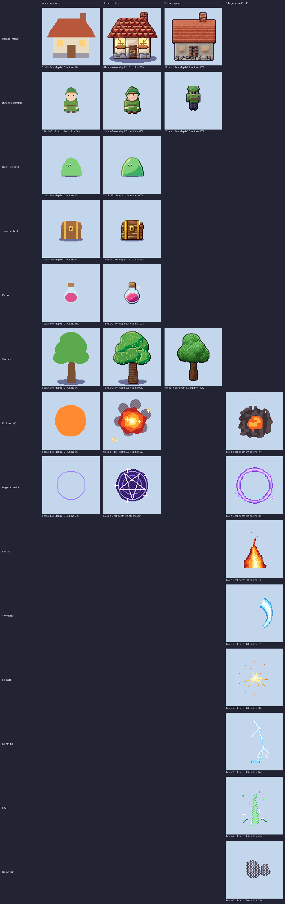

| Asset | Path | Calls | Payload KB | ms | Colors | Shade depth | Outline % | Result |
|---|---|---|---|---|---|---|---|---|
| Cottage (house) | A | 7 | 0.9 | 5 | 6 | 2.0 | 0 | ✅ |
| Cottage (house) | B | 41 | 4.1 | 8 | 40 | 11.7 | 97 | ✅ |
| Cottage (house) | C | 22 | 2.3 | 24 | 24 | 6.7 | 98 | ✅ |
| Ranger (character) | A | 15 | 1.8 | 4 | 8 | 2.0 | 10 | ✅ |
| Ranger (character) | B | 24 | 2.4 | 4 | 50 | 8.4 | 97 | ✅ |
| Ranger (character) | C | 10 | 1.0 | 6 | 16 | 3.2 | 88 | ✅ |
| Slime (monster) | A | 3 | 0.5 | 3 | 3 | 1.0 | 0 | ✅ |
| Slime (monster) | B | 7 | 0.9 | 3 | 18 | 4.2 | 100 | ✅ |
| Treasure chest | A | 7 | 0.9 | 3 | 4 | 4.0 | 3 | ✅ |
| Treasure chest | B | 15 | 1.5 | 4 | 37 | 17.5 | 99 | ✅ |
| Potion | A | 4 | 0.6 | 3 | 3 | 1.0 | 36 | ✅ |
| Potion | B | 11 | 1.2 | 3 | 21 | 5.7 | 100 | ✅ |
| Oak tree | A | 8 | 1.0 | 3 | 2 | 1.0 | 0 | ✅ |
| Oak tree | B | 16 | 1.5 | 5 | 35 | 6.5 | 99 | ✅ |
| Oak tree | C | 8 | 0.9 | 14 | 16 | 5.0 | 100 | ✅ |
| Explosion (8f) | A | 8 | 1.1 | 11 | 1 | 1.0 | 0 | ✅ |
| Explosion (8f) | B | 88 | 29.4 | 12 | 14 | 3.5 | 52 | ✅ |
| Explosion (8f) | G | 1 | 0.2 | 10 | 5 | 2.0 | 16 | ✅ |
| Magic circle (8f) | A | 8 | 1.0 | 8 | 1 | 1.0 | 55 | ✅ |
| Magic circle (8f) | B | 50 | 5.9 | 15 | 9 | 3.0 | 76 | ✅ |
| Magic circle (8f) | G | 1 | 0.2 | 9 | 5 | 3.0 | 88 | ✅ |
| Fire loop | G | 1 | 0.2 | 19 | 6 | 2.0 | 54 | ✅ |
| Sword slash | G | 1 | 0.2 | 8 | 4 | 1.3 | 82 | ✅ |
| Hit spark | G | 1 | 0.2 | 6 | 4 | 1.3 | 38 | ✅ |
| Lightning | G | 1 | 0.2 | 8 | 3 | 1.5 | 26 | ✅ |
| Heal | G | 1 | 0.2 | 10 | 4 | 1.3 | 43 | ✅ |
| Smoke puff | G | 1 | 0.2 | 8 | 3 | 3.0 | 14 | ✅ |

| Tek çağrılık efektler (G) | | | |
| --- | --- | --- | --- |
| 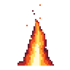 |  | 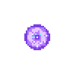 | 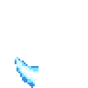 |

**Sonuçlar:**
- **Yapılar, eşyalar, karakterler:** B yolu 7–41 çağrıyla oyuna hazır sonuç veriyor. Siluet tanımı %97–100, ton derinliği 4–17. A ise düz kalıyor (siluet %0–36, ton derinliği 1–2).
- **Büyük ve hacimli asset'ler:** Ev ve ağaç gibi asset'lerde C yolu en az çağrıyla (8–22) en temiz silueti veriyor. 32 px karakterde ise detay kaybı var (ton derinliği 3.2); küçük karakterlerde B daha iyi.
- **Efektler:** Elle yapılan B patlaması 88 çağrı ve 29 KB komut tutuyordu; `fx_generate` aynı işi 1 çağrı ve 0.2 KB ile yapıyor. Dokuz efekt türünün hepsi tek çağrıda, istenen boyut, kare sayısı ve palette üretiliyor.
- **Kapanan eksikler:** Ölçümler üç araç eksiğini ortaya çıkardı ve hepsi eklendi:
  - Çatı ve eğimli formlar için `draw_polygon`.
  - Tuğla, kiremit, tahta ve taş yüzeyler için `pattern_fill`.
  - Efektlerin elle kare kare çizilmesi yerine `fx_generate`.
- **Palet disiplini:** Ev ilk denemede 94 renge çıktı. Bitirme hattının sonuna `quantize scope=all colors=32` eklenince 40 renge indi (32 renklik palet + katman karışımlarının ürettiği tonlar).

Tekrar çalıştırmak için:

```bash
python3 Assets/Bench.py        # komut betikleri, görseller, Assets/Build/bench/report.md
```

Eşiklerin altında kalan bir sonuç olursa betik hata koduyla çıkar, bu yüzden CI'da da çalıştırılabilir.

