# Pixel Studio — Mühendislik Belgesi

Dal: `Pixel_Studio_Beta` · Paket: **`com.pixel.studio`** · Sürüm: **0.1.0**

**com.pixel.studio** — insanların ve yapay zekâ ajanlarının aynı piksel çalışma alanında, gerçek piksel araçlarıyla birlikte çizim ve animasyon yaptığı bağımsız sanat platformu.

Pixel Studio'nun kendi yapay zekâsı yoktur. Zekâyı dışarıdan gelen ajan sağlar (Claude Code, Antigravity, ChatGPT, Gemini ya da kendi ajanınız). Pixel Studio ise onun **elleri, gözleri ve çalışma masası** olur: `set_pixel`, `draw_line`, `frame_duplicate` gibi gerçek editör araçları, revizyon kontrolü, geri alma ve izin sistemiyle birlikte.

```
AI / İnsan ──► MCP (/mcp) · REST (/api/v1) · Function calling · STDIO
                         │
              Kotlin (Android Views / Windows Swing) ── JNI ──► Rust pixcore
                                                               piksel · katman · kare · geçmiş
                                                               render · PNG/GIF · .pxs
```

---

## İçindekiler

1. [Durum ve galeri](#1-durum-ve-galeri)
2. [Dosya yapısı](#2-dosya-yapısı)
3. [Derleme ve testler](#3-derleme-ve-testler)
4. [Mimari](#4-mimari)
5. [MCP bağlantısı ve araçlar](#5-mcp-bağlantısı-ve-araçlar)
6. [REST API ve function calling](#6-rest-api-ve-function-calling)
7. [2D piksel art](#7-2d-piksel-art)
8. [3D voxel](#8-3d-voxel)
9. [Oyun üretimi](#9-oyun-üretimi)
10. [.pxs proje formatı](#10-pxs-proje-formatı)
11. [Bağımlılık politikası](#11-bağımlılık-politikası)
12. [Karşılaştırmalı asset üretim testleri](#12-karşılaştırmalı-asset-üretim-testleri)
13. [Gelişmiş VFX paketi ve ikincil hareket](#13-gelişmiş-vfx-paketi-ve-ikincil-hareket)
14. [Savaşçı karakter: 9 animasyon](#14-savaşçı-karakter-9-animasyon)
15. [Piksel piksel karşılaştırma: Kade ve Bram](#15-piksel-piksel-karşılaştırma-kade-ve-bram)
16. [128×128 özgün karakter: Sela](#16-128128-özgün-karakter-sela)
17. [Editör arayüzü (Windows 10/11 ve Android)](#17-editör-arayüzü-windows-1011-ve-android)
18. [Kalite araçları: eleştirmen, form ışığı, eğriler, manken](#18-kalite-araçları-eleştirmen-form-ışığı-eğriler-manken)
19. [Şelale: 256×256, 30 karelik döngü](#19-şelale-256256-30-karelik-döngü)
20. [Korku aurası: 256×256, 30 karelik döngü](#20-korku-aurası-256256-30-karelik-döngü)
21. [Hibrit hat: AI konsept görselinden gerçek pixel art'a](#21-hibrit-hat-ai-konsept-görselinden-gerçek-pixel-arta)
22. [Sıfırdan çizim neden zayıf ve çözümü: görsel API'si, küçük taslak, skill](#22-sıfırdan-çizim-neden-zayıf-ve-çözümü-görsel-apisi-küçük-taslak-skill)
23. [Fener Bekçisi: sıfırdan en detaylı karakter + 8 karelik idle](#23-fener-bekçisi-sıfırdan-en-detaylı-karakter--8-karelik-idle)

---

## 1. Durum ve galeri

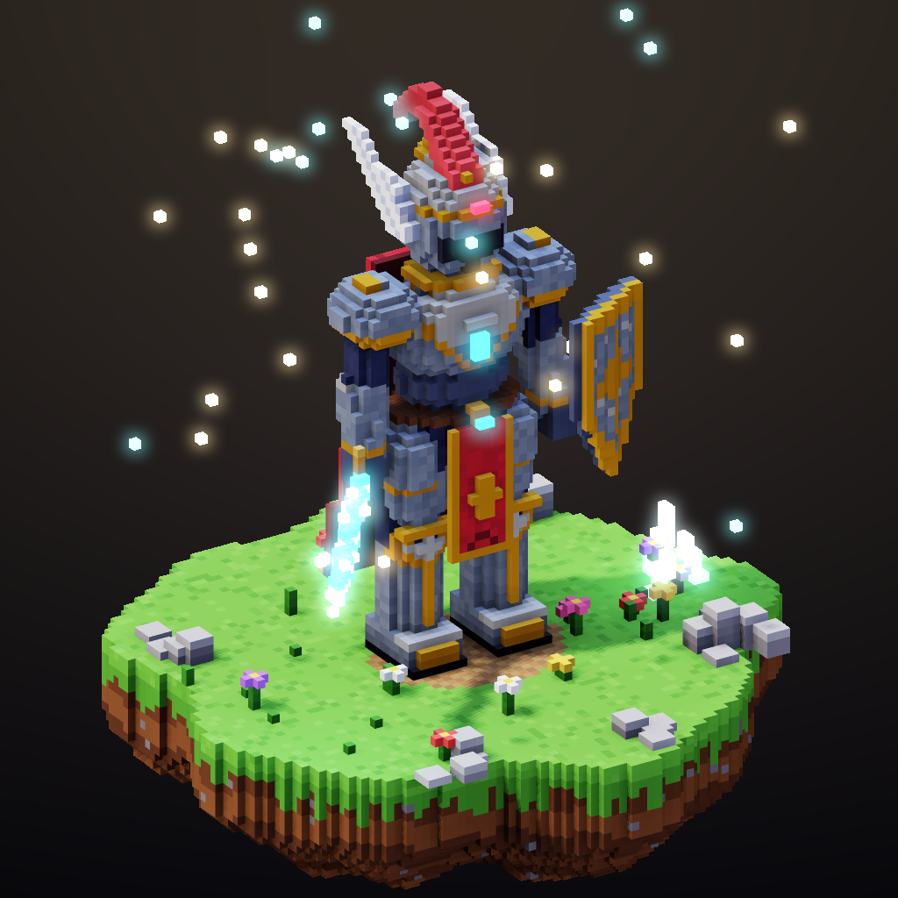

| Parça | Durum | Doğrulama |
| --- | --- | --- |
| Rust çekirdek (`Native/Core.rs`, yalnızca `std`, Rust 1.100) | ✅ | 86 test, `clippy -D warnings` temiz |
| 2D: **gerçek renk** (RGBA8), 16×16 COW tile, katman, dinamik kare, etiket, onion skin | ✅ | birim ve motor testleri |
| **3D Voxel motoru**: 512³ modeller, şekil araçları, PBR materyaller + 7 harita, PNG/prosedürel dokular | ✅ | birim ve motor testleri |
| Rig, keyframe animasyon, prosedürel walk/run/idle, kare kare VFX sekansları | ✅ | motor testleri + varlık betikleri |
| Render: köşe AO, gölge haritası, nokta ışıklar, bloom, G-buffer pass'leri, outline, 8 yönlü sprite bake | ✅ | render testleri, görsel kontrol |
| Revizyon kontrolü, idempotency, atomik transaction, undo/redo | ✅ | motor testleri |
| PNG/GIF/sprite sheet export, PNG import (kendi zlib/LZW/inflate kodumuz) | ✅ | PIL ve JDK ImageIO ile doğrulandı |
| `.pxs` v3 (2D + 3D + rig + animasyon + materyal + doku + slice + tileset + tilemap, CRC-32) | ✅ | gidiş-dönüş testleri |
| JNI köprüsü, Rust ↔ JVM golden render | ✅ | `Native/Golden.jsonl` |
| **2D piksel art araçları**: ASCII çizim, selective outline, ton kaydırmalı rampa, palet kütüphanesi (12 Lospec paleti), quantize + Bayer dither, normal map | ✅ | birim + gateway testleri |
| **Oyun üretimi**: katman karışım modları, slice (hitbox/pivot), 47'lik blob autotile üreticisi, tilemap + ASCII arazi, normal map'li 2D ışık önizlemesi, RotSprite, palet takası, MaxRects atlas, Aseprite JSON / Godot SpriteFrames / Tiled TMJ dışa aktarma | ✅ | birim + motor + gateway testleri |
| **Karakter bitirme**: `auto_shade` (şekle uyan cel gölge + katmanlar arası gölge + rim ışığı), sel-out outline, gradient map, parıltı damgası, pixel-perfect temizlik; 8 pastel chibi (64×80) + 2 animasyonlu portre (128×128) | ✅ | birim + motor + gateway testleri |
| **2D kadro** (10 özgün anime-chibi karakter, idle + walk) ve **2D VFX paketi** (8 efekt) | ✅ | motordan `draw_ascii` ile üretildi |
| MCP (eski + 2026-07-28), REST, function calling: **104 araç** | ✅ | 26 gateway testi (uçtan uca + görsel API taklit sunucusu) |
| Masaüstü editör (Windows 10/11 tarzı): **Pixel + Voxel 3D** sekmeleri, 11 araç, rampa paneli, katman yoğunluğu | ✅ | derleniyor; Xvfb altında çalıştırıldı, ekran görüntüleri [bölüm 17](#17-editör-arayüzü-windows-1011-ve-android) |
| Android: 2D editör (9 araç, rampa/HSV sayfası, katman paneli) + 3D görüntüleyici + Agent Mode | 🟡 | APK derleniyor, lint hatası yok; **cihazda ve emülatörde henüz çalıştırılmadı** |
| LAN + TLS eşleştirme | ⏳ | şimdilik `adb forward` (USB) |

Ayrıntılar: [2D piksel art](#7-2d-piksel-art), [3D voxel](#8-3d-voxel) ve [oyun üretimi](#9-oyun-üretimi).

| Fener Bekçisi (sıfırdan, [bölüm 23](#23-fener-bekçisi-sıfırdan-en-detaylı-karakter--8-karelik-idle)) | 8 karelik idle |
| --- | --- |
| 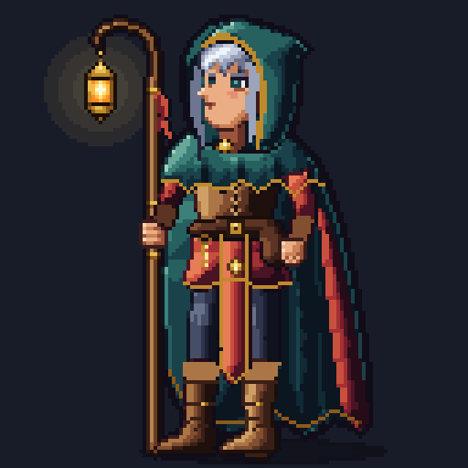 |  |


| Portre: yağmur | Portre: yıldızlı büyücü | Chibi |
| --- | --- | --- |
|  | 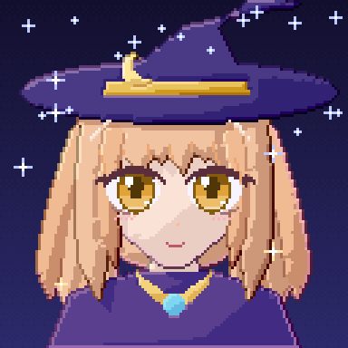 | 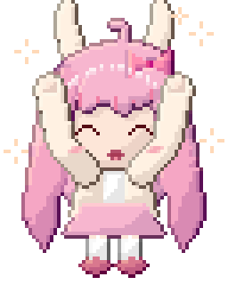  |

| Oyun sahnesi: autotile + gece ışığı (`render_lit`) | Gündüz, katman karışımları |
| --- | --- |
| 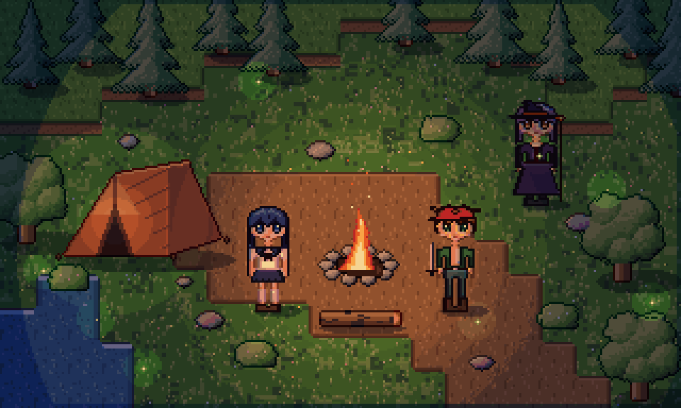 | 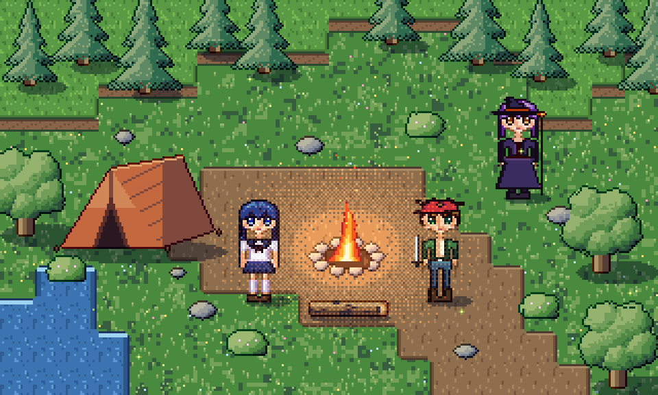 |


| 2D karakterler | 2D VFX |
| --- | --- |
| 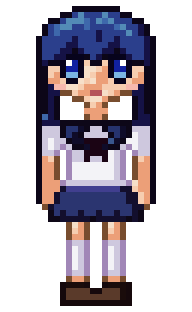  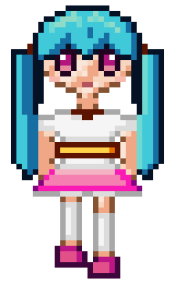 |  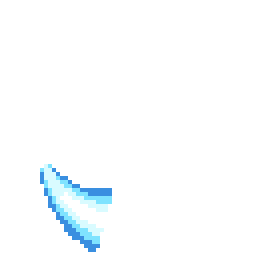  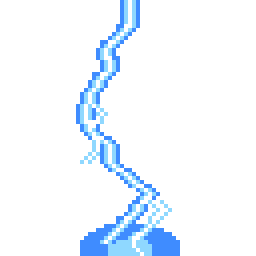 |

| Şövalye 8 yön yürüyüş (256 px) | VFX (16 kare) |
| --- | --- |
| 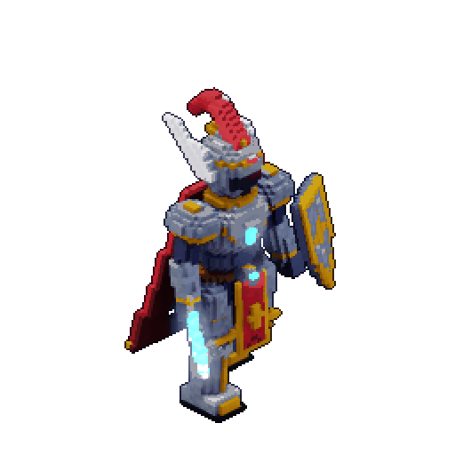 |  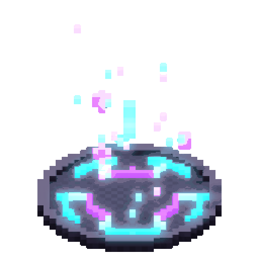  |

---

## 2. Dosya yapısı

```
Pixel_Studio/
├── .github/workflows/build.yml   CI: Rust, JVM (Linux + Windows), Android
├── Android/                      Android editörü
│   ├── Source/Main/              AndroidManifest.xml, Kotlin/Core.kt, Resources/
│   └── build.gradle.kts          NDK ile Native/ derlemesi, APK
├── Assets/                       Varlık üreticileri ve galeri
│   ├── Voxel.py  Sprites.py  Scene.py  Bench.py
│   ├── Knight.jsonl              uygulamaların paketlediği 3D şövalye demosu
│   ├── Icon.png
│   └── Gallery/                  README görselleri, örnek Godot/Tiled/Aseprite çıktıları
├── Gateway/                      Ortak JVM çekirdeği: JNI köprüsü, JSON, MCP + REST, araç kataloğu
│   ├── Source/Main/Kotlin/       Core.kt, Stdio.kt
│   ├── Source/Test/Kotlin/       Tests.kt
│   ├── Schemas/                  MCP / OpenAI / Anthropic / Gemini araç şemaları
│   └── build.gradle.kts
├── Gradle/                       Gradle wrapper
├── Native/                       Rust motoru (pixcore)
│   ├── Core.rs  Tests.rs  Script.rs
│   ├── Golden.jsonl  Golden.fingerprint
│   └── Cargo.toml  Cargo.lock  rust-toolchain.toml  rustfmt.toml
├── Windows/                      Masaüstü editörü (Swing; Windows, Linux, macOS)
│   ├── Source/Main/              Kotlin/Core.kt, Resources/
│   ├── Packaging.properties      .pxs dosya ilişkilendirmesi (jpackage)
│   └── build.gradle.kts
├── Engineering.md                bu belge
└── build.gradle.kts  settings.gradle.kts  gradle.properties  gradlew  gradlew.bat
```

Freedom Network düzeni: her platform tek kaynak dosyası (`Core.kt` / `Core.rs`), kökte yalnızca modül klasörleri ve bu belge.

---

## 3. Derleme ve testler

### Araç zinciri (doğrulanan sürümler)

| Araç | Sürüm |
| --- | --- |
| Rust | 1.100.0 (edition 2024, `Native/rust-toolchain.toml` ile sabit), yalnızca `std` |
| JDK | 25 LTS (bytecode hedefi 17) |
| Kotlin | 2.4.21 |
| Gradle | 9.9.1 (wrapper, `Gradle/`) |
| Android Gradle Plugin | 9.5.1 (yerleşik Kotlin) |
| Android | compileSdk 37.2, targetSdk 37 (Android 17), minSdk 30 (Android 11) |
| NDK | 30.0.16248370 |

### Hızlı başlangıç

```bash
cd Native && cargo test                     # Rust motoru: 86 test (golden render dahil)
./gradlew test                              # JVM: JSON, JNI köprüsü, gateway (Rust'ı otomatik derler)
./gradlew :Windows:run                      # masaüstü editörü
./gradlew :Gateway:run --args="--size 64x64 --port 38471 --workspace ./workspace [--token T] [--allow-destructive]"
```

Uygulama açıldığında **Agent → Connect an agent…** penceresi bağlantı komutlarını ve token'ı gösterir:

```bash
claude mcp add --transport http pixel-studio http://127.0.0.1:38471/mcp --header "Authorization: Bearer <TOKEN>"
```

Sonra ajana şunu söyleyin: *"Pixel Studio'yu kullan. 64x64 bir samuray çiz, ardından 24 karelik koşu animasyonu yap. Her kareyi kendin çiz ve tutarlılığı kontrol et."*

### Rust motoru

```bash
cd Native
cargo fmt --check && cargo clippy --all-targets -- -D warnings && cargo test
cargo run --release --example run_script -- Golden.jsonl out/ 32 32 10   # betiği PNG/GIF/.pxs'e dönüştürür
```

`Core.rs` modül yapısını korur (`mod commands`, `mod voxel`, `mod gamedev` …); bütün testler `Tests.rs` içindedir ve `Core.rs`'in sonunda `#[path = "Tests.rs"] mod tests;` ile bağlanır. `Script.rs` JSON-lines komut betiklerini motorda oynatan geliştirici aracıdır.

### Varlıklar

```bash
python3 Assets/Voxel.py        # hero, knight (→ Assets/Knight.jsonl), vfx
python3 Assets/Sprites.py      # chibi, cast, vfx2d, portraits
python3 Assets/Scene.py        # kamp ateşi sahnesi
cd Native && cargo run --release --example run_script -- ../Assets/Build/chibi_showcase.jsonl out/chibi
```

Betikler komut betiklerini `Assets/Build/` klasörüne yazar (git'e girmez). Tek tek de çalıştırılabilir: `python3 Assets/Sprites.py chibi`.

### Masaüstü / Windows

Windows x64 kurulum paketi (Windows makinesinde):

```powershell
cd Native; cargo build --release --target x86_64-pc-windows-msvc; cd ..
.\gradlew :Windows:packageWindows                         # .exe kurulum
.\gradlew :Windows:packageWindows -PpackageType=app-image  # taşınabilir klasör
```

`jpackage` JRE'yi pakete gömer, `pixcore.dll` dosyasını uygulama klasörüne koyar, `.pxs` dosya ilişkilendirmesini kaydeder (`Windows/Packaging.properties`) ve `Windows/Source/Main/Resources/icon.ico` simgesini kullanır.

### Android

`local.properties` içine `sdk.dir=/path/to/android-sdk` yazın ya da `ANDROID_HOME` tanımlayın. Android modülü yalnızca SDK bulunduğunda projeye dahil edilir.

```bash
rustup target add aarch64-linux-android x86_64-linux-android
./gradlew :Android:assembleDebug
```

`cargoBuild-arm64-v8a` ve `cargoBuild-x86_64` görevleri `Native/` klasörünü NDK'nın clang'ıyla (API 30) derler ve `libpixcore.so` dosyasını APK'ya koyar.

### Testler

| Komut | Kapsam |
| --- | --- |
| `cargo test` (`Native/`) | JSON, raster, render, PNG/GIF/zlib, .pxs, motor, FFI, voxel, oyun üretimi, karakter araçları, golden |
| `./gradlew :Gateway:test` | Kotlin JSON, JNI yaşam döngüsü, golden eşleşmesi, ImageIO ile PNG/GIF çözme; HTTP güvenliği, eski ve 2026 MCP, insan+AI çakışması, onay akışı, REST, function calling, çalışma alanı sınırı, STDIO adaptörü, şema güncelliği |
| `./gradlew :Android:assembleDebug :Android:lintDebug` | APK ve lint |

---

## 4. Mimari

### Katmanlar

| Katman | Konum | Dil | Sorumluluk |
| --- | --- | --- | --- |
| Rust Core (`pixcore`) | `Native/Core.rs` | Rust (`std`) | Belgenin tek otoritesi: pikseller, katmanlar, kareler, geçmiş, render, dışa aktarma, depolama, 3D voxel, oyun üretimi |
| Native köprü | `Native/Core.rs` (`mod ffi`), `Gateway` (`NativeBridge`) | Rust + Kotlin | El yazımı JNI (yalnızca 4 JNIEnv fonksiyonu) |
| Gateway | `Gateway/Source/Main/Kotlin/Core.kt` | Kotlin/JVM | JSON, `PixelEngine`, HTTP sunucusu, MCP, REST, izinler, araç kataloğu |
| STDIO adaptörü | `Gateway/Source/Main/Kotlin/Stdio.kt` | Kotlin/JVM | Alt süreç MCP istemcileri için HTTP köprüsü (`pixstudio-mcp`) |
| Windows/masaüstü | `Windows/Source/Main/Kotlin/Core.kt` | Kotlin + Swing | İnsan editörü |
| Android | `Android/Source/Main/Kotlin/Core.kt` | Kotlin + platform View'ları | İnsan editörü + Agent Mode servisi |
| Araç şemaları | `Gateway/Schemas` | JSON | MCP/OpenAI/Anthropic/Gemini araç şemaları (Kotlin kataloğundan üretilir) |

Gateway ve paylaşılan modüller saf JVM kodudur (`java.net`, `java.util`, `java.security`), bu yüzden hem Android'de hem masaüstünde değişmeden çalışır.

### Tek giriş noktası: komut protokolü

İnsan arayüzü, MCP, REST ve testlerin hepsi aynı çağrıyı yapar:

```json
{"op":"set_pixel","actor":"mcp:Claude Code","operationId":"op_1042","expectedRevision":125,
 "args":{"x":12,"y":18,"color":"#D94B42","frame":4}}
```

Yanıt `{"ok":true,"op":"set_pixel","revision":126,"actor":"...","result":{...}}` ya da `{"ok":false,...,"error":{"code":"conflict","message":"..."}}` biçimindedir. JNI çerçevesi `u32 LE json uzunluğu | JSON | ikili veri` şeklindedir; PNG, GIF, `.pxs` ve ham RGBA bu ikili kısımda taşınır.

İşlem listesi `Native/Core.rs` (`mod commands`) içindeki `OPERATIONS` tablosundadır ve `status` sorgusuyla da alınabilir. Gateway testleri her aracın motorda var olan bir işleme karşılık geldiğini doğrular.

### Veri modeli

```
Document
 ├─ name, width, height (1..4096)
 ├─ palette: Vec<RGBA>  (renk örnekleri; tuval gerçek renk)
 ├─ models: [VoxelModel{size ≤ 512³, chunks 16³, bones, animations}]
 ├─ materials: [Material{PBR + 7 harita}], textures: [RGBA8]
 ├─ layers: [Layer{id, name, visible, locked, opacity, blend}]   alttan üste
 ├─ slices: [Slice{name, color, keys[frame, rect, pivot]}]   hitbox / pivot
 ├─ tilesets: [Arc<Tileset{tile w×h, plain | blob47, tiles}>]
 ├─ tilemaps: [Arc<Tilemap{tileset, cols×rows, cells, terrain}>]
 ├─ frames: [Frame{id, duration_ms}]                       sabit kare sınırı yok
 ├─ tags:   [Tag{name, from_id, to_id, direction, repeat}] Idle/Walk/Attack
 └─ cels:   (layer_id, frame_id) → Arc<PixelGrid>
               PixelGrid = 16×16 tile ızgarası, tile = Option<Arc<[u16; 256]>>
```

- Pikseller **gerçek renk** (`0xRRGGBBAA`, u32) olarak tutulur; renk sınırı yoktur. Palet yalnızca renk örneği (swatch) listesidir. Bir örneği değiştirmek, eski rengi kullanan tüm pikselleri yeniden renklendirir.
- 3D modeller (`models`), PBR materyaller ve dokular aynı belgede bulunur. Ayrıntılar için [3D voxel](#8-3d-voxel).
- Tile'lar ve cel'ler **copy-on-write**'tır. Kare çoğaltmak işaretçi kopyalar; değişmeyen tile'lar kareler arasında fiziksel olarak paylaşılır. Undo anlık görüntüsü bu yüzden ucuzdur.
- Katman ve kare kimlikleri yeniden sıralamadan etkilenmez. API'de kullanıcılar indekslerle çalışır.

### Eşzamanlılık: insan + AI

- **Tek yazıcı:** FFI katmanı her motoru bir mutex arkasında tutar ve komutlar sırayla uygulanır.
- **İyimser revizyon kontrolü:** Her değişiklik revizyonu artırır. `expectedRevision` güncel değilse komut `conflict` ile reddedilir, böylece AI eski bir görüntüye dayanarak insanın yeni çizimini ezemez.
- **Idempotency:** Aynı `operationId` ikinci kez uygulanmaz; önbellekteki yanıt `replayed:true` ile döner.
- **Transaction:** `transaction` içindeki tüm komutlar ya birlikte uygulanır ya da hiçbiri uygulanmaz. Sonuç tek undo adımı ve tek revizyondur.
- **Geçmiş:** Her değişiklik `actor`, `op`, `operationId` ve değişen piksel sayısıyla kaydedilir (`history_list`, `.pxs` içindeki `HIST` bölümü). Undo, değişikliği kimin yaptığından bağımsız olarak çalışır.
- **Arayüz senkronu:** `PixelEngine` her revizyon değişiminde dinleyicileri tetikler; masaüstü ve Android arayüzü ajanın yaptığı değişiklikleri anında gösterir.

### Render

Render tamamen tamsayı aritmetiğiyle yapılır (`renderer::blend_over`) ve aynı girdi her platformda bit düzeyinde aynı sonucu verir. `Native/Golden.jsonl` + `Golden.fingerprint` hem Rust testinde hem JVM/JNI testinde doğrulanır.

### Güvenlik

- Gateway varsayılan olarak yalnızca `127.0.0.1`'e bağlanır. 256 bit rastgele Bearer token zorunludur ve sabit zamanlı karşılaştırılır.
- DNS rebinding'e karşı `Origin` ve (loopback modunda) `Host` doğrulanır; geçersiz Origin `403` döner.
- Ajanlar yalnızca Pixel Studio araçlarına erişir; kabuk, dosya sistemi veya ağ aracı yoktur.
- Yıkıcı araçlar (`frame_delete`, `layer_delete`, `project_new`, `canvas_resize`) ve bunları içeren transaction'lar insan onayı ister. Arayüzsüz modda varsayılan cevap **ret**'tir.
- Dosya yazımı yalnızca çalışma alanı klasörüne yapılır ve dosya adları temizlenir (`../../etc/passwd` → `etc_passwd`).
- Rust tarafında bozuk JSON, aşırı büyük bölge, sınır dışı koordinat ve bozuk `.pxs` girdileri panik yerine hata döndürür; JVM'e asla panik geçmez.

---

## 5. MCP bağlantısı ve araçlar

Endpoint: `http://127.0.0.1:38471/mcp` (port doluysa uygulama boş bir port seçer ve bağlantı penceresinde gösterir). Tüm istekler `Authorization: Bearer <token>` başlığı ister.

### Bağlanma

**Claude Code (HTTP):**
```bash
claude mcp add --transport http pixel-studio http://127.0.0.1:38471/mcp --header "Authorization: Bearer <TOKEN>"
```

**Antigravity / JSON yapılandırması:**
```json
{"mcpServers":{"pixel-studio":{"serverUrl":"http://127.0.0.1:38471/mcp","headers":{"Authorization":"Bearer <TOKEN>"}}}}
```

**STDIO isteyen istemciler:** `pixstudio-mcp` adaptörü (`./gradlew :Gateway:installDist` → `bin/pixstudio-mcp`). Çizim motoru taşımaz; açık uygulamanın HTTP endpoint'ine köprü kurar.
```json
{"mcpServers":{"pixel-studio":{"command":"pixstudio-mcp","args":["--url","http://127.0.0.1:38471/mcp","--token","<TOKEN>"]}}}
```

**Android telefondaki Pixel Studio + bilgisayardaki ajan:** Telefonda Agent Mode'u açın, ardından USB üzerinden `adb forward tcp:38471 tcp:38471` çalıştırın. Bundan sonra bilgisayardaki ajan `127.0.0.1:38471` adresine bağlanır. Sunucu ağa açılmaz.

### Protokol sürümleri

Sunucu "dual-era"dır ve iki dönemi aynı endpoint'te sunar:

| İstemci | Davranış |
| --- | --- |
| `initialize` gönderen eski istemci (2024-11-05, 2025-03-26, 2025-06-18, 2025-11-25) | El sıkışma yapılır, desteklenen sürüm geri döner, `Mcp-Session-Id` verilir (yalnızca istemci adını geçmişe yazmak için) |
| 2026-07-28 istemcisi | Durumsuz çalışır. Her istek `params._meta["io.modelcontextprotocol/protocolVersion"]` ve `clientCapabilities` taşır. `MCP-Protocol-Version`, `Mcp-Method` ve gerekiyorsa `Mcp-Name` başlıkları doğrulanır (uyuşmazsa 400 / -32020). Desteklenmeyen sürüm 400 / -32022 döner. Sonuçlarda `resultType:"complete"` ve `_meta.serverInfo` bulunur. Liste yanıtlarında `ttlMs`/`cacheScope` vardır. `server/discover` desteklenir |

Yanıtlar her zaman `application/json` olarak döner. Bildirimler `202` alır. `GET /mcp` isteği `405` döner.

### Araçlar (100)

Araç seti 2026-11'de sadeleştirildi: aynı işi yapan küçük araçlar birleştirildi (113 → 93 araç, motorda 124 → 97 işlem), el ile piksel sanatı için dört yeni araç eklendi. Ardından kalite araçları geldi (99 araç, 103 işlem; bkz. [bölüm 18](#18-kalite-araçları-eleştirmen-form-ışığı-eğriler-manken)). Eski adlar ve karşılıkları:

| Eski | Yeni |
| --- | --- |
| `project_inspect`, `frame_get`, `animation_info`, `palette_get`, `palette_list`, `gamedev_inspect` | `canvas_inspect detail=full\|frame\|animation\|palette\|gamedev` |
| `export_png`, `export_gif`, `export_spritesheet`, `export_normal_map`, `export_atlas`, `export_godot_spriteframes`, `export_tiled`, `export_tileset` | motorda `export format=…`, ajanda `project_export` |
| `layer_rename`, `layer_visibility`, `layer_lock`, `layer_opacity`, `layer_blend` | `layer_set` (+ `density`) |
| `flip_horizontal`, `flip_vertical` | `flip axis=horizontal\|vertical` |
| `rotsprite` | `rotate` (90/180/270 tam döner, diğer açılar RotSprite) |
| `palette_add`, `palette_load` | `palette_set` (`index`+`color`, `preset` ya da `colors` + `mode`) |
| `replace_color` | `palette_swap from/to` |
| `erase_pixel` | `set_pixel color=transparent` |
| `voxel_get` | `voxel_inspect` |
| `frame_select`, `layer_select` | yalnızca editörler kullanır (ajan kataloğunda yok) |

Tam şemalar `Gateway/Schemas/pixel-studio-tools.mcp.json` dosyasındadır.

| Grup | Araçlar |
| --- | --- |
| Tuval | `canvas_inspect`, `canvas_snapshot` (PNG + özet), `get_pixel`, `read_region` (ascii/hex), `set_pixel`, `set_pixels`, `draw_line`, `draw_rectangle`, `draw_ellipse`, `draw_polygon`, `pattern_fill` (tuğla/kiremit/tahta/taş/karo/çim/dalga/dama), `draw_stroke` (pixel-perfect serbest çizgi), `fill_region`, `flip`, `rotate` (RotSprite dahil), `move_region`, `copy_region`, `clear`, `canvas_resize`* |
| Animasyon | `frame_add`, `frame_duplicate`, `frame_delete`*, `frame_move`, `frame_set_duration`, `animation_tag_create`, `animation_tag_delete`, `animation_set_loop`, `animation_preview` (GIF) |
| Katman | `layer_create`, `layer_delete`*, `layer_set` (ad, görünürlük, kilit, opaklık, karışım, piksel yoğunluğu 1/2/4), `layer_move` |
| Palet ve rampa | `palette_set`, `ramp_set` (değer aralığı uyarısı), `ramp_delete`, `shade` (rampa fırçası) |
| Kalite | `art_review` (eleştirmen + işaretli değer haritası PNG), `shade_form` (form ışığı), `draw_path` (eğri, incelen fırça, dolu şekil), `antialias` (seçici AA), `fix_banding`, `draw_figure` (pozlu manken) |
| Efekt ve hareket | `fx_generate` — 23 efekt türü, tek çağrıda 8–16 kare, otomatik zamanlama, isteğe bağlı additive glow; `fx_particles` — genel parçacık yayıcı; `anim_generate` — durağan sprite'tan 8+ karelik ikincil hareket (nefes, sallanma, squash, vuruş flaşı …) |
| Piksel art | `draw_ascii`, `outline` (selective/selout/solid), `auto_shade`, `gradient_map`, `draw_sparkle`, `pixel_cleanup`, `color_ramp`, `quantize`, `dither_fill` |
| 3D Voxel | `voxel_model_create`, `voxel_model_clone`, `voxel_model_delete`*, `voxel_model_set`, `voxel_inspect`, `voxel_set`, `voxel_set_many`, `voxel_shape`, `voxel_mirror`, `material_set`, `texture_import`, `texture_generate`, `rig_bone_add`, `rig_clear`*, `rig_bind`, `anim3d_create`, `anim3d_key`, `anim3d_generate`, `voxel_render` (PNG), `voxel_render_sheet` (PNG), `voxel_render_to_frames`, `voxel_pick` |
| Oyun üretimi | `slice_set`, `slice_delete`, `palette_swap`, `tileset_create`, `tileset_add_tiles`, `tileset_generate_blob`, `tileset_delete`*, `tilemap_create`, `tilemap_delete`*, `tilemap_set`, `tilemap_terrain`, `tilemap_bake`, `tilemap_render` (PNG), `render_lit` (PNG) — bkz. [Oyun üretimi](#9-oyun-üretimi) |
| Proje | `image_import` (ızgara kurtarma, arka plan, rampa, referans katmanı), `project_save`, `project_export` (png/gif/spritesheet/atlas/godot/tiled/tileset/normal_map), `project_new`*, `project_rename`, `history_undo`, `history_redo`, `history_list`, `transaction` |

`*` işaretli araçlar insan onayı ister. Değişiklik yapan her araç isteğe bağlı `expectedRevision` ve `operationId` parametrelerini kabul eder.

**AI'nın gözleri:** `canvas_snapshot` görsel destekleyen modeller için büyütülmüş bir PNG döndürür; ayrıca içerik sınırlarını ve kullanılan renkleri JSON olarak verir. `read_region` görsel desteklemeyen modeller için pikselleri metin olarak sunar:

```
"legend": {".":"transparent","0":"#F6D7B0","1":"#000000"},
"rows": ["..000..", ".01010.", "..000.."]
```

### Kaynaklar ve promptlar

- Kaynaklar: `pixelstudio://project/current`, `pixelstudio://project/palette`, `pixelstudio://frame/current` (PNG), `pixelstudio://animation/current`, `pixelstudio://guide/pixel-art`
- Promptlar: `draw_sprite`, `animate_sprite`, `build_level`, `review_canvas`
- Sunucu `instructions` alanı ajanlara iş akışını öğretir: önce incele, palet ve katman planla, bloklarla başla, `set_pixels` ile detaylandır, `canvas_snapshot` ile kontrol et, kareleri çoğalt ve yalnızca değişeni düzenle.

---

## 6. REST API ve function calling

Taban adres: `http://127.0.0.1:38471/api/v1`. Tüm istekler `Authorization: Bearer <token>` başlığı ister. İsteğe bağlı `X-Pixel-Actor: <ad>` başlığı geçmişe `api:<ad>` olarak yazılır.

| Metot ve yol | İşlev |
| --- | --- |
| `GET /status` | Motor durumu, revizyon, işlem listesi, gateway bilgisi |
| `GET /project` | `canvas_inspect detail=full` |
| `GET /canvas` | `canvas_inspect` |
| `GET /frame/{i}` | Kare bilgisi |
| `GET /frame/{i}/pixels?x=&y=&width=&height=&format=ascii\|hex\|indexed` | Piksel okuma |
| `GET /snapshot?frame=&scale=` | PNG (`image/png`, `X-Pixel-Revision` başlığıyla) |
| `GET /tools?format=mcp\|openai\|anthropic\|gemini` | Function-calling araç şemaları |
| `POST /tools/{name}` | Bir aracı çağırır. Gövde, modelin ürettiği argüman nesnesidir |
| `POST /commands` | Ham motor komutu: tek nesne, dizi ya da `{"commands":[...]}` |
| `POST /frames` | `frame_add` |
| `POST /animations` | `animation_tag_create` |
| `POST /export` | `{"format":"png\|gif\|spritesheet\|pxs", ...}` → ikili dosya |

Durum kodları: `200` başarı, `400` geçersiz argüman, `401` token yok veya yanlış, `403` izin yok ya da Origin geçersiz, `404` bulunamadı, `409` revizyon çakışması.

### Function calling ile kullanım

1. `GET /api/v1/tools?format=openai` (ya da `anthropic`, `gemini`) ile araç şemalarını alın ve modele verin.
2. Model bir araç çağrısı ürettiğinde argümanları olduğu gibi `POST /api/v1/tools/<name>` adresine gönderin.
3. Yanıttaki `content` (metin/görsel) ve `structuredContent` alanlarını modele geri iletin.

```bash
curl -H "Authorization: Bearer $TOKEN" -H "Content-Type: application/json" \
     -d '{"x":0,"y":0,"width":8,"height":8,"color":"#3366FF","filled":true}' \
     http://127.0.0.1:38471/api/v1/tools/draw_rectangle
```

Şemaların JSON Schema kaynağı Kotlin kataloğudur (`Gateway/Source/Main/Kotlin/Core.kt` içindeki `ToolCatalog`). `./gradlew :Gateway:exportToolSchemas` komutu `Gateway/Schemas/*.json` dosyalarını yeniden üretir; testler bu dosyaların güncel olup olmadığını kontrol eder.

---

## 7. 2D piksel art


### Tuval ve renk

- Tuval **gerçek renklidir** (RGBA8). Palet, renk örneği listesidir; `palette_set` eski rengi kullanan tüm pikselleri yeniden renklendirir (palet takası).
- **Palet kütüphanesi** (`canvas_inspect detail=palette`, `palette_set preset=…`): ENDESGA 32/64, Resurrect 64, Sweetie 16, Apollo, AAP-64, Na16, SLSO8, PICO-8, Lospec500, Vinik24, TwilioQuest 76. Kaynak [Lospec](https://lospec.com/palette-list); yazarları `canvas_inspect detail=palette` çıktısında listelenir.

### Usta piksel artistin araçları

| Araç | Ne yapar |
| --- | --- |
| `draw_ascii` | Sprite'ı metin olarak çizer (satırlar + lejant). `read_region format=ascii` ile aynı biçimdedir: AI ajanı okuyabilir, düzenleyebilir ve tek çağrıda tekrar çizebilir. `flip_x` ile sağ ve sol yönler aynı çizimden üretilir |
| `color_ramp` | Ton kaydırmalı gölge rampası (OKLCH): gölgeler mor-maviye, ışıklar sarıya kayar; gamut eşlemesi tonu korur |
| `outline` | 1 px dış çizgi: sabit renk veya *selective outline* (komşu rengin koyu ve soğuk tonu) |
| `quantize` | Median cut ya da kütüphane paleti + Bayer dither. Bütün animasyon için tek palet kullanılır |
| `dither_fill` | İki renkli sıralı dither (16 yoğunluk seviyesi) |
| `project_export format=normal_map` | Sprite'tan normal map üretir (Godot, Unity ve Unreal Paper2D'de 2D dinamik ışık için) |
| 3D → piksel | `voxel_render*` + `pixel_palette` / `dither`: 3D render'ları piksel art'a dönüştürür (bkz. aşağıdaki karşılaştırma) |

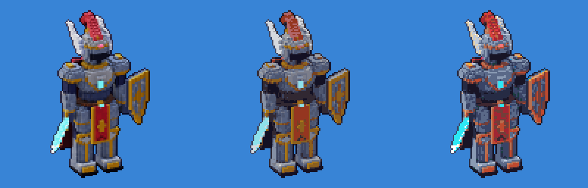

*Soldan sağa: ham render, 16 renk, ENDESGA 32.*

### Kadro (özgün karakterler)

`Assets/Sprites.py` (`build_cast`) ile üretilir. Bu, sprite stüdyolarının kullandığı paper-doll (parça giydirme) yöntemidir:

1. Elle yazılmış bölge haritaları: yüz, 6 saç modeli (ön ve arka katman), 10 kıyafet, göz damgaları, şapka ve silahlar.
2. Otomatik piksel art gölgelendirme: 5 tonlu ton kaydırmalı rampalar, sol üstten ışık, katman önceliğine göre iç çizgiler, renkli selective outline.
3. Elle eklenen detaylar: göz parlaması, anime saç halesi (angel ring), tutam ayrımları, kıvrımlar, allık.
4. Animasyon: idle (nefes, göz kırpma, saç salınımı) ve 4 karelik yürüme.

Aoi, Ren, Mira, Kai, Hana, Sora, Rika, Yuki, Kuro ve Luna; her biri 32×52 px. Çizim motora `draw_ascii` ile aktarılır; etiketler `Aoi_idle`, `Aoi_walk` biçimindedir.

### 2D VFX paketi (64×64)

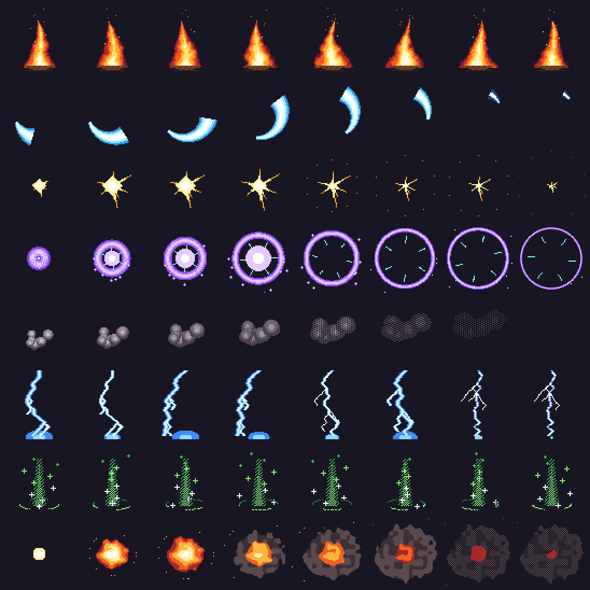

`Assets/Sprites.py` (`build_vfx2d`): ateş (16, döngü), kılıç izi (8), vuruş kıvılcımı (6), büyü patlaması (12), duman (8), yıldırım (8), iyileşme (12, döngü), patlama (12).

Klasik piksel art kurallarına uyar: her efektte 4–6 renklik bant paleti, net kümeler, kenar yumuşatma yok, parlak çekirdekten koyu kenara geçiş, sönerken dither ile kaybolma. Döngüler kesintisizdir; zaman bir çember üzerine eşlendiği için son kare ilk kareye bağlanır.

```bash
python3 Assets/Sprites.py cast vfx2d
cd Native && cargo run --release --example run_script -- ../Assets/Build/cast_showcase.jsonl out/cast
```

### Karakter bitirme araçları (2026 pastel anime stili)

Modern anime piksel karakterlerinin kalitesi büyük ölçüde bitirme aşamasından gelir: şekli takip eden ton kaydırmalı cel gölge, saçın yüze düşen gölgesi, siyah yerine rengin koyu tonuyla çizilmiş outline ve parıltılar. Pixel Studio bu aşamaları araç olarak sunar:

| Araç | Ne yapar |
| --- | --- |
| `auto_shade` | Düz renkli her bölgeyi şeklini takip eden 2–4 tonlu cel gölgeyle boyar: ışık tarafı aydınlık, karşı taraf gölgeli olur, büyük alanlarda yumuşak bir geçiş oluşur. **Üstteki katmanlar gölge düşürür** (kâkül alna, kafa boyna, şapka saça). İsteğe bağlı rim ışığı, açık rampa tanımları, korunacak renkler ve küçük detay bölgelerini atlama desteklenir |
| `outline` `mode=selout` | Seçici outline. Işık tarafında outline açılır, yani sel-out uygulanır. `darkness` ile pastel ya da sert ton seçilir, `inside` şekli büyütmeden kenara çizer |
| `gradient_map` | Parlaklığı bir gradyana eşleyerek renk düzenler: yağmurlu mavi akşam, gün batımı, sepya |
| `draw_sparkle` | 4 köşeli parıltı, artı, elmas ya da nokta damgası (tek tek ya da toplu) |
| `pixel_cleanup` | 1 px çizgilerdeki L köşe fazlalarını temizler ("pixel perfect") |

Önerilen akış: karakteri katmanlara ayrılmış düz renklerle kur (arka saç, gövde, yüz, ön saç, kollar) → her katmana `auto_shade` uygula → `outline mode=selout` → `pixel_cleanup` → gözleri, allığı ve saç parlamasını elle çiz → `draw_sparkle`.

#### Pastel chibi koleksiyonu (64×80)


| | | | |
| --- | --- | --- | --- |
|  | 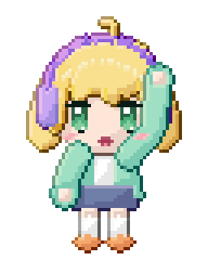 | 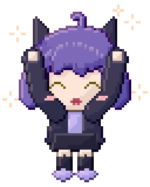 |  |

`Assets/Sprites.py` (`build_chibi`) 8 özgün karakter üretir: Mochi, Yuzu, Fuyu, Kuro, Sora, Ren, Lila ve Hana. Her karakterin 4 karelik idle animasyonu (nefes, göz kırpma, saç salınımı) ve 4 karelik ikinci bir animasyonu vardır (sevinç zıplaması, el sallama ya da ikinci idle). Toplam 64 kare. Saç, inceltilmiş Bezier tutamlardan kurulur. Gözler el çizimi damgalardır: gradyan iris, çift parıltı ve kirpik kanadı. Gölge, outline ve parıltılar tamamen motor araçlarıyla eklenir.

#### Bust portreler (128×128, 8 kare)

| Shizuku: yağmurlu akşam | Astra: yıldızlı büyücü |
| --- | --- |
|  |  |

`Assets/Sprites.py` (`build_portraits`) iki portre üretir. Shizuku'da `gradient_map` ile soğuk akşam tonu, cyan rim ışığı ve yağan yağmur var. Astra'da şapka saça gölge düşürüyor ve gökyüzünde yıldızlar parlıyor. Gözler katmanlıdır: sklera, gradyan iris, koyu iris kenarı, göz bebeği, 3 px kalınlığında kirpik ve kanat, alt kirpik ve iki parıltı.

Tüm karakterler özgündür. Referans görseller yalnızca stil, oran ve teknik analizi için kullanıldı; mevcut karakterler ya da eserler kopyalanmadı.

```bash
python3 Assets/Sprites.py chibi portraits
cd Native && cargo run --release --example run_script -- ../Assets/Build/chibi_showcase.jsonl out/chibi
```

---

## 8. 3D voxel

Pixel Studio'da hem 2D piksel hem 3D voksel ("3D piksel") çizebilirsiniz. 3D modeller rig'lenir, animasyonlandırılır ve tek komutla 8 yönlü 2D sprite'lara, normal map sayfalarına veya düzenlenebilir 2D karelere dönüştürülür.


### Veri modeli

| Kavram | Ayrıntı |
| --- | --- |
| Model | En fazla 512×512×512 seyrek voksel ızgarası, 16³'lük copy-on-write chunk'lar. y yukarı, model önü +z, `origin` = ayakların arası |
| Voksel | Gerçek renk RGBA8 (16,7 milyon renk + alfa; yarı saydam duman ve cam desteklenir) + materyal + kemik |
| Materyal (PBR) | roughness, metallic, emission, uv_scale, normal_strength + 7 harita: **albedo, normal, roughness, metallic, occlusion (AO), height, emission** |
| Doku eşleme | Her voksel yüzü kendi ekseninde UV alır (X yüzleri z/y, Y yüzleri x/z, Z yüzleri x/y). `uv_scale` = voksel başına texel; render alt-voksel UV kullanır |
| Dokular | PNG içe aktarma (`texture_import`) veya 9 prosedürel PBR seti (`texture_generate`): brushed_metal, hammered_metal, leather, fabric, scales, stone, wood, chainmail, noise |
| Rig | Kemik hiyerarşisi (head → tail), katı (rigid) skinning, otomatik bağlama |
| Animasyon | Keyframe (Euler + öteleme, yumuşak interpolasyon), prosedürel yürüme/koşma/bekleme (ayaklar zemine basar), kare kare model sekansları (VFX) |

### Render motoru

- Yüzey çıkarma: düzgün normaller ve iki ölçekli AO, ayrıca **MagicaVoxel tarzı köşe AO'su** (yüz üzerinde interpolasyonlu).
- **PBR**: GGX, Smith ve Fresnel; stüdyo ortam yansıması; toon modu (`toon_steps`).
- **Gölge haritası** (`shadows`, 3×3 PCF), şeffaf sprite'lar için **zemin gölgesi** (`ground_shadow`).
- **Nokta ışıklar** (`lights`: ateş, pencere, büyü), **bloom** (`bloom`, `bloom_radius`); parlama şeffaf piksellere hale olarak taşar.
- G-buffer pass'leri: lit, albedo, normal, depth, occlusion, roughness, metallic, emission.
- Süpersampling, seçici outline (selective outline), iç çizgiler, gradyan arka plan ve vinyet.
- Deterministiktir: aynı proje her platformda aynı pikselleri üretir.

### Tipik akış (MCP araçlarıyla)

1. `voxel_model_create` → `texture_generate` / `material_set`
2. `rig_bone_add` (hips, spine, chest, neck, head, upper_arm_l/r, lower_arm_l/r, hand_l/r, upper_leg_l/r, lower_leg_l/r, foot_l/r, cape)
3. `voxel_shape` (box, ellipsoid, capsule, cone, cylinder; add/paint/erase, gradyan, jitter, `mirror_x`) veya ayrıntı için `voxel_set_many`
4. `rig_bind` → `anim3d_generate {kind: walk|run|idle}` ya da `anim3d_key`
5. `voxel_render` ile kontrol et (agent'ın gözleri)
6. `voxel_render_sheet {directions: 8, animation: "walk", pass: "lit"|"normal"…}` ya da `voxel_render_to_frames` (2D'ye bake; etiketler `walk_S`, `walk_SE`, …)

### VFX: kare kare 3D animasyon

Statik tabanı bir kez modelleyin, `voxel_model_clone` ile her kareye kopyalayın ve hareket eden voksel'leri (alev, kıvılcım, duman) ekleyin. Ardından `voxel_render_sheet {models: ["Fire_00", …, "Fire_15"]}` ile tek ve sabit bir kamerayla render edin.


### Hazır varlıklar

| Varlık | Betik | İçerik |
| --- | --- | --- |
| Sir Valen (iri vokselli şövalye) + diorama | `Assets/Voxel.py` (`build_knight`) | Rig'li model; walk/run/idle; 8 yön × 8 kare 256 px sprite'lar, normal map sayfası, GIF'ler, diorama render'ı |
| Aurelion (512³ yüksek çözünürlüklü kahraman) | `Assets/Voxel.py` (`build_hero`) | 300 voksel boyunda; PBR dokular; 8 yönlü walk/run/idle sayfaları ve tüm pass'ler |
| VFX kütüphanesi | `Assets/Voxel.py` (`build_vfx`) | 16 karelik kamp ateşi (kesintisiz döngü), arcane portal (döngü), patlama |

Hepsi aynı yöntemle üretilir:

```bash
python3 Assets/Voxel.py knight
cd Native && cargo run --release --example run_script -- ../Assets/Build/knight_showcase.jsonl out/
```

Betikler yalnızca herkese açık komut protokolünü kullanır; bir AI ajanı MCP üzerinden aynı sonucu üretebilir. Masaüstü uygulamasında **3D Voxel → Load knight demo** ile şövalyeyi yükleyebilirsiniz.

---

## 9. Oyun üretimi

Pixel Studio yalnızca çizim yapmaz, çizimi oyuna taşır. Bu belgedeki araçlar bir sahneyi baştan sona üretir: zemin tileset'i, otomatik döşenen harita, gölge ve parıltı katmanları, normal map'li gece ışığı, hitbox verisi ve Godot / Tiled / Aseprite uyumlu dosyalar.


| Gündüz (albedo, katman karışımları) | Gece (`render_lit`: ateş, fener, ateş böcekleri, 5 bant) |
| --- | --- |
|  |  |

Sahnenin tamamı [`Assets/Scene.py`](Assets/Scene.py) ile motorun herkese açık komutlarından üretilir (99 komut). Yapay zekâ ajanları da aynı araçları MCP üzerinden kullanır.

### Neyi neden ekledik

Araştırdığımız 2026 dönemi iş akışları ve araçlar:

- **Aseprite v1.3.18** (Temmuz 2026) ve sürüm notları: tilemap katmanları, slice'lar (9-slice ve pivot), JSON sprite sheet çıktısı. Sprite sheet verisini bu formatla uyumlu yazıyoruz, böylece Aseprite içe aktarıcısı olan her motor dosyayı okuyabiliyor. Kaynaklar: <https://blog.aseprite.org/2026/07/22/aseprite-v1318/>, <https://www.aseprite.org/release-notes>
- **Dinamik ışıklı piksel sanatı** (normal map + nokta ışıklar, Godot/Unity 2D ışıkları, SpriteIlluminator iş akışı). Bu yüzden normal map üretimi ve editör içinde ışık önizlemesi var. Kaynaklar: <https://80.lv/articles/exploring-next-gen-pixel-art-with-real-time-dynamic-lighting>, <https://forum.defold.com/t/normal-map-lighting-for-2d-pixel-art-sprites/70967>, <https://www.codeandweb.com/spriteilluminator/tutorials/how-to-create-dynamically-lit-2d-scenes-for-unity>
- **47 tile'lık blob autotile üreticileri** (Blobsmith, AutoBlob, Ziva autotile şablonu). Tek bir dolgu tile'ından 47 kenar ve köşe varyasyonunu otomatik çıkarıyoruz. Kaynaklar: <https://blobsmith.itch.io/blobsmith>, <https://violetpixel13.itch.io/autoblob>, <https://ziva.sh/tools/autotile-template-generator>

### Araçlar

| Araç | Ne yapar |
| --- | --- |
| `layer_set blend=…` | Katman karışım modu: normal, multiply (gölge, AO), screen/add (parıltı, ateş ışığı, büyü), overlay/soft_light (renk düzeltme), darken, lighten |
| `slice_set` / `slice_delete` | Kareye özel adlandırılmış dikdörtgenler: hitbox, hurtbox, pivot, silah bağlama noktası. `frame` verilmeyen anahtar tüm animasyonda geçerlidir; sonraki anahtarlar kendi karesinden itibaren onu geçersiz kılar. Kare silinirse anahtar bir sonraki kareye taşınır |
| `palette_swap` | RGB eşleşmesiyle renk değiştirme, alfa korunur. Takım renkleri, düşman varyantları, gündüz/gece paletleri, hasar flaşı için. Kapsam: cel, katman, kare ya da tümü |
| `rotate` | 90/180/270 dışındaki açılarda RotSprite döndürme (Scale2x ×3 = 8× büyütme, en yakın komşu, geri örnekleme). Çizgiler kırılmaz, bulanıklık ya da yeni renk oluşmaz |
| `tileset_create` / `tileset_add_tiles` | Tuvalden ızgara halinde tile keser. Aynı ve boş tile'lar atlanır |
| `tileset_generate_blob` | Tek bir dikişsiz dolgudan (tuval bölgesi ya da prosedürel renk + vurgu kümeleri) eksiksiz **47'lik blob autotile** seti üretir: aydınlık üst kenar, gölgeli yanlar, seçici outline, yuvarlak köşeler, isteğe bağlı uçurum dudağı (gölge + katman çizgileri) |
| `tilemap_create` / `tilemap_set` | Tile hücre ızgarası. Hücreler `[[x, y, tile], …]` ya da satır metni (`"0 1 1 2"`) olarak verilir |
| `tilemap_terrain` | ASCII arazi boyama (`#` arazi, `.` boş). Her hücre için kenar, iç köşe ve dış köşe otomatik seçilir. Harita kenarı arazi sayılır, böylece dolgular sınıra temiz biçimde ulaşır |
| `tilemap_bake` / `tilemap_render` | Haritayı bir katmana çizer (sahneyle birlikte birleşir, ışıklanır, dışa aktarılır) ya da PNG olarak gösterir |
| `render_lit` | Normal map'li 2D nokta ışıklar. Normaller çizimden üretilir ya da elle boyanmış bir normal katmanından alınır. `unlit_layers` (ateş, parlayan gözler) tam parlak kalır. `bands` ışığı keskin piksel basamaklarına böler |
| `project_export format=atlas` | Kırpılmış, tekilleştirilmiş MaxRects atlas + Aseprite uyumlu JSON (`frames`, `frameTags`, `layers`, `slices`). Phaser, PixiJS, Unity ve Godot içe aktarıcıları okur |
| `project_export format=godot` | Godot 4 `SpriteFrames` .tres dosyası. Her etiket için bir animasyon oluşur, kırpılan kareler `AtlasTexture` margin'leriyle geri kurulur, kare süreleri korunur |
| `project_export format=tiled` | Tiled TMJ haritası: gömülü tileset ve blob setler için **Wang arazi seti** (harita Tiled'ın arazi fırçasıyla düzenlenmeye devam edebilir) + tileset PNG'si |
| `project_export format=tileset` | Tileset atlas PNG'si. Blob setler için mask sırası da döner |
| `canvas_inspect detail=gamedev` | Slice'lar, tileset'ler, tilemap'ler (ASCII arazi önizlemesiyle) ve katman karışım modları |

`project_export` dosyaları doğrudan çalışma alanına yazar: `format=atlas` (`.png` + `.json`), `godot` (`.png` + `.tres`), `tiled` (`_tileset.png` + `.tmj`), `normal_map`.

### Örnek akış (ajan için)

```jsonc
{"op":"tileset_generate_blob","name":"plateau","tile_size":16,"fill":"#5B9A44","lip":6,"lip_color":"#8A6446"}
{"op":"tilemap_create","name":"level","tileset":"plateau","columns":20,"rows":12}
{"op":"tilemap_terrain","tilemap":"level","rows":["####################","######..........###.","...................."]}
{"op":"tilemap_bake","tilemap":"level","layer":"Ground"}
{"op":"layer_set","layer":"Shadows","blend":"multiply"}
{"op":"slice_set","name":"hurtbox","x":118,"y":104,"width":16,"height":40,"pivot":[8,40]}
{"op":"render_lit","lights":[{"x":168,"y":118,"color":"#FFB060","intensity":3.3,"radius":160}],"ambient":"#3E4A7C","bands":5,"unlit_layers":["Fire"]}
{"op":"export","format":"tiled","tilemap":"level"}
```

### Örnek çıktılar

- Tileset'ler (4×): [plato](Assets/Gallery/tileset_plateau_x4.png), [toprak](Assets/Gallery/tileset_dirt_x4.png), [gölet](Assets/Gallery/tileset_pond_x4.png)
- Motor dosyaları: [Tiled .tmj](Assets/Gallery/clearing.tmj), [Godot .tres](Assets/Gallery/campfire.tres), [Aseprite JSON atlas](Assets/Gallery/campfire_atlas.json)
- Sahnenin normal map'i: [campfire_clearing_normals.png](Assets/Gallery/campfire_clearing_normals.png)

### Sınırlar

- Tilemap'ler şu an bir katmana "bake" edilerek sahneye girer. Canlı tilemap katmanı (Aseprite tarzı, tile düzenlenince sahnenin anında güncellenmesi) henüz yok.
- `render_lit` bir önizlemedir. Oyundaki asıl ışığı motor hesaplar; önizleme aynı normal map'i kullanır.
- Tiled ve Godot dosyalarının biçimi testlerle doğrulanıyor, fakat Tiled ve Godot uygulamalarının kendisinde bu ortamda açılıp denenmedi.

---

## 10. .pxs proje formatı

Tüm tamsayılar little-endian'dır. Metinler `u32 uzunluk + UTF-8` olarak saklanır.

```
"PXS\0" | version u16 = 3 | reserved u16
chunk* : tag[4] | length u32 | payload
"END\0" | 4 | CRC-32 (END'den önceki tüm baytlar)
```

| Bölüm | İçerik |
| --- | --- |
| `META` | ad, genişlik, yükseklik, aktif katman id, aktif kare id, sonraki katman id, sonraki kare id |
| `PALT` | renk örnekleri (swatch): sayı + `u32 0xRRGGBBAA` (little-endian). Tuval gerçek renk olduğu için pikseller palete bağlı değildir |
| `LAYR` | katmanlar alttan üste: id, ad, görünür, kilitli, opaklık, karışım modu (v3: 0 normal, 1 multiply, 2 screen, 3 add, 4 overlay, 5 darken, 6 lighten, 7 soft light) |
| `FRAM` | kareler sırayla: id, süre (ms) |
| `TAGS` | ad, başlangıç kare id, bitiş kare id, yön (0 ileri, 1 geri, 2 ping-pong), tekrar (0 = sonsuz) |
| `TILE` | tekilleştirilmiş 16×16 tile'lar, RLE: `run sayısı u16` + `(uzunluk u16, piksel u32 0xRRGGBBAA)*` |
| `CELS` | `(katman id, kare id)` + satır satır tile referansları (`0` = boş, `n` = TILE[n-1]) |
| `HIST` | işlem günlüğü: revizyon, aktör, işlem, operationId, değişen piksel, zaman damgası |
| `MATL` | PBR materyaller: ad, roughness, metallic, emission, uv_scale, normal_strength, 7 harita için doku indeksi (`-1` = yok) |
| `TXTR` | dokular: ad, genişlik, yükseklik, zlib ile sıkıştırılmış RGBA8 |
| `VOXM` | voksel modeller: ad, boyut, origin, kemikler (ad, parent, head, tail), animasyonlar (ad, kare sayısı, ms, döngü, anahtarlar), zlib ile sıkıştırılmış 16³ chunk'lar (voksel başına `rgba u32, materyal u8, kemik u8`) |
| `SLCE` | (v3) slice'lar: ad, renk, anahtarlar (kare id, x, y, genişlik, yükseklik, pivot var mı, pivot x/y) |
| `TSET` | (v3) tileset'ler: ad, tile genişliği/yüksekliği, tür (0 düz, 1 47'lik blob), tile sayısı, zlib ile sıkıştırılmış `u32 0xRRGGBBAA` pikseller |
| `TMAP` | (v3) tilemap'ler: ad, tileset indeksi, sütun, satır, zlib(`u32` hücreler — 0 boş, n = tile n-1 — + hücre başına arazi baytı) |

- Aynı içeriğe sahip tile'lar bir kez saklanır. Çoğaltılmış ya da bekletilmiş animasyon kareleri neredeyse hiç yer kaplamaz.
- Okuyucu tüm sayıları, kimlikleri, palet referanslarını ve RLE uzunluklarını doğrular. Bozuk ya da kesik dosya hata verir, panik oluşturmaz.
- Bilinmeyen bölümler atlanır (ileriye uyumluluk). Kaydetme deterministiktir: yükle → kaydet işlemi aynı baytları üretir.
- Sürüm 2 dosyaları açılır (karışım modu normal kabul edilir); kaydetme her zaman sürüm 3 yazar.

---

## 11. Bağımlılık politikası

Çalışma zamanında üçüncü taraf kütüphane yoktur. Rust tarafı yalnızca `std` kullanır. Kotlin tarafında tek çalışma zamanı bağımlılığı dilin kendi `kotlin-stdlib`'idir; UI için platform API'leri kullanılır (Android `View`/`Canvas`, JDK Swing). Derleme araçları (Gradle, AGP, NDK, JDK) ve yalnızca test kapsamındaki `kotlin-test` bu politikanın dışındadır.

---

## 12. Karşılaştırmalı asset üretim testleri

Soru: Pixel Studio ile ev, karakter, eşya, ağaç ve efekt gibi herhangi bir piksel asset'i kolayca ve oyun kalitesinde yapabiliyor muyuz? `Assets/Bench.py` aynı özgün tasarımları, ajanların MCP üzerinden çağırdığı araçlarla dört yoldan üretir. Ardından her sonucu ölçer:

| Yol | Ne kullanır |
| --- | --- |
| **A** ham | Yalnızca düz şekiller (dikdörtgen, elips, poligon). Sıradan bir ajanın ilk denemesi |
| **B** zanaat | Aynı şekiller + `pattern_fill`, `auto_shade`, `outline mode=selout`, `draw_sparkle`, `dither_fill`, `layer_set blend`, `quantize` (palet kilidi) |
| **C** voxel | 3D voxel model → `voxel_render_to_frames` (piksel paleti + outline) |
| **G** üretici | Tek `fx_generate` çağrısı (animasyonlu efektler) |

Ölçülenler:
- **Çağrı sayısı:** proje kurulumu ve dışa aktarma hariç.
- **Komut boyutu** ve **motorun süresi**.
- **Renk sayısı:** palet disiplini.
- **Ton derinliği:** her ana renk ailesindeki ton sayısı.
- **Siluet tanımı:** kenar pikselinin iç dolgudan ayrı bir tonda olması. Işık tarafında açık tutulan sel-out kenarlar da sayılır.

Ölçüm ayrı bir sprite olarak yapılır; zemin gölgesi katmanı gizlenir.

Kalite eşikleri:
- **B ve C:** ton derinliği ≥ 3, renk ≤ 64, siluet ≥ %80.
- **Efektler:** 3–24 parlaklık bandı.
- **G:** tam olarak 1 çağrı.

A yolu karşılaştırma tabanıdır, değerlendirmeye girmez.


| Asset | Path | Calls | Frames | Payload KB | ms | Colors | Shade depth | Outline % | Motion | Loop seam | Result |
|---|---|---|---|---|---|---|---|---|---|---|---|
| Cottage (house) | A | 9 | 8 | 1.2 | 21 | 9 | 3.0 | 2 | 0.012 | 0.01 | ✅ |
| Cottage (house) | B | 44 | 8 | 4.5 | 23 | 42 | 12.7 | 95 | 0.109 | 0.122 | ✅ |
| Cottage (house) | C | 24 | 8 | 2.5 | 42 | 27 | 7.7 | 94 | 0.01 | 0.008 | ✅ |
| Ranger (character) | A | 16 | 8 | 1.8 | 9 | 8 | 2.0 | 10 | 0.036 | 0.0 | ✅ |
| Ranger (character) | B | 25 | 8 | 2.5 | 11 | 49 | 8.2 | 91 | 0.08 | 0.0 | ✅ |
| Ranger (character) | C | 11 | 8 | 1.1 | 11 | 16 | 3.2 | 90 | 0.114 | 0.0 | ✅ |
| Slime (monster) | A | 4 | 8 | 0.6 | 8 | 3 | 1.0 | 0 | 0.092 | 0.141 | ✅ |
| Slime (monster) | B | 8 | 8 | 0.9 | 12 | 18 | 4.2 | 100 | 0.22 | 0.31 | ✅ |
| Treasure chest | A | 8 | 8 | 0.9 | 8 | 4 | 4.0 | 3 | 0.083 | 0.194 | ✅ |
| Treasure chest | B | 16 | 8 | 1.5 | 14 | 37 | 17.5 | 99 | 0.28 | 0.654 | ✅ |
| Potion | A | 5 | 8 | 0.7 | 9 | 3 | 1.0 | 36 | 0.113 | 0.264 | ✅ |
| Potion | B | 12 | 8 | 1.2 | 10 | 21 | 5.7 | 100 | 0.225 | 0.525 | ✅ |
| Oak tree | A | 9 | 8 | 1.0 | 23 | 2 | 1.0 | 0 | 0.028 | 0.061 | ✅ |
| Oak tree | B | 17 | 8 | 1.6 | 25 | 35 | 6.5 | 99 | 0.144 | 0.295 | ✅ |
| Oak tree | C | 9 | 8 | 1.0 | 31 | 16 | 5.0 | 99 | 0.303 | 0.627 | ✅ |
| Explosion (8f) | A | 8 | 8 | 1.1 | 16 | 1 | 1.0 | 0 | 0.296 | 0.966 | ✅ |
| Explosion (8f) | B | 86 | 8 | 29.1 | 17 | 14 | 3.5 | 52 | 0.582 | 0.999 | ✅ |
| Explosion (8f) | G | 1 | 8 | 0.2 | 13 | 5 | 2.0 | 16 | 0.593 | 1.0 | ✅ |
| Magic circle (8f) | A | 8 | 8 | 1.0 | 10 | 1 | 1.0 | 55 | 0.0 | 0.0 | ✅ |
| Magic circle (8f) | B | 50 | 8 | 5.9 | 14 | 9 | 3.0 | 76 | 0.321 | 0.378 | ✅ |
| Magic circle (8f) | G | 1 | 8 | 0.2 | 17 | 5 | 3.0 | 88 | 0.876 | 1.0 | ✅ |

Her varlık en az 8 karelik bir döngüdür. Durağan varlıklara tek bir `anim_generate` ya da `fx_particles` çağrısıyla ikincil hareket eklenir; Bölüm 13'e bakın. Ölçümler bu yüzden zaman da içerir:

- **Hareket:** ardışık kareler arasında değişen piksellerin oranı.
- **Döngü dikişi:** son kareden ilk kareye geçerken değişen piksellerin oranı.

**Sonuçlar:**
- **Yapılar, eşyalar, karakterler:** B yolu 7–41 çağrıyla oyuna hazır sonuç veriyor. Siluet tanımı %97–100, ton derinliği 4–17. A ise düz kalıyor (siluet %0–36, ton derinliği 1–2).
- **Büyük ve hacimli asset'ler:** Ev ve ağaç gibi asset'lerde C yolu en az çağrıyla (8–22) en temiz silueti veriyor. 32 px karakterde ise detay kaybı var (ton derinliği 3.2); küçük karakterlerde B daha iyi.
- **Efektler:** Elle yapılan B patlaması 88 çağrı ve 29 KB komut tutuyordu; `fx_generate` aynı işi 1 çağrı ve 0.2 KB ile yapıyor. Dokuz efekt türünün hepsi tek çağrıda, istenen boyut, kare sayısı ve palette üretiliyor.
- **Kapanan eksikler:** Ölçümler üç araç eksiğini ortaya çıkardı ve hepsi eklendi:
  - Çatı ve eğimli formlar için `draw_polygon`.
  - Tuğla, kiremit, tahta ve taş yüzeyler için `pattern_fill`.
  - Efektlerin elle kare kare çizilmesi yerine `fx_generate`.
- **Palet disiplini:** Ev ilk denemede 94 renge çıktı. Bitirme hattının sonuna `quantize scope=all colors=32` eklenince 40 renge indi (32 renklik palet + katman karışımlarının ürettiği tonlar).

Tekrar çalıştırmak için:

```bash
python3 Assets/Bench.py        # komut betikleri, görseller, Assets/Build/bench/report.md
```

Eşiklerin altında kalan bir sonuç olursa betik hata koduyla çıkar, bu yüzden CI'da da çalıştırılabilir.

---

## 13. Gelişmiş VFX paketi ve ikincil hareket

### Araştırma: bu efektler nasıl yapılıyor?

Telifli ve telifsiz çalışmalar yalnızca teknik açıdan incelendi; hiçbir görsel ya da kare kopyalanmadı. Çıkan kurallar araçlara şöyle uygulandı:

| Gözlem | Kaynak | Pixel Studio'daki karşılığı |
| --- | --- | --- |
| Her efektte hazırlık → doruk → sönme fazları vardır; ateş beyazdan altına, oradan köze soğur. Efektler iki görünümde yapılır: "strict" (sınırlı palet, bantlı ışık, ikili alfa) ve "lit" (additive) | [PVFX Foundry (CC0)](https://nerijs.itch.io/pvfx-foundry) | `fx_generate` fazlı çizer; sıcaktan soğuğa bantlı rampalar kullanır; `glow` lit görünüm için ayrı bir Add katmanına dithered hale ekler |
| Eşit kare süresi en sık yapılan hatadır: hazırlık kısa, darbe karesi uzun tutulur, ilk ve son kareler yavaşlatılır | [Sprite AI: animasyon ilkeleri](https://www.sprite-ai.art/guides/animation-principles) | `timing: auto`: doruk karesi 1.7×, hazırlık 0.8×, son kare 1.3×; döngülerde kare süresi eşit kalır |
| Smear'ler 2–3 renkle sınırlı kalır, hafif darbelerde 3–8 döküntü pikseli olur, darbe anında 1–2 karelik beyaz flaş olur | [GamineAI: combat FX](https://gamineai.com/blog/pixel-art-combat-fx-hitstop-smear-frames-impact-timing-2026) | `slash` ve `dash` 4–5 renk kullanır; `shockwave`'de 10 döküntü pikseli var; `anim_generate kind=hurt` 2 kare beyaz flaş + sönen sarsıntı üretir |
| Nefes ve squash için 1–3 piksel yeterlidir; saç ve pelerin gövdeden geç hareket eder (follow-through); ikincil hareket sprite'ı canlandırır | [Sprite AI](https://www.sprite-ai.art/guides/animation-principles), [WigglyPaint rehberi](https://wigglypaint.com/blog/pixel-art-animation-guide/), [cxong: 12 ilke](https://cxong.github.io/2023/03/12-principles-of-animation) | `anim_generate`: `breathe` (1 px), `squash` (alanı koruyarak), `sway` (üst kısım gecikmeli), `float`, `bob`, `shake`, `pulse`; hareketin uç noktaları 1.4× uzun tutulur |
| Patlamalar 12 karede, 96 px civarında yapılır; ateş ve parçacıklar kareden kareye ("straight-ahead") çizilir | [OpenGameArt örnekleri](https://opengameart.org/content/free-pixel-effects-pack), [Penusbmic: explosions](https://penusbmic.itch.io/pixel-art-tutorial-understanding-explosions) | `explosion` varsayılan olarak 12 karedir; `fx_particles` kareden kareye fizik simülasyonu yapar |

### Paket: 33 efekt, hepsi en az 8 kare

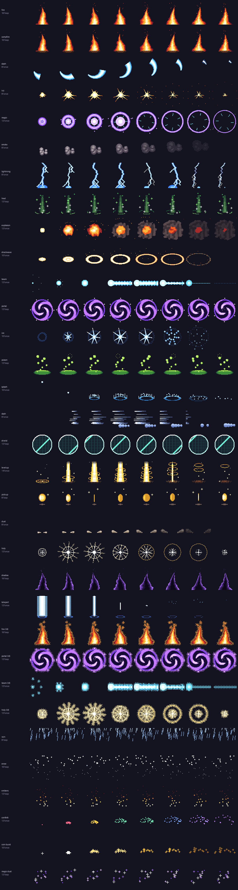

| | | | |
| --- | --- | --- | --- |
| 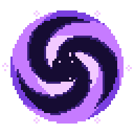 | 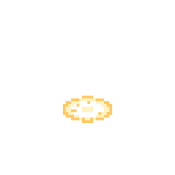 | 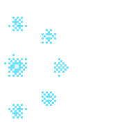 | 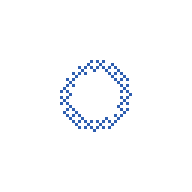 |
| 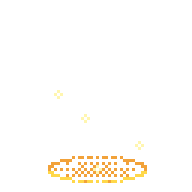 | 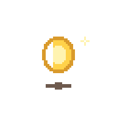 | 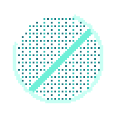 | 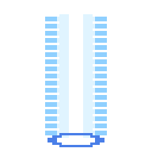 |
| 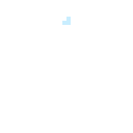 | 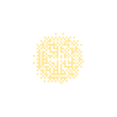 | 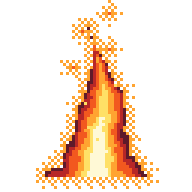 | 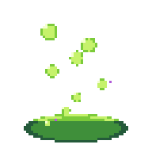 |
| 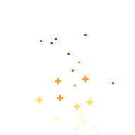 | 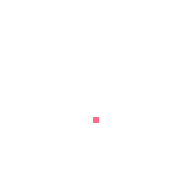 | 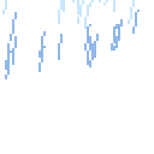 | 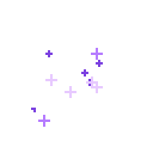 |

**`fx_generate` (23 tür, tek çağrı):**
- **Döngüler:** fire, campfire, shadow, poison, portal, shield, heal, pickup.
- **Tek seferlikler:** slash, hit, magic, smoke, lightning, explosion, shockwave, beam, ice, splash, dash, levelup, dust, holy, teleport.

**`fx_particles`:** rain, snow, embers, confetti, coin burst ve magic dust bu araçla tek çağrıda yapıldı. Ayrıca fire, portal, beam ve holy'nin glow'lu "lit" sürümleri var.

### İkincil hareket: durağan sprite → 8 karelik döngü

| Nefes (karakter) | Squash (slime) | Sallanma (ağaç) | Baca dumanı + pencere ışığı (ev) |
| --- | --- | --- | --- |
| 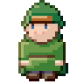 | 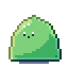 | 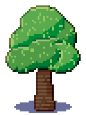 | 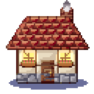 |

### Testler

`Assets/Bench.py` her efekti ve her varlığı kare kare dışa aktarır ve şu eşiklerle değerlendirir:

1. En az 8 kare.
2. Hareket var (kareler arası değişim ≥ %0.5).
3. Durağan varlıkların hareketi tutarlı (değişim ≤ %50; titreme olmaz).
4. Döngüler dikişsiz kapanır (son → ilk kare değişimi, ortalama adımın 2.5 katından ya da %10'dan küçük).
5. Tek seferlik efektler söner (doruk ilk ya da son karede değildir veya son kare doruğun %95'inden küçüktür).
6. 2–24 renk.

| VFX | Calls | Frames | Colors | Type | Motion | Loop seam | Peak frame | End/peak | Result |
|---|---|---|---|---|---|---|---|---|---|
| fire | 1 | 16 | 6 | loop | 0.506 | 0.527 | 9 | 0.87 | ✅ |
| campfire | 1 | 16 | 9 | loop | 0.444 | 0.466 | 9 | 0.88 | ✅ |
| slash | 1 | 8 | 5 | one-shot | 0.852 | 1.0 | 3 | 0.08 | ✅ |
| hit | 1 | 8 | 5 | one-shot | 0.493 | 0.968 | 1 | 0.15 | ✅ |
| magic | 1 | 12 | 5 | one-shot | 0.861 | 1.0 | 5 | 0.29 | ✅ |
| smoke | 1 | 8 | 4 | one-shot | 0.726 | 1.0 | 3 | 0.0 | ✅ |
| lightning | 1 | 8 | 4 | one-shot | 0.528 | 0.982 | 0 | 0.4 | ✅ |
| heal | 1 | 12 | 4 | loop | 0.779 | 0.791 | 10 | 0.99 | ✅ |
| explosion | 1 | 12 | 7 | one-shot | 0.488 | 1.0 | 7 | 0.53 | ✅ |
| shockwave | 1 | 10 | 4 | one-shot | 0.936 | 1.0 | 4 | 0.0 | ✅ |
| beam | 1 | 12 | 4 | one-shot | 0.724 | 1.0 | 6 | 0.02 | ✅ |
| portal | 1 | 12 | 6 | loop | 0.286 | 0.285 | 0 | 1.0 | ✅ |
| ice | 1 | 10 | 5 | one-shot | 0.661 | 1.0 | 4 | 0.0 | ✅ |
| poison | 1 | 12 | 6 | loop | 0.404 | 0.448 | 3 | 0.95 | ✅ |
| splash | 1 | 10 | 4 | one-shot | 0.858 | 1.0 | 5 | 0.12 | ✅ |
| dash | 1 | 8 | 4 | one-shot | 0.85 | 1.0 | 4 | 0.42 | ✅ |
| shield | 1 | 12 | 5 | loop | 0.307 | 0.367 | 1 | 1.0 | ✅ |
| levelup | 1 | 14 | 5 | one-shot | 0.688 | 1.0 | 5 | 0.13 | ✅ |
| pickup | 1 | 8 | 5 | loop | 0.636 | 0.546 | 0 | 0.77 | ✅ |
| dust | 1 | 8 | 4 | one-shot | 0.799 | 1.0 | 3 | 0.0 | ✅ |
| holy | 1 | 12 | 4 | one-shot | 0.722 | 0.832 | 3 | 0.13 | ✅ |
| shadow | 1 | 16 | 5 | loop | 0.456 | 0.483 | 9 | 0.87 | ✅ |
| teleport | 1 | 12 | 4 | one-shot | 0.638 | 1.0 | 0 | 0.0 | ✅ |
| fire (lit) | 1 | 16 | 6 | loop | 0.461 | 0.472 | 9 | 0.89 | ✅ |
| portal (lit) | 1 | 12 | 6 | loop | 0.294 | 0.293 | 1 | 1.0 | ✅ |
| beam (lit) | 1 | 12 | 4 | one-shot | 0.556 | 0.872 | 6 | 0.18 | ✅ |
| holy (lit) | 1 | 12 | 4 | one-shot | 0.46 | 0.673 | 3 | 0.15 | ✅ |
| rain | 1 | 8 | 2 | loop | 0.709 | 0.718 | 6 | 0.96 | ✅ |
| snow | 1 | 16 | 2 | loop | 0.984 | 0.971 | 8 | 0.9 | ✅ |
| embers | 1 | 12 | 5 | loop | 0.968 | 0.967 | 0 | 0.94 | ✅ |
| confetti | 1 | 12 | 5 | one-shot | 0.864 | 1.0 | 10 | 0.46 | ✅ |
| coin burst | 1 | 10 | 4 | one-shot | 0.802 | 1.0 | 4 | 0.89 | ✅ |
| magic dust | 1 | 12 | 4 | loop | 0.672 | 0.838 | 10 | 0.94 | ✅ |

**Testlerin bulduğu ve düzeltilen hata:** Efekt ya da parçacık aracı zaman çizelgesini uzattığında yeni karelerde diğer katmanlar boş kalıyordu; evin voxel sürümü ilk kareden sonra kayboluyordu. Artık yeni kareler diğer katmanları önceki kareden taşır.

Motor testi 23 efekt türünün hepsini kontrol eder:
- en az 8 kare,
- tek seferliklerde uzun tutulan doruk, döngülerde eşit zamanlama,
- glow katmanının Add karışımıyla oluşması.

Ayrıca parçacık döngüsünü ve 8 hareket türünü doğrular: kare 0 orijinal poz olarak kalır ve katmanlar birlikte hareket eder.

---

## 14. Savaşçı karakter: 9 animasyon

**Bram, bronz bekçi** özgün bir tasarımdır. Çelik zırhı ve bronz süsleri, teal tabardı, kırmızı atkısı ve tüylüğü, kılıcı ve yuvarlak kalkanı vardır. Kare boyutu 128×110, karakter yaklaşık 60 piksel boyundadır ve yandan, sağa bakar. Dokuz animasyon tek komut betiğinde birlikte üretilir: `python3 Assets/Sprites.py warrior`, toplam 84 kare.

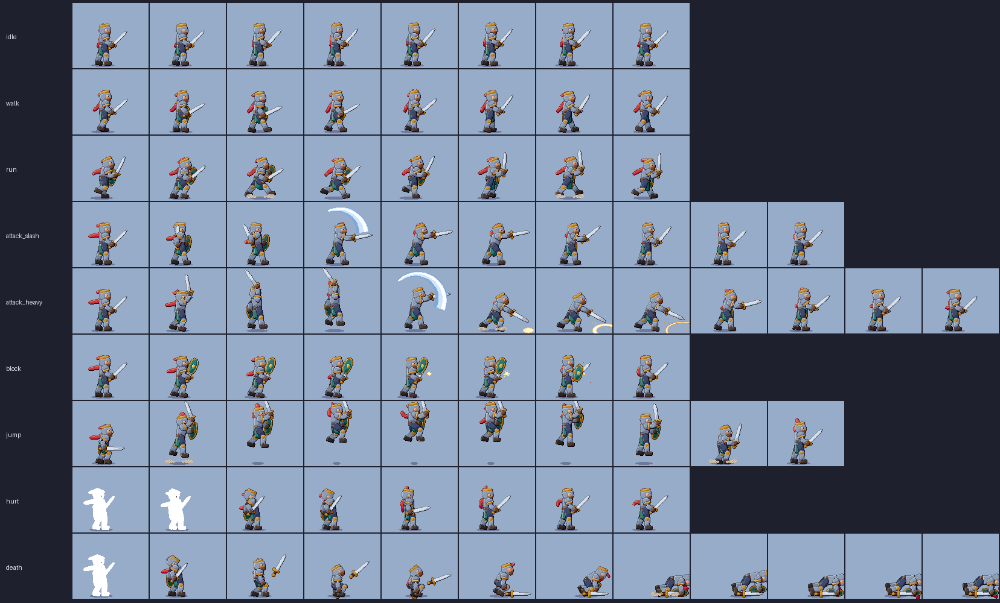

| idle | walk | run |
| --- | --- | --- |
| 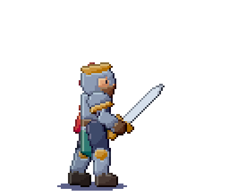 | 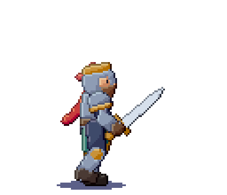 | 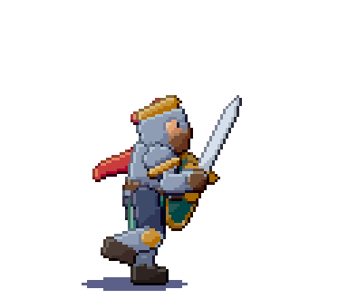 |
| **attack_slash** | **attack_heavy** | **block** |
| 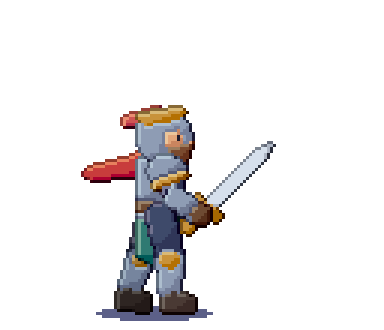 |  | 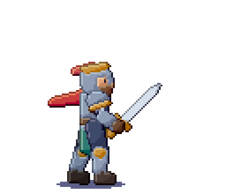 |
| **jump** | **hurt** | **death** |
| 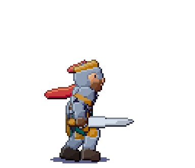 |  |  |

### Nasıl yapılıyor

- **2D iskelet:**
  - Omurga, iki kol, iki bacak, kılıç ve kalkandan oluşur.
  - Her kare, anahtar pozlar arasında smoothstep geçişle hesaplanır. Yürüme ve koşu döngüleri faz fonksiyonlarıyla üretilir.
  - Parçalar kapsül ve poligon olarak motorun `draw_polygon` aracıyla çizilir.
- **Ayak oturtma:** Her karede en alçak ayak ya da diz zemine indirilir. Bu sayede yürüyüşte gövdenin inip kalkması kendiliğinden oluşur.
- **Derinlik:** Uzak kol, bacak ve kalkan bir ton koyu ve daha az doygun renkle çizilir. Blokta kalkan ön katmana geçer.
- **Gecikmeli hareket (follow-through):**
  - Atkı ve tüylük Verlet zinciriyle gövdenin gerisinden gelir; rüzgâr animasyonun hızına göre ayarlanır.
  - Döngülerde fizik iki tur önceden çalıştırılır, böylece kaydedilen tur dikişsiz kapanır.
- **Motorun bitirme adımları:** `auto_shade` (üstteki katmanların gölgesiyle), `outline mode=selout`, gölge katmanı için `layer_set blend=multiply`.
- **Efektler:**
  - Savuruşlarda 3 renkli smear yayı.
  - Ağır vuruşta `fx_generate shockwave`, blokta `fx_generate hit` kıvılcımı.
  - Zıplamada, inişte ve koşuda toz.
  - Hasar ve ölümün ilk karelerinde `gradient_map` ile tam beyaz vuruş flaşı.
- **Zamanlama:**
  - Idle 140–180 ms, walk 100 ms, run 70 ms.
  - Saldırıda hazırlık 80–100 ms, smear karesi 40 ms, darbe karesi 130–140 ms tutulur, toparlanma 90–120 ms.
  - Ölümün son karesi 600 ms bekler.
- **Oyun verisi:**
  - Darbe karelerinde `hitbox_attack_slash` ve `hitbox_attack_heavy` slice'ları, tüm animasyonda `hurtbox`.
  - Her animasyon bir etiket olarak gelir; döngüler sonsuz, tek seferlikler bir kez oynar.
  - Godot SpriteFrames, Aseprite atlas JSON ve `.pxs` dosyaları `Assets/Build/` altına yazılır.

### Test

`Assets/Bench.py` her animasyonu ayrı ayrı değerlendirir:

- en az 8 kare,
- hareket var,
- döngüler dikişsiz kapanır,
- tek seferliklerde doruk ilk ya da son karede değildir,
- tek seferliklerde kare süreleri çeşitlidir.

| Warrior animation| Frames | Type | Total ms | Frame timing (ms) | Motion | Loop seam | Result |
|---|---|---|---|---|---|---|---|
| idle | 8 | loop | 1260 | 180/150/140/160/180/150/140/160 | 0.191 | 0.143 | ✅ |
| walk | 8 | loop | 800 | 100/100/100/100/100/100/100/100 | 0.653 | 0.714 | ✅ |
| run | 8 | loop | 560 | 70/70/70/70/70/70/70/70 | 0.782 | 0.842 | ✅ |
| attack_slash | 10 | one-shot | 950 | 100/90/80/40/130/110/90/90/100/120 | 0.688 | 0.098 | ✅ |
| attack_heavy | 12 | one-shot | 1140 | 100/110/90/70/40/140/100/90/90/90/100/120 | 0.763 | 0.113 | ✅ |
| block | 8 | one-shot | 830 | 100/80/140/140/60/90/100/120 | 0.584 | 0.12 | ✅ |
| jump | 10 | one-shot | 930 | 120/60/70/80/120/100/80/70/110/120 | 0.847 | 0.879 | ✅ |
| hurt | 8 | one-shot | 710 | 60/60/90/100/90/90/100/120 | 0.631 | 0.974 | ✅ |
| death | 12 | one-shot | 1790 | 60/100/100/120/160/90/80/70/90/120/200/600 | 0.728 | 0.999 | ✅ |

---

## 15. Piksel piksel karşılaştırma: Kade ve Bram

Bram'ın kalitesi neden internetteki iyi piksel sanatının gerisinde kalıyor? Bunu görmek için aynı türde özgün bir savaşçıyı, **Kade**'i, 32×32 boyutta elle yaptım:

- Ana pozun her pikseli ve rengi tek tek yazıldı (`Assets/Sprites.py`, `build_kade`).
- 8 karelik idle animasyonu bu pozun elle düzenlenmesiyle oluşturuldu:
  - 1 piksellik nefes ve tabardın 1 piksel esnemesi,
  - tüylük ve atkı ucunun salınımı,
  - göz kırpma,
  - namluda gezen parıltı.

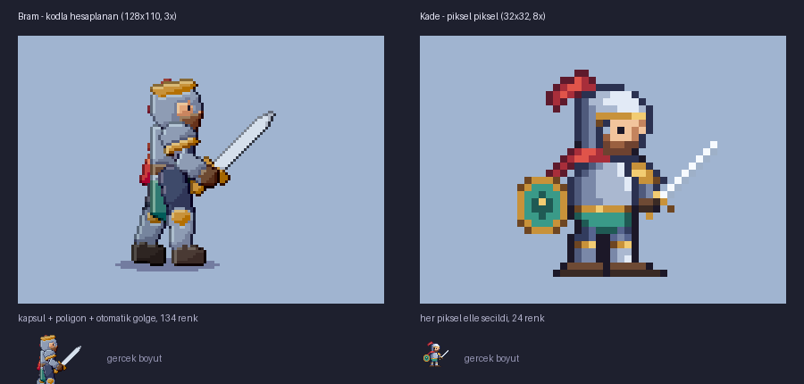 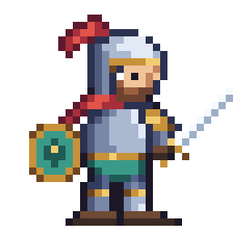

| | Bram (kodla hesaplanan) | Kade (piksel piksel) |
| --- | --- | --- |
| Boyut | 128×110 kare, ~60 px karakter | 32×32 kare, ~29 px karakter |
| Yöntem | Kapsül ve poligon iskelet, otomatik gölge, otomatik outline | Her piksel elle; gölge, ışık tarafı ve outline elle seçildi |
| Animasyondaki toplam renk | 134 | 24 |
| Siluet tanımı | %83 | %79 |
| Idle döngü dikişi | 0.143 | 0.020 |

**Ders:** Okunaklılığı ve "piksel sanatı" hissini, palet disiplini ve her pikselin bilinçli seçimi belirliyor; çözünürlük değil. Otomatik araçlar aynı malzemeye onlarca ara ton üretip görüntüyü bulanıklaştırıyor. Elle çizimde her renk bir amaç taşıyor.

İki yöntemin güçlü yanları farklı:
- **Kodla iskelet (Bram):** Çok sayıda animasyonu ve ara kareyi hızlı üretiyor.
- **Elle çizim (Kade):** Kalite getiriyor ama zaman alıyor.

En iyi sonuç ikisini birleştirmekten gelir: anahtar pozları ve karakteri elle çizmek, ara işleri araçlara bırakmak (ara kareler, varyantlar, efektler, dışa aktarma).

## 16. 128×128 özgün karakter: Sela

Hedef, referans görsellerdeki kaliteye motorun kendi araçlarıyla ulaşmaktı: ~100 px boyunda, 3/4 duruşlu, rampalarla gölgelenmiş, tek koyu dış konturlu bir karakter. Referanslardan yalnızca **teknik** incelendi; Sela özgün bir tasarım (gezgin bir haritacı: mor-siyah at kuyruğu, hardal atkı, lacivert tunik, deri kemer, çanta ve çizmeler).

### Referansın piksel piksel incelemesi

- Görsel aslında **127×127** piksel; 3,35× tam sayı olmayan bir oranla büyütülmüş. "Her piksel aynı boyda değil" görüntüsü buradan geliyor. `image_import grid=auto` bu ızgarayı geri buluyor (testte 3,35× büyütülmüş 20×14 görüntü piksel piksel geri kuruldu).
- 35 renk; her malzemenin 3–5 tonluk kendi rampası var (ten, pelerin, gri üst, saç, deri).
- Dış kontur büyük ölçüde tek bir koyu lacivert (`#060715`). İç ayrımlar konturla değil, koyu tonla yapılıyor.
- Renk kümeleri küçük (medyan 2 piksel). Tek piksel oranı %5: gürültü yok, her nokta bilinçli.

### Motorda eklenenler

| Gereksinim | Araç |
| --- | --- |
| Malzeme rampaları (palet disiplini) | `ramp_set`, `color_ramp name=…`, `.pxs` içinde `RAMP` bloğu |
| Elle gölge: rengi rampasında bir ton kaydırmak | `shade steps=±n` (yeni renk üretmez) |
| Otomatik gölgede palet kilidi | `auto_shade palette_lock` (rampa varsa varsayılan) |
| Farklı boyda pikseller | `layer_set density=2\|4`: katman yarım/çeyrek piksellerle çalışır, render en ince yoğunlukta birleşir |
| Temiz serbest çizgi | `draw_stroke` (L köşe çiftleri otomatik silinir) |
| Referans çalışma | `image_import grid=auto ramps=true reference=true` |

### İlk deneme neden kötüydü?

İlk Sela (v1) renk sayısı ve küme boyutu gibi ikincil ölçütlerde referansla aynı bantta çıktı, ama kötü görünüyordu. Gri tonlamaya çevirince sebep ortaya çıktı: **açık-koyu (değer) aralığı** referansın yarısıydı (39'a karşı 72) ve figür arka plandan ayrışmıyordu. Ayrıca gölgeler formu izlemiyordu (satır satır hesaplanan ışık dikey şeritler bırakıyordu), duruş kazık gibiydi ve eğriler düz çokgen kenarlarından oluşuyordu. Bu eksikleri kapatmak için [bölüm 18](#18-kalite-araçları-eleştirmen-form-ışığı-eğriler-manken)'deki araçlar yazıldı ve Sela onlarla sıfırdan yapıldı.

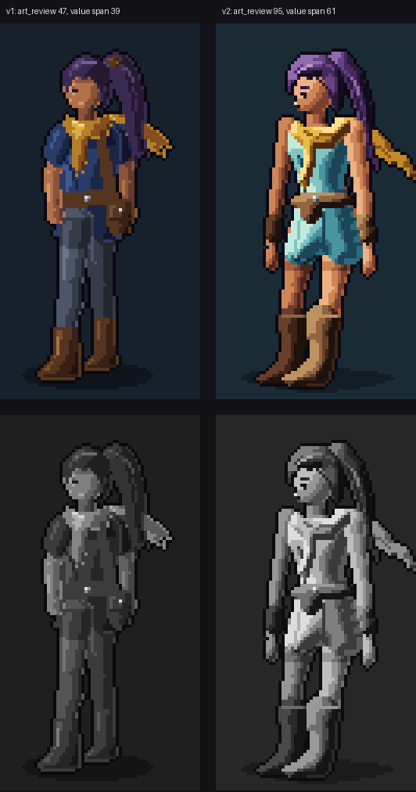

### Süreç (v2)

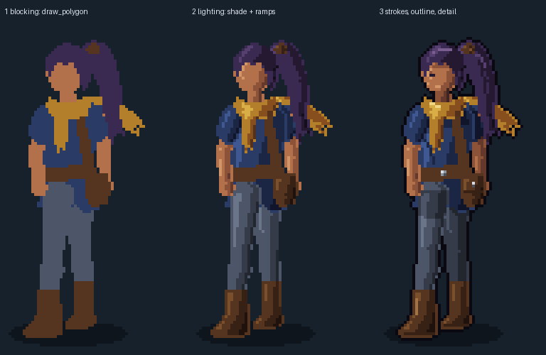

1. **Değer planı:** Her malzeme için koyudan açığa en az ~45 L aralıklı bir rampa (`ramp_set` aralığı raporlar). Açık malzemeler (tunik, ten) rampanın üst yarısından başlar; figür arka plandan açık durur.
2. **Beden:** `draw_figure` 6,6 kafa boyunda, kontrapposto pozunda, sola dönük, 5 katmanlı bir manken çizer ve eklem noktalarını döndürür.
3. **Giysi ve saç:** Eklemlere göre `draw_path` ile dolu eğri şekiller (tunik, kemer, çizmeler, saç kütlesi, atkı) ve incelen fırça darbeleri (at kuyruğu, atkı uçları, bileklikler). Her parça uzuvların arasındaki doğru katmanda.
4. **Işık:** Her malzeme katmanı `shade_form` ile sol üstten tek ışıkla, şişirilmiş form normalleri üzerinden aydınlatılır; uzak parçalar bir ton koyu (`depth -1`).
5. **Çizgiler ve bitiriş:** Kumaş kıvrımları, saç telleri ve çizme ağızları rampa tonlarında `draw_path`; boyunda ve uyluklarda `shade` ile düşen gölge; mankenin silüet kopyasına tek koyu kontur; `fix_banding` ve `antialias`.
6. **Kontrol:** `art_review`.

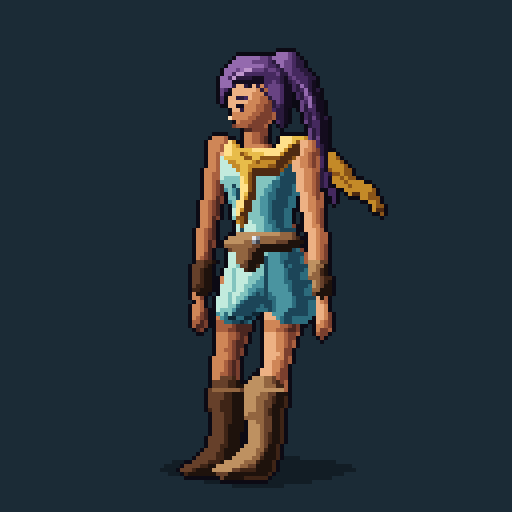 

Üretici: `python3 Assets/Sprites.py sela` (103 motor komutu) → `run_script Assets/Build/sela_showcase.jsonl out/`.

### Ölçüm (`art_review`)

| | Referans (127×127) | Sela v1 | Sela v2 |
| --- | --- | --- | --- |
| Puan | 94 | 47 | **95** |
| Değer aralığı (iç tonlar, p10–p90) | 72 | 39 | **61** |
| Figür–zemin ayrımı (L) | 20 | 12 | **21** |
| Renk | 36 | 33 | 33 |
| Eleştirmenin bulduğu sorunlar | küçük bir pillow bölgesi | düşük değer, zayıf silüet, zeminle karışma, şeritler | yok |

Referansla kalan fark artık değer yapısında değil, el emeği detayda: karın ve diz gibi anatomi kümeleri, yırtık kumaş kenarları, daha zengin kıvrımlar. Bunlar `draw_path` ve `shade` ile tek tek eklenebilir; v2'nin üreticisi bunun iskeletini veriyor.

## 17. Editör arayüzü (Windows 10/11 ve Android)

Arayüz, hazır şablon görünümünden çıkarılıp piksel sanatçısının iş akışına göre yeniden kuruldu. İki platform aynı tasarım dilini kullanıyor: nötr gri koyu tema (renkler tuvalde doğru okunsun diye), tek mavi vurgu rengi, 6 px yuvarlatılmış düz kontroller, vektörle çizilen ikonlar (görsel dosya yok, her ölçekte keskin).


### Masaüstü (Swing, Windows 10/11 · Linux · macOS)

| Alan | İçerik |
| --- | --- |
| Araç rafı (sol) | Kalem `B`, Silgi `E`, **Gölge fırçası** `D`, Doldur `G`, Damlalık `I`, Çizgi `L`, Dikdörtgen `R`, Elips `O`, Seçim `M`, Taşı `V`, El `H`; altında ana/ikincil renk çipleri (`X` takas) |
| Seçenek çubuğu (üst) | Etkin araca göre değişir: fırça boyutu 1–4 (`[` `]`), pixel-perfect, gölge adımı, dolu şekil, bitişik doldurma, X/Y ayna simetrisi; sağda ızgara, onion skin, yakınlaştırma |
| Tuval | Fareyle aynı noktaya kilitli yakınlaştırma (1–96×, piksel dostu adımlar), Boşluk / orta / sağ tuşla kaydırma, şeffaflık damalı zemini, fırça önizleme imleci, simetri kılavuzları, seçimde yürüyen karıncalar. 2×/4× yoğunluklu katmanda ince ızgara görünür ve fırça yarım/çeyrek piksellerle çizer |
| Sağ panel | **Renk** (HSV kare + ton şeridi + HEX), **Rampalar ve renk örnekleri** (malzeme rampaları satır satır; `+ Ramp` ana renkten 5 tonluk rampa üretir), **Katmanlar** (göz, kilit, küçük önizleme, yoğunluk/karışım/opaklık rozetleri; opaklık, karışım modu ve piksel boyutu 1×/2×/4× seçimi), **Ajan etkinliği** |
| Zaman çizelgesi | Kare küçük resimleri, oynat/durdur, kare ekle/çoğalt/sil/taşı, süre (ms), toplam süre ve FPS |
| Menüler | File (yeni sprite boyut ön ayarları, aç, **görsel içe aktar** ve **referans içe aktar**: ızgara kurtarma + rampa çıkarma, kaydet, PNG/GIF/sprite sheet/normal map dışa aktarma), Edit (geri al/yinele, seçim, çevir, döndür), Image (tuval boyutu, kontur türleri, rampa gölgeleme, pixel-perfect temizlik, renk azaltma, palet kütüphanesi), Game, View, Agent |
| Durum çubuğu | Tuval boyutu, etkin katman ve piksel yoğunluğu, kare, rampa sayısı, imleç konumu ve altındaki renk; sağda revizyon ve Agent Mode adresi |

3D sekmesi aynı temayı kullanır; stok Swing bileşenleri (`JComboBox`, `JSlider`, `JCheckBox`, düğmeler) `Theme.styleTree` ile düz stile çevrilir.


### Android (yalnızca platform View'ları)

- **Üst çubuk:** proje adı, geri al / yinele, Katmanlar, 3D, Ajan ve menü (yeni 32/64/128, aç, kaydet, görsel/referans içe aktar, PNG/GIF dışa aktar, kontur, rampa gölgeleme, pixel-perfect temizlik).
- **Seçenek şeridi:** etkin aracın ayarları (boyut 1–4, pixel-perfect, Koyu/Açık gölge adımı, dolu şekil, bitişik doldurma, X/Y ayna) ve görünüm (ızgara, onion, sığdır).
- **Tuval:** tek parmak çizer, iki parmak yakınlaştırır ve kaydırır. Fırça yoğunluklu katmanlarda yarım/çeyrek pikselle çalışır.
- **Alt araç rafı:** 9 vektör ikonlu araç (uzun basış açıklama gösterir) ve renk çipi. Renk çipi; HSV seçici, malzeme rampaları ve renk örneklerinden oluşan alt sayfayı açar.
- **Katman paneli:** sağdan açılır. Satırlarda göz, kilit, önizleme, ad ve rozetler bulunur. Uzun basış özellik penceresini açar (ad, opaklık, karışım modu, piksel boyutu 1×/2×/4×, silme).
- **Kare şeridi:** oynat, kare seçimi, uzun basışla süre ayarı ve silme, ekle ve çoğalt.

Doğrulama: APK `assembleDebug` ile derleniyor, `lintDebug` hata vermiyor (kalan uyarılar eski kodla aynı türden: metin birleştirme, özel View yapıcıları, başlatıcı simge şekli). Bu ortamda Android emülatörü ve KVM bulunmadığından Android arayüzünün ekran görüntüsü alınamadı. Cihazda deneme bekliyor.

## 18. Kalite araçları: eleştirmen, form ışığı, eğriler, manken

Sela v1'in neden kötü göründüğünü araştırırken ortaya çıkan eksikler, güncel pixel art kaynaklarına dayanan altı araçla kapatıldı. Hepsi `Native/Core.rs` içinde `mod artkit` altında; testleri `Native/Tests.rs` içinde `mod artkit_tools`.

| Araç | Yöntem ve kaynak |
| --- | --- |
| `art_review` | Kareyi (ya da tek katmanı) tuval pikselinde render eder ve ölçer. Ölçütler: iç tonların değer aralığı (p10–p90), en açık ton, silüet ve figür–zemin kontrastı, **banding** (Pixel Fixer, TU Delft 2025: aynı renk kümesinde ≥ 2 px'lik yatay/dikey segmentin komşu satır/sütundaki farklı renkli segmentle aynı başlangıç ve bitişe sahip olması; hata Eb = çift sayısı), **pillow** (spritebox lint kuralı: açık yarının ağırlık merkezi şeklin merkeziyle çakışıyor ve açıklık kenardan uzaklıkla artıyor), 1 px şeritler, yetim pikseller, silüet tırtıkları (adımlı bir bölümde iki komşusundan ≥ 2 px uzun/kısa koşu). 0–100 puan, her sorun için düzelten aracı ve sorunları işaretleyen gri tonlu değer haritası PNG'si döndürür (kırmızı banding, sarı şerit, camgöbeği pillow, mor tırtık). |
| `fix_banding` | Pixel Fixer'ın otomatik düzeltmesi: banding çiftindeki segmentin bir ucu kısaltılır, uç pikselin rengi rampadaki ara tondan seçilir (ya da komşunun rengi kopyalanır). Hata düştüğü sürece tekrarlanır. |
| `shade_form` | Pillow'un tersi: yüzey normali üzerinden Lambert ışığı, rampa basamaklarına kuantize. Form türleri küre/elips, incelen kapsül (uzuvlar, çizmeler) ve herhangi bir silüetin "şişirilmiş" yükseklik alanı (pah mesafesi → dairesel profil → yumuşatma → gradyan). Gölge tarafında yansıyan ışık, tek başına kalan ton pikselleri temizlenir, yalnızca rampa renkleri kullanılır. |
| `draw_path` | Noktalardan geçen Catmull-Rom eğrisi, kübik Bézier zinciri ya da çoklu çizgi. 1 px yol pixel-perfect yapılır; aynı yönde adımlayan her bölümde koşu uzunlukları tek yönlü hale getirilir (izotonik regresyon, toplam korunur, en fazla 2 px kayma). Eğri tepesindeki tek piksellik tümsekler düzleştirilir. `width` sayı ya da liste olabilir (incelen fırça); `closed+filled` dolu eğri şekil çizer. |
| `antialias` | Seçici iç AA (Ricky Han'ın segment yöntemi ve Pixel Parmesan kuralları): koyu çizginin açık dolguya yaptığı her iç köşede, koşu uzunluğunun `amount` kadarına ara ton konur. 45° basamaklara ve saydamlığa dokunulmaz. Ton rampadaki ara basamaktan ya da en yakın mevcut renkten seçilir. |
| `draw_figure` | 2–9 kafa boyunda, `stand` / `contrapposto` / `walk` pozunda, 3/4 açıda manken. Uzuvlar incelen kapsüllerden, gövde kapalı eğriden, baş elipsten oluşur. Uzak taraf bir ton koyu; form ışığıyla aydınlatılmış hazır gelir. Eklem noktalarını döndürür. `layers 5` uzak kol, uzak bacak, gövde, yakın bacak ve yakın kolu ayrı katmanlara koyar. |

`ramp_set` artık rampanın açıklık değerlerini döndürür; tonlar koyudan açığa sıralı değilse ya da aralık 40 L'nin altındaysa uyarır.

**Ajan rehberi** (`pixel-studio://guide` kaynağı ve `draw_sprite` / `review_canvas` promptları) bu sırayı öğretir: değer planı → `draw_figure` → `draw_path` → `shade_form` → çizgiler → kontur, `fix_banding`, `antialias` → `art_review` 85 ve üzeri puan verene kadar.

**Arayüz:** Masaüstünde *Image* menüsü (Review art… `Ctrl+Shift+R`, Form light, Fix banding, Selective anti-alias); Android'de taşma menüsü.

**Eleştirmenin kalibrasyonu:** Referans görsel 94, Sela v1 47, Sela v2 95 puan aldı. Değer aralığı eşiği (55), referansın 72'si ile v1'in 39'u arasında. Figür–zemin ve silüet eşikleri, referansı geçirip v1'i yakalayacak şekilde ayarlandı.

Kaynaklar:
- R. Bites, *Pixel Fixer: Semi-Automated Techniques for Correcting Pixel Art*, TU Delft, 2025 — <https://repository.tudelft.nl/record/uuid:b3c91b18-d9e8-48e0-91ce-8afafd2439d8>
- spritebox lint kuralları (pillow, banding) — <https://github.com/jmsansan/spritebox/issues/23>
- Ricky Han, *Pixel Art Algorithm: Selective Anti-Aliasing* — <http://rickyhan.com/jekyll/update/2019/09/01/pixel-art-algorithm-selective-outlining-anti-aliasing.html>
- Pixel Parmesan, *Anti-Aliasing Fundamentals for Pixel Artists* — <https://pixelparmesan.com/anti-aliasing-fundamentals-for-pixel-artists>
- PixNote, *Shading & Lighting* — <https://pixnote.net/en/learn/shading>

## 19. Şelale: 256×256, 30 karelik döngü


256×256 piksel, 30 kare × 70 ms = 2,1 saniyelik **dikişsiz** döngü. Üretici: `python3 Assets/Sprites.py waterfall` → `run_script Assets/Build/waterfall_showcase.jsonl out/`. Çıktılar: GIF (1× ve 2×), 6×5 sprite sheet + JSON (`Assets/Gallery/waterfall_sheet.png`), 30 ayrı PNG kare, `.pxs` proje.

**Sabit sahne (motor araçlarıyla):**
- Gökyüzü dither'lı sert bantlarla çizildi (yumuşak gradyan yok); iki ağaç silüeti var, uzaktaki daha açık.
- Kayalık iki katmandan oluşuyor:
  - Her yanda boşluksuz bir kaya kütlesi.
  - Önünde düzensiz katmanlar halinde açısal bloklar. Her blokta aydınlık üst yüz, orta ön yüz, koyu sağ yüz, alt kısımda gölge, çatlak ve koyu derz var.
  - Şelaleye yakın (ıslak, gölgede) ve alt sıradaki bloklar bir ton koyu.
- Yosun şeritleri, sarkan yosunlar ve ot demetleri `draw_path` + `shade_form` ile çizildi.
- Kayalara kontur, `antialias` ve `fix_banding` uygulandı.

**Hareketli su (her kare hesaplanıp `image_import` ile yerleştirilir).** Bütün hareketlerin periyodu 30'u tam böler:

| Öğe | Yöntem | Periyot |
| --- | --- | --- |
| Düşen su | 2–4 px'lik iplikler, her birinin dikey tonu düşük frekanslı periyodik gürültü; silindir gibi soldan aydınlatılmış gövde; aşağıda hızlanma hissi için uzayan şeritler; 4 px/kare akış | 120 px = 30 kare |
| Tepe kenarı | En açık tonlarda kıvrılan şerit | 10 kare |
| Nehir yüzeyi | Kenara doğru akan çizgiler | 15 kare |
| Çarpma köpüğü | Zamanda periyodik iki boyutlu dalga alanı, üç tona eşiklenmiş | 30 kare |
| Damlalar | 46 balistik parçacık, ömürleri 10/15/30 kare | 10–30 kare |
| Havuz | Genişleyen kesik halkalar, şelalenin titreşen yansıması, pırıltılar | 15 / 10 / 30 kare |
| Sis | Bayer 4×4 dither'lı, yavaşça kıpırdayan bulut (yarı saydam piksel yerine) | 30 kare |

**Doğrulama:** 30. kare 0. kareyle piksel piksel aynı (hesaplanarak denetlendi). Son kareden ilk kareye geçişte değişen piksel sayısı (4159), normal kare geçişleriyle (4012–4357) aynı aralıkta. Yani döngüde atlama yok. `art_review` puanı 86. Kalan tek uyarı, sahnenin açık gökyüzü kenarını arka plan saydığı için değer aralığını düşük ölçmesi.

## 20. Korku aurası: 256×256, 30 karelik döngü

 

256×256, 30 kare × 60 ms = 1,8 saniyelik dikişsiz döngü. Üretici: `python3 Assets/Sprites.py aura` → `run_script Assets/Build/aura_showcase.jsonl out/`.

**Çıktılar:**
- Figürlü önizleme GIF'i.
- Oyun için yalnızca auradan oluşan saydam GIF, 6×5 sprite sheet + JSON (`Assets/Gallery/aura_sheet.png`) ve 30 PNG kare.
- `.pxs` proje dosyası.

Aura katmanları yarı saydam piksel içermez; her oyun motorunda keskin kalır.

**Figür (önizleme):** Boynuzlu, kukuletalı, yırtık pelerinli bir silüet. Gövde `draw_figure` ile, pelerin, kukuleta ve boynuzlar `draw_path` ile çizildi; pelerin `shade_form` ile gölgelendi. Altta duran kırmızı bir kopyaya kontur verildiği için yalnızca **dış** silüet parlıyor; içeride eklem çizgisi yok. Kukuletanın içi boşluk gibi siyah, iki yanan göz var.

**Aura öğeleri** (hepsinin periyodu 30'u tam böler):

| Öğe | Yöntem |
| --- | --- |
| Kara alev | Ters ateş: kenar kan kırmızısı, iç boşluk siyahı. Dikeyde uzun, yatayda dar periyodik gürültü sayesinde alev dilleri yükseldikçe kopar. 30 karede bir "nefes alır". |
| Hale | Silüetin dışındaki 12 piksellik mesafe alanında yukarı akan titrek ateş, gövdeyi sarar. |
| Rün çemberi | İki elips ve 3 şekilden oluşan 12 rün. Döngüde 3 rün aralığı döner; açılar tamsayı adımdan hesaplanır. |
| Ruhlar | Çığlık atan, çenesi açılıp kapanan kafatasları yükselir ve Bayer dither ile dağılarak kaybolur. |
| Gözler | Alevlerin içinde açılıp kapanan kırmızı göz çiftleri. |
| Şimşek | İki vuruşta ellerden zemine dallanan kızıl şimşek. |
| Kıvılcım ve pençeler | 54 yükselen kıvılcım; zeminde nefesle uzayıp kısalan gölge pençeleri. |

Alev ve hale tek piksellik benekleri çoğunluk filtresiyle temizlenir.

**Döngü doğrulaması:** Hareket fonksiyonları 30 kare kaydırıldığında piksel piksel aynı sonucu veriyor. Bunun için iki önlem alındı: faz periyoda indirgeniyor, kare indeksi 30'a göre normalize ediliyor (`sin(2π)` ≠ 0 kaymasına karşı). Son kareden ilk kareye geçişte değişen piksel sayısı (12876), normal kare geçişleri (11493–13900) aralığında.

## 21. Hibrit hat: AI konsept görselinden gerçek pixel art'a

Motor kendi başına "güzel karakter" icat etmekte zayıf kaldığı için, yaratıcı taslak bir görsel modelinden gelir. Motor bu taslağı **gerçek, düzenlenebilir pixel art'a** çevirir; geri kalanını (yönler, animasyon, temizlik, dışa aktarma) kendi araçlarıyla yapar.


*Bir görsel modelinin ürettiği 2400×1792 JPEG'den motorun çıkardığı 80×110 piksellik sprite (×4 gösterim).*

### Akış

1. **Prompt:** MCP `concept_prompt` promptu (ya da editördeki şablon) görsel modeline uygun bir prompt üretir:
   - düz tek renk (#FF00FF) arka plan,
   - tutarlı piksel ızgarası,
   - sol üstten tek ışık,
   - yaklaşık 32 renk,
   - ayakları görünen tam boy.
2. **Görsel modeli:** Kullanıcı görseli üretir (ChatGPT/OpenAI, Gemini, Midjourney…) ve editöre ya da ajana verir.
3. **`concept_import`:**
   - **Biçim:** PNG ya da baseline JPEG doğrudan girer (motorda saf Rust JPEG çözücü var). Masaüstü diğer biçimleri ImageIO ile, Android BitmapFactory ile (WebP, HEIF dahil) PNG'ye çevirir.
   - **Izgara:** Kenar profilinin Fourier tepkisiyle bulunur. 12 gri seviyenin altındaki farklar sıkıştırma gürültüsü sayılır. Harmonik tuzağına karşı tepe noktasının 2, 3 ve 4 katları da denenir: gerçek hücre güçlü yanıt verir, gerçek hücrenin katlarında yanıt söner.
   - **Örnekleme:** Her hücrenin ortasından baskın renk alınır; JPEG gürültüsüne ve bulanıklığa dayanıklıdır.
   - **Temizlik:**
     - Kenarın baskın rengi algısal toleransla silinir.
     - Komşusunun sadece sıkıştırma salınımı olan tek pikseller birleştirilir; gerçek detaylar korunur.
     - Palet azaltılır ve renk tonu ailelerinden rampalar çıkarılır.
     - Sprite içeriğe göre kırpılır, tuval sprite'a uydurulur.
4. **Devamı:** Diğer 7 yön (`turnaround_prompt` + aynalama), animasyon, `art_review`, dışa aktarma.

### Ölçüm

İlk konsept (2400×1792 baseline JPEG, macenta arka plan):

| Ölçüt | Sonuç |
| --- | --- |
| Bulunan hücre | 15 px (güven 0,54) |
| Sprite | 80×110 |
| Renk | 40 |
| Silinen arka plan | 15.284 piksel |
| Süre | ~0,6 s |

Görselin ölçeklenmiş hali ile motorun çıktısı yan yana neredeyse aynı.

Testler (`mod artkit_tools`):
- **JPEG:** 4:2:0 renk alt örneklemeli dört renkli bir JPEG doğru çözülüyor.
- **Konsept:** 7× büyütülmüş, gürültülü, q85 JPEG bir sprite'ın ızgarası (7,0), boyutu (8×9), göz ve ten pikselleri ile silinen arka planı doğru geri kuruluyor.

**Editör:** Masaüstü *File → Import AI concept…* (`Ctrl+Shift+J`); Android taşma menüsü *Import AI concept…*. Ajanlar için `concept_import` aracı ve `concept_prompt` / `turnaround_prompt` MCP promptları.

**Sınırlar:** Progressive JPEG motor içinde henüz çözülmüyor; editörler bu durumda görseli PNG'ye çevirip yeniden deniyor. Görsel modellerini API ile doğrudan çağırma [bölüm 22](#22-sıfırdan-çizim-neden-zayıf-ve-çözümü-görsel-apisi-küçük-taslak-skill)'de.

## 22. Sıfırdan çizim neden zayıf ve çözümü: görsel API'si, küçük taslak, skill

### Neden sıfırdan zayıf, konseptten iyi?

Aynı motor, bir görsel modelinin konseptinden 0,6 saniyede birebir bir sprite çıkardı ([bölüm 21](#21-hibrit-hat-ai-konsept-görselinden-gerçek-pixel-arta)). Ajanın sıfırdan çizdiği karakterler ise eleştirmenden 47/100 aldı. Fark motordan değil, işin türünden geliyor:

| | Konseptten (`concept_import`) | Sıfırdan (ajan koordinat yazar) |
| --- | --- | --- |
| Tasarım kararlarını kim veriyor | Milyonlarca görselle eğitilmiş görsel modeli | Dil modeli, tek tek koordinatlarla |
| Ajanın görevi | Ölçmek: ızgara, renk, arka plan | Binlerce pikseli hayal edip yerleştirmek |
| Geri bildirim | Her adım sayısal olarak doğrulanabilir | Az sayıda, düşük çözünürlüklü bakış |
| Hata birikimi | Yok, her hücre bağımsız | Erken oran ve poz hataları sona kadar taşınır |

Araştırmalar da aynı şeyi gösteriyor:
- **SVGenius (2025):** Dil modellerinin kodla çizdiği grafiklerin kalitesi karmaşıklık arttıkça hızla düşüyor.
- **Render-in-the-Loop (arXiv 2604.20730), RefineSVG (arXiv 2607.27699), Generator/Critic (arXiv 2603.09312):** Her adımda çıktıyı görüp düzeltmek açığı kısmen kapatıyor, ama tamamen kapatmıyor.
- **PixelBench (arXiv 2611.02540):** Pixel art'ta da aynı eğilim var.

Sektörün çözümü de bu yönde: pixel art'a özel görsel modelleri (PixelLab, Retro Diffusion) ve ardından temizlik.

Bir sınır daha var: eleştirmen (`art_review`) kusurları ölçer (banding, yetim piksel, değer aralığı), güzelliği ölçemez. Yüksek puan "kusursuz" demektir, "çekici" demek değildir.

### Çözüm

1. **Görsel modeli API'si (`generate_image`):**
   - Gateway OpenAI uyumlu (`/v1/images/generations`) ve Gemini (`:generateContent`, `responseModalities: IMAGE`) uç noktalarını doğrudan çağırır.
   - `kind=concept`: tek görünüş üretir ve `concept_import` ile içe aktarır.
   - `kind=turnaround`: mevcut tuvali referans olarak gönderir. Gelen 8 yönlü sayfayı içe aktarır ve `split_sheet` ile S…SW karelerine böler.
   - Ham görsel Exports klasörüne kaydedilir; tekrar içe aktarmak için yeni bir ücretli çağrı gerekmez.
   - Araç `DESTRUCTIVE` erişimli olduğu için her çağrı ücretlidir ve insan onayı ister.
   - `image_api_status` sağlayıcıyı, modeli ve anahtarın olup olmadığını gösterir; anahtarın kendisini asla göstermez.
2. **Ayarlar:**
   - Ortam değişkenleri `PIXEL_STUDIO_IMAGE_PROVIDER/_MODEL/_KEY/_URL/_SIZE` ya da çalışma alanındaki `image_api.json` (yalnızca sahibi okuyabilir).
   - Masaüstü: *File → AI image model* (konsept üret `Ctrl+Shift+G`, turnaround üret, prompt kopyala, ayarlar). Android: taşma menüsü.
   - Model adları sık değiştiği için (birçoğu 2026'da emekliye ayrıldı) kodda sabit model yok; model ayarlardan seçilir.
3. **Görsel modeli yoksa yedek yöntem: önce küçük taslak.** Sanatçıların yöntemi:
   - Tasarım 32–48 px'te `draw_ascii` ile yapılır. Piksel sayısı az olduğu için her birine tek tek karar verilebilir ve tek bakış bütün tasarımı kapsar.
   - Sonra `upscale` uygulanır (EPX/Scale2x: merdivenleri yuvarlar, blok blok büyütmez).
   - Son olarak tam boyutta `shade_form`, `draw_path`, `fix_banding`, `antialias` ve `art_review` ile incelenir.
   - Yakın inceleme için `canvas_snapshot` artık `x, y, width, height` ile bölge kırpabiliyor (otomatik büyütme, 512 px'e kadar).
4. **`split_sheet`:**
   - Bir sayfadaki sprite'ları boş sütunlardan ayırır ve tozları atar.
   - Her birini ortalar ve hepsini aynı zemin çizgisine oturtur.
   - Sonuç kare (`frames`) ya da katman (`layers`) olarak alınır; isimler verilebilir.
5. **`concept_import` düzeltmesi (bu turda bulundu):**
   - Saydam PNG'ler artık saydam kalıyor. Önceden saydam pikseller siyah ve opak oluyordu; PixelLab gibi saydam çıktı veren modeller bundan etkileniyordu.
   - Arka plan kenarlardan taşma dolgusuyla siliniyor.
   - Kapalı ceplerdeki arka plan rengi (kol ile gövde arası) yalnızca doygun anahtar renklerde (macenta, yeşil) siliniyor. Siyah ya da beyaz arka plan artık konturları ve parlak noktaları yemiyor.
   - Galerideki ranger'ın doğrudan içe aktarımı ile turnaround sayfasından bölünmüş hali artık piksel piksel aynı (fark 0).

### Skill: `pixel-art-character`

`.claude/skills/pixel-art-character/` bütün hattı yöneten bir ajan rehberi; Claude Code bu depoda otomatik bulur.

| Dosya | İçerik |
| --- | --- |
| `SKILL.md` | Neden hibrit; yol seçimi (API → prompt → sıfırdan); içe aktarma, turnaround, renk birleştirme, animasyon, kalite çıtası, dışa aktarma |
| `references/prompts.md` | Konsept, 8 yönlü turnaround, animasyon anahtar pozları, eşya/portre promptları, negatif prompt, model notları, yeniden üretme listesi |
| `references/pipeline.md` | Her aşamanın tam araç çağrıları ve argümanları; aynalama sonrası düzeltme listesi; yürüme ve saldırı zamanlamaları |
| `references/quality-bar.md` | Sayısal eşikler (puan ≥ 85, değer aralığı ≥ 55, banding, yetim piksel) ve her seferinde yapılan göz testi |
| `references/from-scratch.md` | Küçük taslak → EPX → inceleme yöntemi ve denenmiş bir `draw_ascii` örneği |
| `references/api-setup.md` | Sağlayıcılar, ortam değişkenleri, anahtar güvenliği, hata kodları |
| `scripts/pipeline.py` | Kabuktan tek komut: `import` (içe aktar → eleştir → PNG/×4/.pxs) ve `turnaround --palette-from` (içe aktar → böl → konsept paletine eşle → yön başına PNG + spritesheet) |

### Testler

- **Rust (`mod artkit_tools`):**
  - EPX merdiven köşelerini yumuşatıyor.
  - Sayfa bölme: üç sprite ve bir toz, üç kare, ortak zemin.
  - Bölgesel snapshot.
  - Saydam / beyaz / macenta arka planlı içe aktarma: saydamlık korunuyor, beyaz iç parlaklık kalıyor, macenta cep siliniyor.
- **Gateway (`ImageApiTest`, taklit HTTP sunucusu):**
  - OpenAI uyumlu üretim: yol, Bearer başlığı, model, prompt; sonuç 8 px hücreli 10×16 sprite; anahtar yanıtta yok.
  - Gemini: yol, `x-goog-api-key`, `responseModalities`; onay reddedilince hiç istek gitmiyor.
  - Ortam değişkenleri dosyadaki ayarları eziyor.
- **Betik:** `pipeline.py import` ve `turnaround` galerideki ranger ve ondan yapılmış üç yönlü bir sayfayla çalıştırıldı.

**Sınırlar:**
- Yürüme ve koşu döngülerinde bacaklar her karede yeniden çizilmeli. En iyi sonuç görsel modelinden gelen anahtar pozlarla alınıyor; modelsiz yöntem çalışıyor ama daha fazla deneme istiyor.
- Aynalanan yönlerde asimetrik detaylar (silah eli, saç ayrımı) ve ışık yönü elle düzeltilmeli.
- Gerçek ücretli API çağrıları bu ortamda yapılmadı; istek ve yanıt biçimleri taklit sunucu ve sağlayıcı belgeleriyle doğrulandı.

## 23. Fener Bekçisi: sıfırdan en detaylı karakter + 8 karelik idle

 

*Özgün tasarım; görsel modeli kullanılmadan, yalnızca motor komutlarıyla çizildi. Kaynak: `python3 Assets/Sprites.py warden` (1.363 komut, 8 kare).*

Kancalı bir asanın ucunda fener taşıyan bir gezgin. Kıyafeti şöyle:
- Pirinç işlemeli turkuaz kukuleta ve pelerin.
- Sivri uçlu kısa omuz pelerini.
- Bağcıklı deri yelek.
- Alev amblemli kırmızı tabard.
- Anahtar halkası, kemer çantası, kat kat çizmeler ve asada kurdele.

### Yöntem ([bölüm 22](#22-sıfırdan-çizim-neden-zayıf-ve-çözümü-görsel-apisi-küçük-taslak-skill)'deki yedek yöntemin uygulanışı)

1. **Değer planı ve rampalar:** Her malzeme için koyudan açığa ton kaydırmalı bir rampa hazırlandı (pelerin 7 ton, diğerleri 5–6 ton).
2. **Bloklama:** Her parça kendi katmanında düz bir şekil (`draw_path`): pelerin, astar, bacaklar, çizmeler, yelek, tunik, tabard, omuz peleri, kollar, kukuleta. Her şekil `Sil` katmanına da çizilir; sonda tek bir koyu dış kontur oluşur.
3. **Piksel piksel çizilen bölgeler (`draw_ascii`):** Ayrıntının yoğun olduğu yerler: yüz (17×20, göz kapağı, iris, kaş, burun, ağız, allık), perçem, eller ve fener (3 alev durumu). En büyük kalite artışı buradan geldi.
4. **Işık:**
   - `shade_form` tek ışıkla her parçaya hacim veriyor.
   - Elle yerleştirilen gölge şekilleri: kukuleta ve saçın alna düşen gölgesi, kemerin tuniğe düşen gölgesi, pelerin ve omuz pelerini kıvrımları, diz ve bilek kırışıkları.
   - Fenerden gelen sıcak kenar ışığı sol kenarlarda; arka plandan ayırmak için soğuk bir kenar ışığı sağ kenarlarda.
5. **Bitiş:**
   - Parçalar arasında seçici iç konturlar ve tek koyu dış kontur.
   - Palet rampalara kilitlendi (`quantize`): 88 renkten 56'ya.
6. **Idle animasyonu:**
   - Her kare aynı parametrik tariften yeniden çiziliyor: nefeste üst gövde 1 px iniyor, pelerin eteği dalgalanıyor, kurdele uçuşuyor, 5. karede göz kırpılıyor, fener alevi ve hale titriyor.
   - Her kare kendi ışığını ve konturunu aldığı için katman kaydırmadan kaynaklanan dikiş oluşmuyor.

### Yineleme


| Sürüm | Değişiklik | `art_review` | Renk |
| --- | --- | --- | --- |
| v1 | Bloklama + form ışığı; yüz boş, gölgeler yumuşak | 87 | 76 |
| v2 | Elle çizilmiş yüz ve fener, pirinç işlemeler, dış kontur, gölge şekilleri | 87 | 84 |
| v3 | Genç yüz, tabard, çizme konçları, kenar ışığı | 81 | 88 |
| v4 | Parmaklı eller, ince boyun, rampalara kilitli palet | 88 | 56 |
| v5–v8 | Yelek bağcığı, kıvrımlar, asa bantları ve kurdele, anahtar halkası, derin gölge, soğuk kenar ışığı, zemin gölgesi | 89 | 56 |
| Son | Bacaklar +5 px, daha geniş duruş, pelerin eteğinde pirinç işleme, 8 karelik idle | 89 | 56 |

Her adımda 4× tam görüntü ve 8× yakın kırpmalar (yüz, gövde, çizmeler) incelendi. Galerideki AI konseptli ranger ile yan yana karşılaştırıldı. Bu karşılaştırma bacakların kısa ve duruşun dar olduğunu gösterdi; son sürümde düzeltildi.

**Sınırlar:**
- Kafa stilize olarak büyük (yaklaşık 4,5 baş boy).
- Poz bir bekleme duruşu; yürüme ve saldırı için yeni anahtar pozlar gerekiyor.
- Eleştirmenin değer aralığı 48 (hedef 55). Gölgede kalan pelerin bilinçli olarak orta-koyu tutuldu; fener ve saç en açık noktalar.
