# Pixel Studio

**com.pixel.studio** — insanların ve yapay zekâ ajanlarının aynı piksel çalışma alanında, gerçek piksel araçlarıyla birlikte çizim ve animasyon yaptığı bağımsız sanat platformu.

Pixel Studio'nun kendi yapay zekâsı yoktur. Zekâyı dışarıdan gelen ajan sağlar (Claude Code, Antigravity, ChatGPT, Gemini ya da kendi ajanınız). Pixel Studio ise onun **elleri, gözleri ve çalışma masası** olur: `set_pixel`, `draw_line`, `frame_duplicate` gibi gerçek editör araçları, revizyon kontrolü, geri alma ve izin sistemiyle birlikte.

```
AI / İnsan ──► MCP (/mcp) · REST (/api/v1) · Function calling · STDIO
                         │
              Kotlin (Android Views / Windows Swing) ── JNI ──► Rust pixcore
                                                               piksel · katman · kare · geçmiş
                                                               render · PNG/GIF · .pxs
```

## Durum

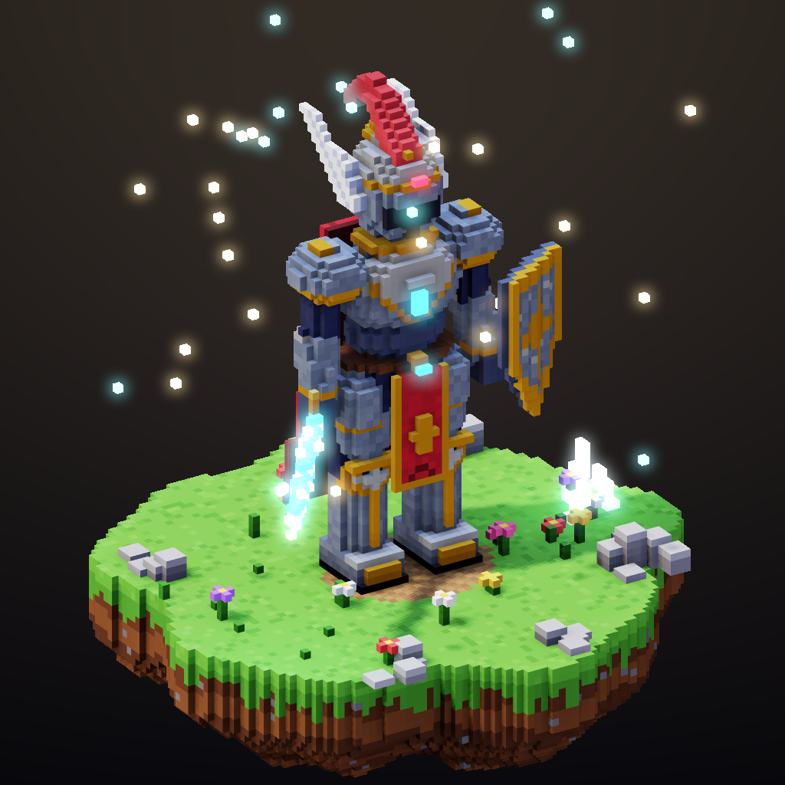

| Parça | Durum | Doğrulama |
| --- | --- | --- |
| Rust çekirdek (`core-rust`, yalnızca `std`, Rust 1.100) | ✅ | 68 test, `clippy -D warnings` temiz |
| 2D: **gerçek renk** (RGBA8), 16×16 COW tile, katman, dinamik kare, etiket, onion skin | ✅ | birim ve motor testleri |
| **3D Voxel motoru**: 512³ modeller, şekil araçları, PBR materyaller + 7 harita, PNG/prosedürel dokular | ✅ | birim ve motor testleri |
| Rig, keyframe animasyon, prosedürel walk/run/idle, kare kare VFX sekansları | ✅ | motor testleri + varlık betikleri |
| Render: köşe AO, gölge haritası, nokta ışıklar, bloom, G-buffer pass'leri, outline, 8 yönlü sprite bake | ✅ | render testleri, görsel kontrol |
| Revizyon kontrolü, idempotency, atomik transaction, undo/redo | ✅ | motor testleri |
| PNG/GIF/sprite sheet export, PNG import (kendi zlib/LZW/inflate kodumuz) | ✅ | PIL ve JDK ImageIO ile doğrulandı |
| `.pxs` v3 (2D + 3D + rig + animasyon + materyal + doku + slice + tileset + tilemap, CRC-32) | ✅ | gidiş-dönüş testleri |
| JNI köprüsü, Rust ↔ JVM golden render | ✅ | `tests/golden` |
| **2D piksel art araçları**: ASCII çizim, selective outline, ton kaydırmalı rampa, palet kütüphanesi (12 Lospec paleti), quantize + Bayer dither, normal map | ✅ | birim + gateway testleri |
| **Oyun üretimi**: katman karışım modları, slice (hitbox/pivot), 47'lik blob autotile üreticisi, tilemap + ASCII arazi, normal map'li 2D ışık önizlemesi, RotSprite, palet takası, MaxRects atlas, Aseprite JSON / Godot SpriteFrames / Tiled TMJ dışa aktarma | ✅ | birim + motor + gateway testleri |
| **Karakter bitirme**: `auto_shade` (şekle uyan cel gölge + katmanlar arası gölge + rim ışığı), sel-out outline, gradient map, parıltı damgası, pixel-perfect temizlik; 8 pastel chibi (64×80) + 2 animasyonlu portre (128×128) | ✅ | birim + motor + gateway testleri |
| **2D kadro** (10 özgün anime-chibi karakter, idle + walk) ve **2D VFX paketi** (8 efekt) | ✅ | motordan `draw_ascii` ile üretildi |
| MCP (eski + 2026-07-28), REST, function calling: **108 araç** | ✅ | 13 uçtan uca gateway testi |
| Masaüstü editör: **2D Pixel + 3D Voxel** sekmeleri | ✅ | derleniyor; Xvfb altında çalıştırıldı |
| Android: 2D editör + 3D görüntüleyici + Agent Mode | 🟡 | APK derleniyor, lint temiz; **cihazda henüz çalıştırılmadı** |
| LAN + TLS eşleştirme | ⏳ | şimdilik `adb forward` (USB) |

Ayrıntılar: [docs/VOXEL.md](docs/VOXEL.md) (3D), [docs/PIXELART.md](docs/PIXELART.md) (2D piksel art, kadro, 2D VFX) ve [docs/GAMEDEV.md](docs/GAMEDEV.md) (oyun üretimi).

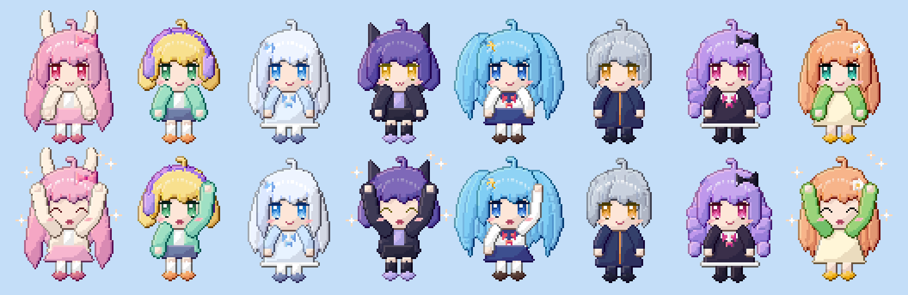

| Portre: yağmur | Portre: yıldızlı büyücü | Chibi |
| --- | --- | --- |
|  |  |   |

| Oyun sahnesi: autotile + gece ışığı (`render_lit`) | Gündüz, katman karışımları |
| --- | --- |
| 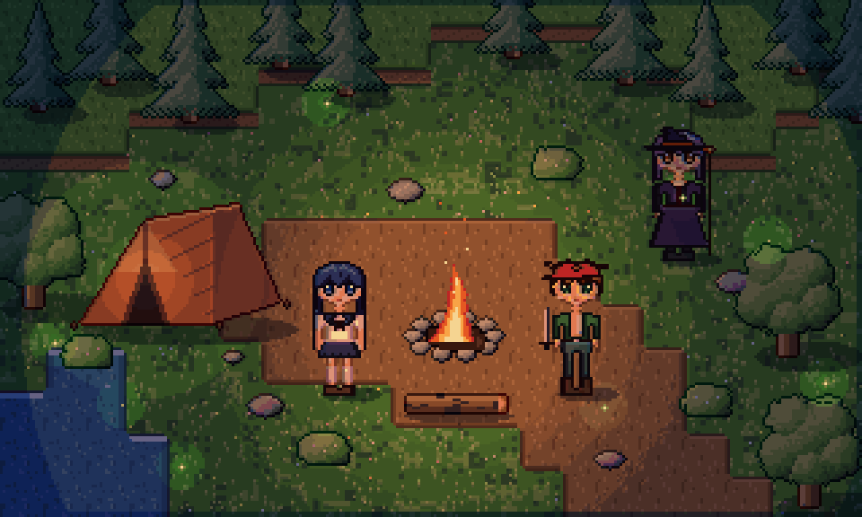 | 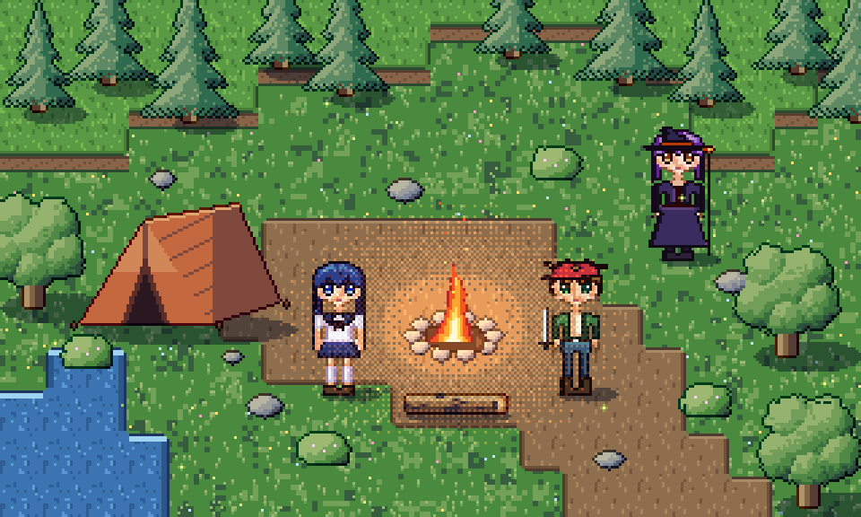 |

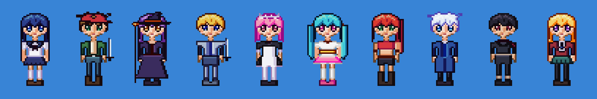

| 2D karakterler | 2D VFX |
| --- | --- |
| 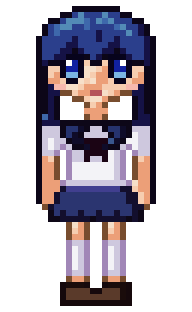 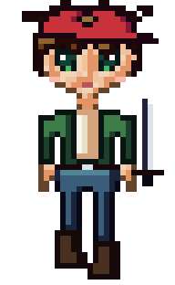 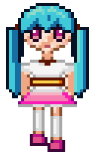 | 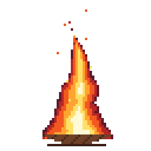 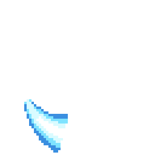  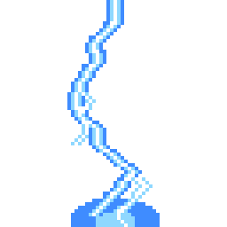 |

| Şövalye 8 yön yürüyüş (256 px) | VFX (16 kare) |
| --- | --- |
| 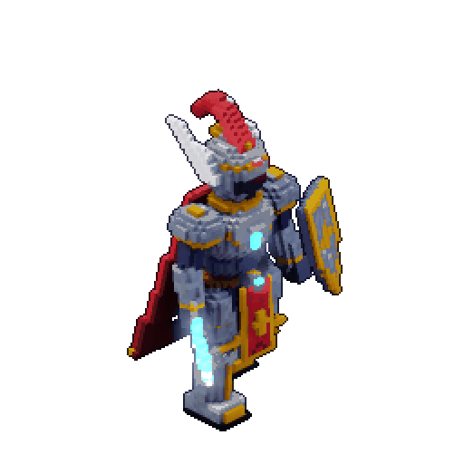 | 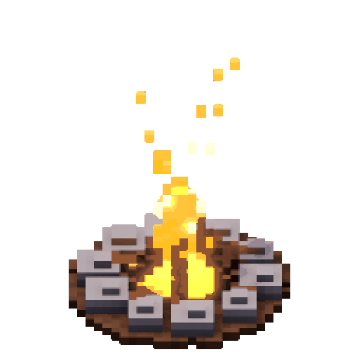 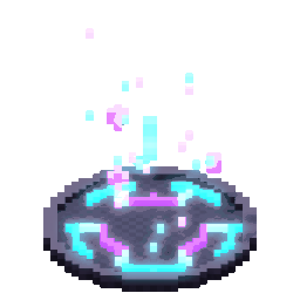 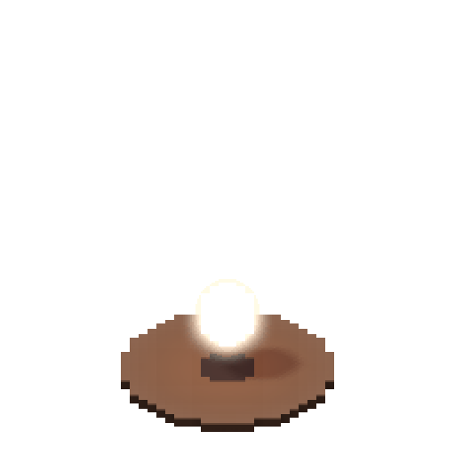 |

## Hızlı başlangıç

```bash
# Rust testleri
cd core-rust && cargo test

# Tüm Kotlin testleri (Rust çekirdeğini otomatik derler)
./gradlew test

# Masaüstü editörü (Linux/macOS/Windows)
./gradlew :app-kotlin:windows:run

# Arayüzsüz sunucu (CI veya sunucu kullanımı)
./gradlew :agent-gateway:run --args="--size 64x64 --workspace ./workspace"
```

Uygulama açıldığında **Agent → Connect an agent…** penceresi bağlantı komutlarını ve token'ı gösterir:

```bash
claude mcp add --transport http pixel-studio http://127.0.0.1:38471/mcp --header "Authorization: Bearer <TOKEN>"
```

Sonra ajana şunu söyleyin: *"Pixel Studio'yu kullan. 64x64 bir samuray çiz, ardından 24 karelik koşu animasyonu yap. Her kareyi kendin çiz ve tutarlılığı kontrol et."*

## Dokümanlar

- [docs/ARCHITECTURE.md](docs/ARCHITECTURE.md): katmanlar, veri modeli, eşzamanlılık
- [docs/VOXEL.md](docs/VOXEL.md): 3D voksel, PBR, rig, animasyon, VFX
- [docs/PIXELART.md](docs/PIXELART.md): 2D piksel art araçları, kadro, 2D VFX
- [docs/GAMEDEV.md](docs/GAMEDEV.md): tileset/autotile, tilemap, 2D ışık, slice, Godot/Tiled/Aseprite dışa aktarma
- [docs/MCP.md](docs/MCP.md): MCP bağlantısı, araçlar, kaynaklar, promptlar, protokol sürümleri
- [docs/API.md](docs/API.md): REST API ve function calling
- [docs/PROJECT-FORMAT.md](docs/PROJECT-FORMAT.md): `.pxs` dosya formatı
- [docs/BUILD.md](docs/BUILD.md): araç zinciri, Android/Windows derleme ve paketleme

## Bağımlılık politikası

Çalışma zamanında üçüncü taraf kütüphane yoktur. Rust tarafı yalnızca `std` kullanır. Kotlin tarafında tek çalışma zamanı bağımlılığı dilin kendi `kotlin-stdlib`'idir; UI için platform API'leri kullanılır (Android `View`/`Canvas`, JDK Swing). Derleme araçları (Gradle, AGP, NDK, JDK) ve yalnızca test kapsamındaki `kotlin-test` bu politikanın dışındadır.
