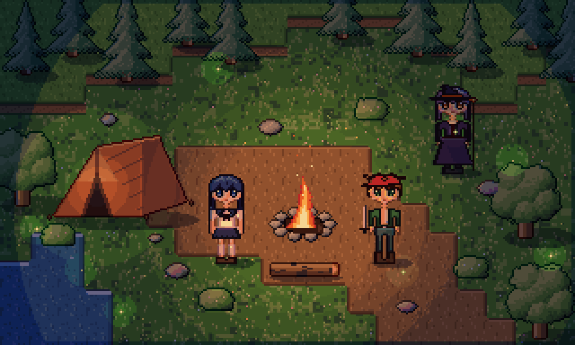
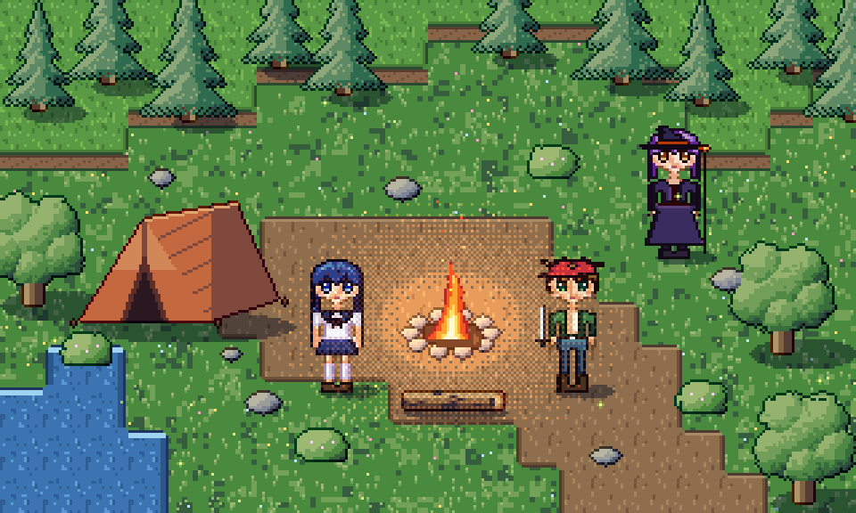

# Oyun üretimi: tileset, autotile, ışık, slice ve motor dışa aktarma

Pixel Studio yalnızca çizim yapmaz, çizimi oyuna taşır. Bu belgedeki araçlar bir sahneyi baştan sona üretir: zemin tileset'i, otomatik döşenen harita, gölge ve parıltı katmanları, normal map'li gece ışığı, hitbox verisi ve Godot / Tiled / Aseprite uyumlu dosyalar.



| Gündüz (albedo, katman karışımları) | Gece (`render_lit`: ateş, fener, ateş böcekleri, 5 bant) |
| --- | --- |
|  |  |

Sahnenin tamamı [`assets/level/build_level.py`](../assets/level/build_level.py) ile motorun herkese açık komutlarından üretilir (99 komut). Yapay zekâ ajanları da aynı araçları MCP üzerinden kullanır.

## Neyi neden ekledik

Araştırdığımız 2026 dönemi iş akışları ve araçlar:

- **Aseprite v1.3.18** (Temmuz 2026) ve sürüm notları: tilemap katmanları, slice'lar (9-slice ve pivot), JSON sprite sheet çıktısı. Sprite sheet verisini bu formatla uyumlu yazıyoruz, böylece Aseprite içe aktarıcısı olan her motor dosyayı okuyabiliyor. Kaynaklar: <https://blog.aseprite.org/2026/07/22/aseprite-v1318/>, <https://www.aseprite.org/release-notes>
- **Dinamik ışıklı piksel sanatı** (normal map + nokta ışıklar, Godot/Unity 2D ışıkları, SpriteIlluminator iş akışı). Bu yüzden normal map üretimi ve editör içinde ışık önizlemesi var. Kaynaklar: <https://80.lv/articles/exploring-next-gen-pixel-art-with-real-time-dynamic-lighting>, <https://forum.defold.com/t/normal-map-lighting-for-2d-pixel-art-sprites/70967>, <https://www.codeandweb.com/spriteilluminator/tutorials/how-to-create-dynamically-lit-2d-scenes-for-unity>
- **47 tile'lık blob autotile üreticileri** (Blobsmith, AutoBlob, Ziva autotile şablonu). Tek bir dolgu tile'ından 47 kenar ve köşe varyasyonunu otomatik çıkarıyoruz. Kaynaklar: <https://blobsmith.itch.io/blobsmith>, <https://violetpixel13.itch.io/autoblob>, <https://ziva.sh/tools/autotile-template-generator>

## Araçlar

| Araç | Ne yapar |
| --- | --- |
| `layer_blend` | Katman karışım modu: normal, multiply (gölge, AO), screen/add (parıltı, ateş ışığı, büyü), overlay/soft_light (renk düzeltme), darken, lighten |
| `slice_set` / `slice_delete` | Kareye özel adlandırılmış dikdörtgenler: hitbox, hurtbox, pivot, silah bağlama noktası. `frame` verilmeyen anahtar tüm animasyonda geçerlidir; sonraki anahtarlar kendi karesinden itibaren onu geçersiz kılar. Kare silinirse anahtar bir sonraki kareye taşınır |
| `palette_swap` | RGB eşleşmesiyle renk değiştirme, alfa korunur. Takım renkleri, düşman varyantları, gündüz/gece paletleri, hasar flaşı için. Kapsam: cel, katman, kare ya da tümü |
| `rotsprite` | RotSprite döndürme (Scale2x ×3 = 8× büyütme, en yakın komşu, geri örnekleme). Çizgiler kırılmaz, bulanıklık ya da yeni renk oluşmaz |
| `tileset_create` / `tileset_add_tiles` | Tuvalden ızgara halinde tile keser. Aynı ve boş tile'lar atlanır |
| `tileset_generate_blob` | Tek bir dikişsiz dolgudan (tuval bölgesi ya da prosedürel renk + vurgu kümeleri) eksiksiz **47'lik blob autotile** seti üretir: aydınlık üst kenar, gölgeli yanlar, seçici outline, yuvarlak köşeler, isteğe bağlı uçurum dudağı (gölge + katman çizgileri) |
| `tilemap_create` / `tilemap_set` | Tile hücre ızgarası. Hücreler `[[x, y, tile], …]` ya da satır metni (`"0 1 1 2"`) olarak verilir |
| `tilemap_terrain` | ASCII arazi boyama (`#` arazi, `.` boş). Her hücre için kenar, iç köşe ve dış köşe otomatik seçilir. Harita kenarı arazi sayılır, böylece dolgular sınıra temiz biçimde ulaşır |
| `tilemap_bake` / `tilemap_render` | Haritayı bir katmana çizer (sahneyle birlikte birleşir, ışıklanır, dışa aktarılır) ya da PNG olarak gösterir |
| `render_lit` | Normal map'li 2D nokta ışıklar. Normaller çizimden üretilir ya da elle boyanmış bir normal katmanından alınır. `unlit_layers` (ateş, parlayan gözler) tam parlak kalır. `bands` ışığı keskin piksel basamaklarına böler |
| `export_atlas` | Kırpılmış, tekilleştirilmiş MaxRects atlas + Aseprite uyumlu JSON (`frames`, `frameTags`, `layers`, `slices`). Phaser, PixiJS, Unity ve Godot içe aktarıcıları okur |
| `export_godot_spriteframes` | Godot 4 `SpriteFrames` .tres dosyası. Her etiket için bir animasyon oluşur, kırpılan kareler `AtlasTexture` margin'leriyle geri kurulur, kare süreleri korunur |
| `export_tiled` | Tiled TMJ haritası: gömülü tileset ve blob setler için **Wang arazi seti** (harita Tiled'ın arazi fırçasıyla düzenlenmeye devam edebilir) + tileset PNG'si |
| `export_tileset` | Tileset atlas PNG'si. Blob setler için mask sırası da döner |
| `gamedev_inspect` | Slice'lar, tileset'ler, tilemap'ler (ASCII arazi önizlemesiyle) ve katman karışım modları |

`project_export` dosyaları doğrudan çalışma alanına yazar: `format=atlas` (`.png` + `.json`), `godot` (`.png` + `.tres`), `tiled` (`_tileset.png` + `.tmj`), `normal_map`.

## Örnek akış (ajan için)

```jsonc
{"op":"tileset_generate_blob","name":"plateau","tile_size":16,"fill":"#5B9A44","lip":6,"lip_color":"#8A6446"}
{"op":"tilemap_create","name":"level","tileset":"plateau","columns":20,"rows":12}
{"op":"tilemap_terrain","tilemap":"level","rows":["####################","######..........###.","...................."]}
{"op":"tilemap_bake","tilemap":"level","layer":"Ground"}
{"op":"layer_blend","layer":"Shadows","mode":"multiply"}
{"op":"slice_set","name":"hurtbox","x":118,"y":104,"width":16,"height":40,"pivot":[8,40]}
{"op":"render_lit","lights":[{"x":168,"y":118,"color":"#FFB060","intensity":3.3,"radius":160}],"ambient":"#3E4A7C","bands":5,"unlit_layers":["Fire"]}
{"op":"export_tiled","tilemap":"level"}
```

## Örnek çıktılar

- Tileset'ler (4×): [plato](../assets/gallery/level/tileset_plateau_x4.png), [toprak](../assets/gallery/level/tileset_dirt_x4.png), [gölet](../assets/gallery/level/tileset_pond_x4.png)
- Motor dosyaları: [Tiled .tmj](../assets/gallery/level/exports/tiled/clearing.tmj), [Godot .tres](../assets/gallery/level/exports/godot/campfire.tres), [Aseprite JSON atlas](../assets/gallery/level/exports/atlas/campfire_atlas.json)
- Sahnenin normal map'i: [campfire_clearing_normals.png](../assets/gallery/level/campfire_clearing_normals.png)

## Sınırlar

- Tilemap'ler şu an bir katmana "bake" edilerek sahneye girer. Canlı tilemap katmanı (Aseprite tarzı, tile düzenlenince sahnenin anında güncellenmesi) henüz yok.
- `render_lit` bir önizlemedir. Oyundaki asıl ışığı motor hesaplar; önizleme aynı normal map'i kullanır.
- Tiled ve Godot dosyalarının biçimi testlerle doğrulanıyor, fakat Tiled ve Godot uygulamalarının kendisinde bu ortamda açılıp denenmedi.
