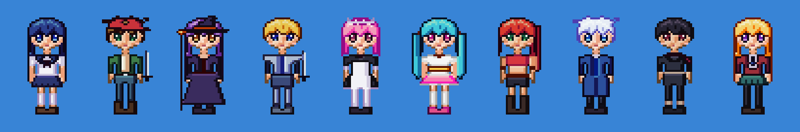
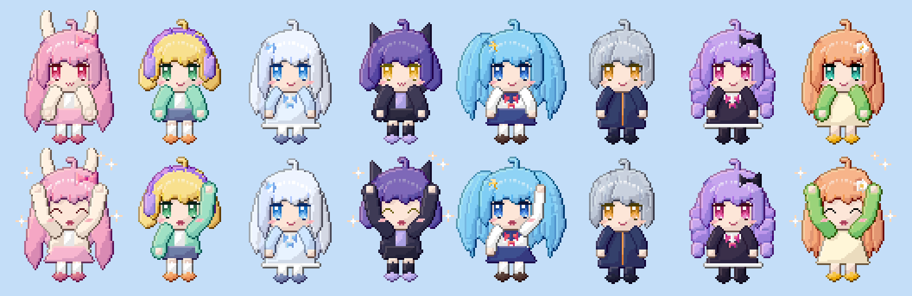
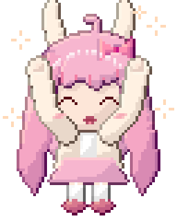
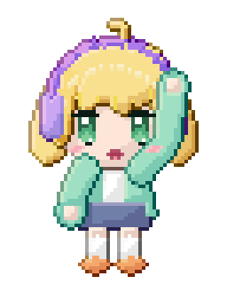
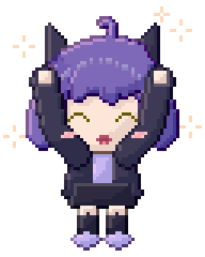
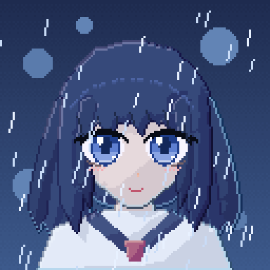
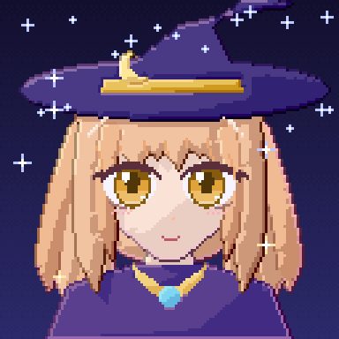

# 2D piksel art: araçlar, kadro ve VFX



## Tuval ve renk

- Tuval **gerçek renklidir** (RGBA8). Palet, renk örneği listesidir; `palette_set` eski rengi kullanan tüm pikselleri yeniden renklendirir (palet takası).
- **Palet kütüphanesi** (`palette_list`, `palette_load`): ENDESGA 32/64, Resurrect 64, Sweetie 16, Apollo, AAP-64, Na16, SLSO8, PICO-8, Lospec500, Vinik24, TwilioQuest 76. Kaynak [Lospec](https://lospec.com/palette-list); yazarları `palette_list` çıktısında listelenir.

## Usta piksel artistin araçları

| Araç | Ne yapar |
| --- | --- |
| `draw_ascii` | Sprite'ı metin olarak çizer (satırlar + lejant). `read_region format=ascii` ile aynı biçimdedir: AI ajanı okuyabilir, düzenleyebilir ve tek çağrıda tekrar çizebilir. `flip_x` ile sağ ve sol yönler aynı çizimden üretilir |
| `color_ramp` | Ton kaydırmalı gölge rampası (OKLCH): gölgeler mor-maviye, ışıklar sarıya kayar; gamut eşlemesi tonu korur |
| `outline` | 1 px dış çizgi: sabit renk veya *selective outline* (komşu rengin koyu ve soğuk tonu) |
| `quantize` | Median cut ya da kütüphane paleti + Bayer dither. Bütün animasyon için tek palet kullanılır |
| `dither_fill` | İki renkli sıralı dither (16 yoğunluk seviyesi) |
| `export_normal_map` | Sprite'tan normal map üretir (Godot, Unity ve Unreal Paper2D'de 2D dinamik ışık için) |
| 3D → piksel | `voxel_render*` + `pixel_palette` / `dither`: 3D render'ları piksel art'a dönüştürür (bkz. aşağıdaki karşılaştırma) |


*Soldan sağa: ham render, 16 renk, ENDESGA 32.*

## Kadro (özgün karakterler)

`assets/sprites2d/build_cast.py` ile üretilir. Bu, sprite stüdyolarının kullandığı paper-doll (parça giydirme) yöntemidir:

1. Elle yazılmış bölge haritaları: yüz, 6 saç modeli (ön ve arka katman), 10 kıyafet, göz damgaları, şapka ve silahlar.
2. Otomatik piksel art gölgelendirme: 5 tonlu ton kaydırmalı rampalar, sol üstten ışık, katman önceliğine göre iç çizgiler, renkli selective outline.
3. Elle eklenen detaylar: göz parlaması, anime saç halesi (angel ring), tutam ayrımları, kıvrımlar, allık.
4. Animasyon: idle (nefes, göz kırpma, saç salınımı) ve 4 karelik yürüme.

Aoi, Ren, Mira, Kai, Hana, Sora, Rika, Yuki, Kuro ve Luna; her biri 32×52 px. Çizim motora `draw_ascii` ile aktarılır; etiketler `Aoi_idle`, `Aoi_walk` biçimindedir.

## 2D VFX paketi (64×64)


`assets/sprites2d/build_vfx2d.py`: ateş (16, döngü), kılıç izi (8), vuruş kıvılcımı (6), büyü patlaması (12), duman (8), yıldırım (8), iyileşme (12, döngü), patlama (12).

Klasik piksel art kurallarına uyar: her efektte 4–6 renklik bant paleti, net kümeler, kenar yumuşatma yok, parlak çekirdekten koyu kenara geçiş, sönerken dither ile kaybolma. Döngüler kesintisizdir; zaman bir çember üzerine eşlendiği için son kare ilk kareye bağlanır.

```bash
python3 assets/sprites2d/build_cast.py && python3 assets/sprites2d/build_vfx2d.py
cd core-rust && cargo run --release --example run_script -- ../assets/sprites2d/cast_showcase.jsonl out/cast
```

## Karakter bitirme araçları (2026 pastel anime stili)

Modern anime piksel karakterlerinin kalitesi büyük ölçüde bitirme aşamasından gelir: şekli takip eden ton kaydırmalı cel gölge, saçın yüze düşen gölgesi, siyah yerine rengin koyu tonuyla çizilmiş outline ve parıltılar. Pixel Studio bu aşamaları araç olarak sunar:

| Araç | Ne yapar |
| --- | --- |
| `auto_shade` | Düz renkli her bölgeyi şeklini takip eden 2–4 tonlu cel gölgeyle boyar: ışık tarafı aydınlık, karşı taraf gölgeli olur, büyük alanlarda yumuşak bir geçiş oluşur. **Üstteki katmanlar gölge düşürür** (kâkül alna, kafa boyna, şapka saça). İsteğe bağlı rim ışığı, açık rampa tanımları, korunacak renkler ve küçük detay bölgelerini atlama desteklenir |
| `outline` `mode=selout` | Seçici outline. Işık tarafında outline açılır, yani sel-out uygulanır. `darkness` ile pastel ya da sert ton seçilir, `inside` şekli büyütmeden kenara çizer |
| `gradient_map` | Parlaklığı bir gradyana eşleyerek renk düzenler: yağmurlu mavi akşam, gün batımı, sepya |
| `draw_sparkle` | 4 köşeli parıltı, artı, elmas ya da nokta damgası (tek tek ya da toplu) |
| `pixel_cleanup` | 1 px çizgilerdeki L köşe fazlalarını temizler ("pixel perfect") |

Önerilen akış: karakteri katmanlara ayrılmış düz renklerle kur (arka saç, gövde, yüz, ön saç, kollar) → her katmana `auto_shade` uygula → `outline mode=selout` → `pixel_cleanup` → gözleri, allığı ve saç parlamasını elle çiz → `draw_sparkle`.

### Pastel chibi koleksiyonu (64×80)



| | | | |
| --- | --- | --- | --- |
|  |  |  |  |

`assets/chibi/build_chibi.py` 8 özgün karakter üretir: Mochi, Yuzu, Fuyu, Kuro, Sora, Ren, Lila ve Hana. Her karakterin 4 karelik idle animasyonu (nefes, göz kırpma, saç salınımı) ve 4 karelik ikinci bir animasyonu vardır (sevinç zıplaması, el sallama ya da ikinci idle). Toplam 64 kare. Saç, inceltilmiş Bezier tutamlardan kurulur. Gözler el çizimi damgalardır: gradyan iris, çift parıltı ve kirpik kanadı. Gölge, outline ve parıltılar tamamen motor araçlarıyla eklenir.

### Bust portreler (128×128, 8 kare)

| Shizuku: yağmurlu akşam | Astra: yıldızlı büyücü |
| --- | --- |
|  |  |

`assets/chibi/build_portraits.py` iki portre üretir. Shizuku'da `gradient_map` ile soğuk akşam tonu, cyan rim ışığı ve yağan yağmur var. Astra'da şapka saça gölge düşürüyor ve gökyüzünde yıldızlar parlıyor. Gözler katmanlıdır: sklera, gradyan iris, koyu iris kenarı, göz bebeği, 3 px kalınlığında kirpik ve kanat, alt kirpik ve iki parıltı.

Tüm karakterler özgündür. Referans görseller yalnızca stil, oran ve teknik analizi için kullanıldı; mevcut karakterler ya da eserler kopyalanmadı.

```bash
cd assets/chibi && python3 build_chibi.py && python3 build_portraits.py
cd ../../core-rust && cargo run --release --example run_script -- ../assets/chibi/chibi_showcase.jsonl out/chibi
```
