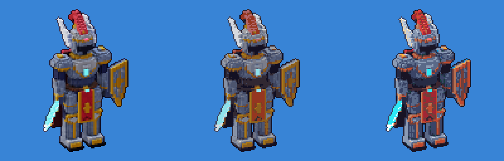
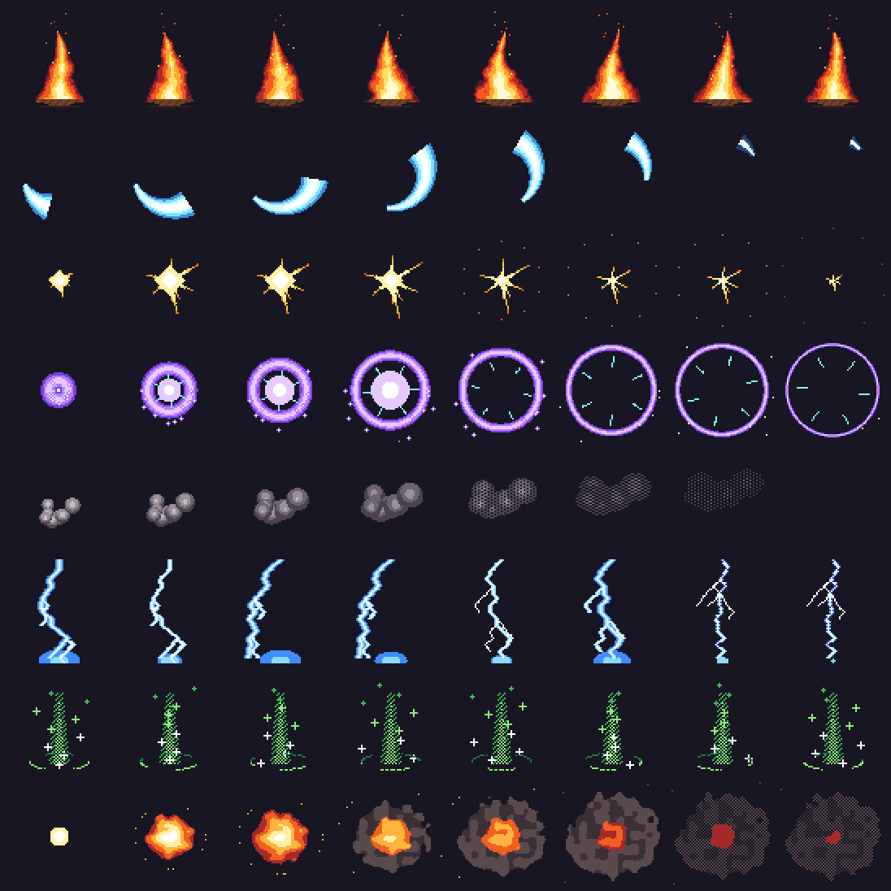

# 2D piksel art: araçlar, kadro ve VFX


## Tuval ve renk

- Tuval **gerçek renklidir** (RGBA8). Palet, renk örneği listesidir; `palette_set` eski rengi kullanan tüm pikselleri yeniden renklendirir (palet takası).
- **Palet kütüphanesi** (`palette_list`, `palette_load`): ENDESGA 32/64, Resurrect 64, Sweetie 16, Apollo, AAP-64, Na16, SLSO8, PICO-8, Lospec500, Vinik24, TwilioQuest 76. Kaynak [Lospec](https://lospec.com/palette-list); yazarları `palette_list` çıktısında listelenir.

## Usta piksel artistin araçları

| Araç | Ne yapar |
| --- | --- |
| `draw_ascii` | Sprite'ı metin olarak çizer (satırlar + lejant). `read_region format=ascii` ile aynı biçimdedir: AI ajanı okuyabilir, düzenleyebilir ve tek çağrıda tekrar çizebilir. `flip_x` ile sağ ve sol yönler aynı çizimden üretilir |
| `color_ramp` | Ton kaydırmalı gölge rampası (OKLCH): gölgeler mor-maviye, ışıklar sarıya kayar; gamut eşlemesi tonu korur |
| `outline` | 1 px dış çizgi: sabit renk veya *selective outline* (komşu rengin koyu ve soğuk tonu) |
| `quantize` | Median cut ya da kütüphane paleti + Bayer dither. Bütün animasyon için tek palet kullanılır |
| `dither_fill` | İki renkli sıralı dither (16 yoğunluk seviyesi) |
| `export_normal_map` | Sprite'tan normal map üretir (Godot, Unity ve Unreal Paper2D'de 2D dinamik ışık için) |
| 3D → piksel | `voxel_render*` + `pixel_palette` / `dither`: 3D render'ları piksel art'a dönüştürür (bkz. aşağıdaki karşılaştırma) |



*Soldan sağa: ham render, 16 renk, ENDESGA 32.*

## Kadro (özgün karakterler)

`assets/sprites2d/build_cast.py` ile üretilir. Bu, sprite stüdyolarının kullandığı paper-doll (parça giydirme) yöntemidir:

1. Elle yazılmış bölge haritaları: yüz, 6 saç modeli (ön ve arka katman), 10 kıyafet, göz damgaları, şapka ve silahlar.
2. Otomatik piksel art gölgelendirme: 5 tonlu ton kaydırmalı rampalar, sol üstten ışık, katman önceliğine göre iç çizgiler, renkli selective outline.
3. Elle eklenen detaylar: göz parlaması, anime saç halesi (angel ring), tutam ayrımları, kıvrımlar, allık.
4. Animasyon: idle (nefes, göz kırpma, saç salınımı) ve 4 karelik yürüme.

Aoi, Ren, Mira, Kai, Hana, Sora, Rika, Yuki, Kuro ve Luna; her biri 32×52 px. Çizim motora `draw_ascii` ile aktarılır; etiketler `Aoi_idle`, `Aoi_walk` biçimindedir.

## 2D VFX paketi (64×64)



`assets/sprites2d/build_vfx2d.py`: ateş (16, döngü), kılıç izi (8), vuruş kıvılcımı (6), büyü patlaması (12), duman (8), yıldırım (8), iyileşme (12, döngü), patlama (12).

Klasik piksel art kurallarına uyar: her efektte 4–6 renklik bant paleti, net kümeler, kenar yumuşatma yok, parlak çekirdekten koyu kenara geçiş, sönerken dither ile kaybolma. Döngüler kesintisizdir; zaman bir çember üzerine eşlendiği için son kare ilk kareye bağlanır.

```bash
python3 assets/sprites2d/build_cast.py && python3 assets/sprites2d/build_vfx2d.py
cd core-rust && cargo run --release --example run_script -- ../assets/sprites2d/cast_showcase.jsonl out/cast
```
