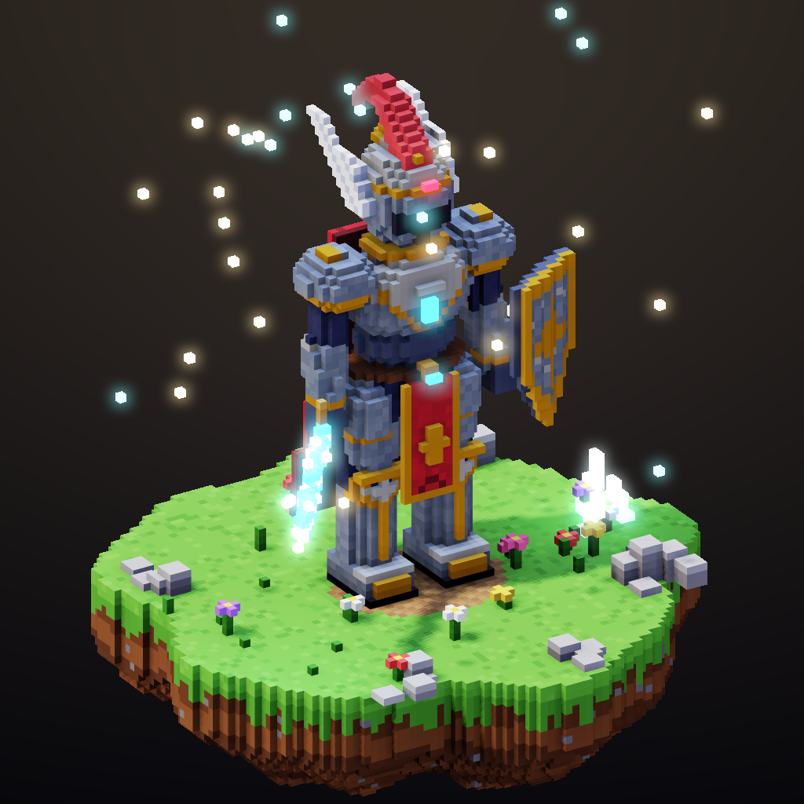
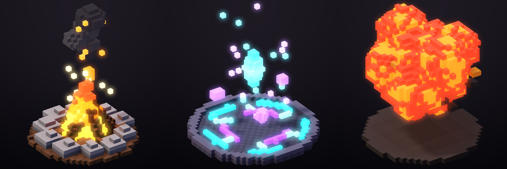

# 3D Pixel (Voxel) iş akışı

Pixel Studio'da hem 2D piksel hem 3D voksel ("3D piksel") çizebilirsiniz. 3D modeller rig'lenir, animasyonlandırılır ve tek komutla 8 yönlü 2D sprite'lara, normal map sayfalarına veya düzenlenebilir 2D karelere dönüştürülür.



## Veri modeli

| Kavram | Ayrıntı |
| --- | --- |
| Model | En fazla 512×512×512 seyrek voksel ızgarası, 16³'lük copy-on-write chunk'lar. y yukarı, model önü +z, `origin` = ayakların arası |
| Voksel | Gerçek renk RGBA8 (16,7 milyon renk + alfa; yarı saydam duman ve cam desteklenir) + materyal + kemik |
| Materyal (PBR) | roughness, metallic, emission, uv_scale, normal_strength + 7 harita: **albedo, normal, roughness, metallic, occlusion (AO), height, emission** |
| Doku eşleme | Her voksel yüzü kendi ekseninde UV alır (X yüzleri z/y, Y yüzleri x/z, Z yüzleri x/y). `uv_scale` = voksel başına texel; render alt-voksel UV kullanır |
| Dokular | PNG içe aktarma (`texture_import`) veya 9 prosedürel PBR seti (`texture_generate`): brushed_metal, hammered_metal, leather, fabric, scales, stone, wood, chainmail, noise |
| Rig | Kemik hiyerarşisi (head → tail), katı (rigid) skinning, otomatik bağlama |
| Animasyon | Keyframe (Euler + öteleme, yumuşak interpolasyon), prosedürel yürüme/koşma/bekleme (ayaklar zemine basar), kare kare model sekansları (VFX) |

## Render motoru

- Yüzey çıkarma: düzgün normaller ve iki ölçekli AO, ayrıca **MagicaVoxel tarzı köşe AO'su** (yüz üzerinde interpolasyonlu).
- **PBR**: GGX, Smith ve Fresnel; stüdyo ortam yansıması; toon modu (`toon_steps`).
- **Gölge haritası** (`shadows`, 3×3 PCF), şeffaf sprite'lar için **zemin gölgesi** (`ground_shadow`).
- **Nokta ışıklar** (`lights`: ateş, pencere, büyü), **bloom** (`bloom`, `bloom_radius`); parlama şeffaf piksellere hale olarak taşar.
- G-buffer pass'leri: lit, albedo, normal, depth, occlusion, roughness, metallic, emission.
- Süpersampling, seçici outline (selective outline), iç çizgiler, gradyan arka plan ve vinyet.
- Deterministiktir: aynı proje her platformda aynı pikselleri üretir.

## Tipik akış (MCP araçlarıyla)

1. `voxel_model_create` → `texture_generate` / `material_set`
2. `rig_bone_add` (hips, spine, chest, neck, head, upper_arm_l/r, lower_arm_l/r, hand_l/r, upper_leg_l/r, lower_leg_l/r, foot_l/r, cape)
3. `voxel_shape` (box, ellipsoid, capsule, cone, cylinder; add/paint/erase, gradyan, jitter, `mirror_x`) veya ayrıntı için `voxel_set_many`
4. `rig_bind` → `anim3d_generate {kind: walk|run|idle}` ya da `anim3d_key`
5. `voxel_render` ile kontrol et (agent'ın gözleri)
6. `voxel_render_sheet {directions: 8, animation: "walk", pass: "lit"|"normal"…}` ya da `voxel_render_to_frames` (2D'ye bake; etiketler `walk_S`, `walk_SE`, …)

## VFX: kare kare 3D animasyon

Statik tabanı bir kez modelleyin, `voxel_model_clone` ile her kareye kopyalayın ve hareket eden voksel'leri (alev, kıvılcım, duman) ekleyin. Ardından `voxel_render_sheet {models: ["Fire_00", …, "Fire_15"]}` ile tek ve sabit bir kamerayla render edin.



## Hazır varlıklar

| Varlık | Betik | İçerik |
| --- | --- | --- |
| Sir Valen (iri vokselli şövalye) + diorama | `assets/knight/build_knight.py` | Rig'li model; walk/run/idle; 8 yön × 8 kare 256 px sprite'lar, normal map sayfası, GIF'ler, diorama render'ı |
| Aurelion (512³ yüksek çözünürlüklü kahraman) | `assets/hero/build_hero.py` | 300 voksel boyunda; PBR dokular; 8 yönlü walk/run/idle sayfaları ve tüm pass'ler |
| VFX kütüphanesi | `assets/vfx/build_vfx.py` | 16 karelik kamp ateşi (kesintisiz döngü), arcane portal (döngü), patlama |

Hepsi aynı yöntemle üretilir:

```bash
python3 assets/knight/build_knight.py
cd core-rust && python3 assets/knight/build_knight.py && cd core-rust && cargo run --release --example run_script -- ../assets/knight/knight_showcase.jsonl out/
```

Betikler yalnızca herkese açık komut protokolünü kullanır; bir AI ajanı MCP üzerinden aynı sonucu üretebilir. Masaüstü uygulamasında **3D Voxel → Load knight demo** ile şövalyeyi yükleyebilirsiniz.
